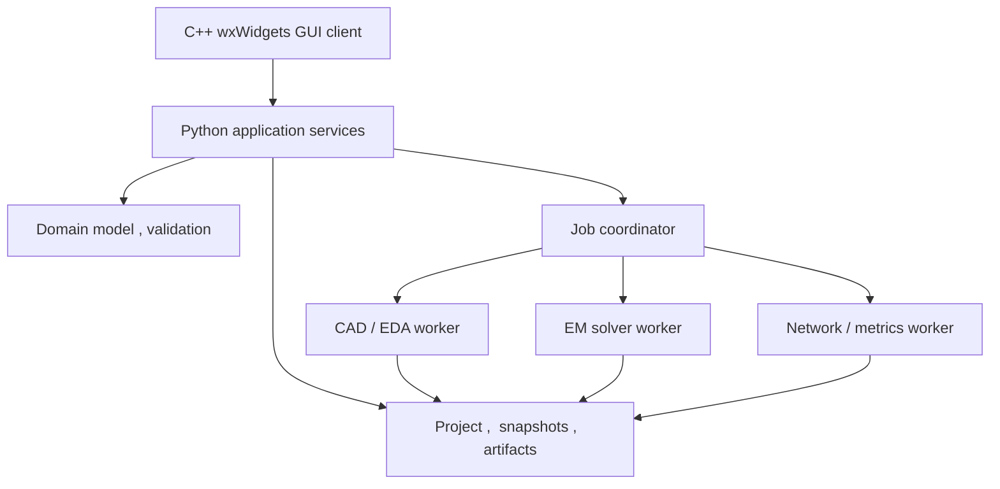

# 소프트웨어 아키텍처와 모듈 책임

개정: 3.4 / 2026-11-07 KST / 상태: 설계 기준선 승인 / 개발: 착수 전

## 1. 구조 원칙

도메인 모델은 GUI, CAD kernel, EM solver, 파일 형식에 종속되지 않는다. UI는 도메인 명령을 보내며 CAD/solver worker는 불변 입력으로 파생물을 만든다. source CAD face나 메모리 객체 포인터를 project ID로 저장하지 않는다. 단일 host에서도 CAD와 solver를 별도 프로세스로 실행해 native extension crash와 장기 실행이 UI 저장 상태를 손상시키지 않게 한다.

## 2. 모듈 소유권

| ID | 모듈 | 입력/출력 | 소유하는 책임 | 소유하지 않는 책임 |
| --- | --- | --- | --- | --- |
| MOD-01 | domain | validated entities/commands | 단위, 기하 정의, 적층, net, material, port, 목표 의미 | GUI widget, OCCT shape, solver 호출 |
| MOD-02 | application | command/result DTO | transaction, use case, revision, 실행 정책 | Maxwell 직접 해법 |
| MOD-03 | reference | source/record/index | 근거 조회, 충돌, model promotion, 조건 검색 | 논문 수치를 무검증 기본값으로 강제 |
| MOD-04 | geometry | semantic graph->region/solid/mesh | exact primitive, Boolean, stable map, 형상검증 | solver 손실 모델 결정 |
| MOD-05 | material | source curves->material model | 데이터 조건, fit, validity, loss partition | 도체 형상의 묵시적 치환 |
| MOD-06 | solver_adapter | snapshot/plan->native inputs/results | capability, native mapping, mesh, port, normalization | GUI 상태, 원본 project 수정 |
| MOD-07 | networks | raw complex data->derived networks | wave definition, Z0, reference plane, matching, drive | field basis 없는 복소 패턴 생성 |
| MOD-08 | metrics | results/context->metrics/assessment | 단일/다중 포트, band, UWB, NFC, RFID, MIMO | 조건이 다른 결과의 무조건 결합 |
| MOD-09 | optimization | variables/objectives/budget->candidates | sampling, constraints, cache, Pareto, uncertainty | 실패 solver를 성공 값으로 대체 |
| MOD-10 | measurements | raw files/metadata->aligned comparison | parsing, calibration provenance, alignment, holdout | 측정 불확도를 임의 0으로 설정 |
| MOD-11 | exports | snapshot/profile->artifacts | drawing, STEP, EDA/CAM, manifest, roundtrip | 저장한 물성을 외부 포맷이 완전히 담는다고 가정 |
| MOD-12 | storage | entities/artifacts/index | atomic save, hash, migration, archive, recovery | 결과를 binary 동일성만으로 정확하다 판단 |
| MOD-13 | jobs | plan/artifacts->state/events | process, queue, budget, cancel, lease, restart | backend 미지원 checkpoint 재개 |
| MOD-14 | ui | view models/events | 편집, selection, 실행/검증 표시, 오류 안내 | 숫자 물리 수식을 위젯 코드에 중복 구현 |
| MOD-15 | automation | CLI/RPC request->same services | headless/batch/recipe, portable scripts | GUI와 다른 계산 규칙 |
| MOD-16 | verification | fixtures/profiles->evidence | independent checks, convergence, regression, reports | 한 예제 통과를 전체 capability 승격에 사용 |

## 3. 패키지 배치 제안

아래는 후속 저장소의 소스 배치 기준이다. 이 문서 묶음 안에 아래 제품 소스가 이미 구현돼 있음을 뜻하지 않는다.

| 경로 | 내용 |
| --- | --- |
| `src/rfad/domain/` | entities, units, expressions, constraints, revision, state |
| `src/rfad/application/` | command handlers, validation, design/analysis/export services |
| `src/rfad/adapters/cad/` | cadquery/occt implementation + semantic mapping |
| `src/rfad/adapters/eda/` | kicad profile + independent CAM reader |
| `src/rfad/adapters/solvers/openems/` | native model/mesh/port/run/result adapters |
| `src/rfad/adapters/networks/` | scikit-rf conversions and tested wave conventions |
| `src/rfad/physics/` | 검증된 순수 수식, metric, objective; solver 구현과 분리 |
| `src/rfad/storage/` | project, snapshot, artifact, index, migration, archive |
| `src/rfad/jobs/` | worker RPC, scheduler, cancellation, event store |
| `ui/wxwidgets/` | C++ wxWidgets GUI client, presenters, selection models; domain 직접 변경 금지 |
| `src/rfad/cli/` | user command line, import/export/run diagnostics |
| `schemas/`, `fixtures/`, `tests/` | 계약, 기준 입력, 단위/통합/수렴/왕복 시험 |
| `docs/`, `licenses/`, `runtime_profiles/` | 본 문서, notice/SBOM, 실제 검증한 tool lock |

## 4. worker와 운영체제 경계

C++ wxWidgets GUI client의 R1 첫 환경은 Windows 11 x64 wxMSW와 로컬 WSL2 Linux worker다. Linux wxGTK GUI는 후속 출시하며 버전은 미정이다. wxQt와 Qt 의존 viewer는 제외한다. GUI 선택 상태는 `selected_pending_validation`이고, GUI-SPIKE-001..007은 해당 출시 환경의 통합/성능 검증으로 유지한다. GUI client는 별도 Python application service와 로컬 coordinator에 JSON-RPC로 연결한다. CAD worker와 postprocessor는 host 또는 고정 Linux 환경에서 실행할 수 있다. Linux native/headless worker의 R0 검증은 Linux GUI 일정과 분리해 유지한다. Windows에서 coordinator는 `wsl.exe`에 허용된 distribution/worker entrypoint와 구조화된 argv를 전달한다. 파일은 host의 user path를 그대로 worker에 붙이지 않고 staging root에 artifact hash로 복사한 뒤 manifest로 확인한다.

R1 transport는 stdio의 UTF-8 JSON-RPC message를 NDJSON 한 줄 framing으로 보낸다. payload 안의 newline은 JSON escaping을 적용한다. stdout은 protocol 전용, stderr는 로그이며 GUI가 로그를 protocol로 파싱하지 않는다. 한 message size 제한, string 길이, artifact 개수, 로그 retention은 config로 관리한다. 대형 field 배열을 JSON으로 전송하지 않는다. 원격 transport는 같은 message contract에 authentication, 전송, 삭제 정책을 추가하는 후속 adapter다.

command ACK와 실제 job completion을 구분한다. `job.submit` 응답은 durable job ID를 뜻하며 완료된 성능 값을 뜻하지 않는다. event는 monotonically increasing seq, run ID, timestamp, phase, progress basis를 갖고 재연결 시 마지막 seq 다음부터 읽을 수 있다. progress total을 알 수 없는 solver는 확정 퍼센트를 만들지 않는다.

## 5. transaction과 동시성

1. UI가 `expected_revision`과 command ID를 보낸다.
2. application이 현재 revision을 확인하고 복제한 상태에 command를 적용한다.
3. 단위, 참조, 필수 constraint를 검사한다. 편집 중 불완전한 상태는 별도 draft object로 보존한다.
4. 성공한 상태만 새 revision으로 commit하고 파생 데이터의 영향 집합을 계산한다.
5. view model과 undo stack에 변경 이벤트를 발행한다.

프로젝트에 동시에 두 writer가 commit하지 않게 lock/lease와 expected revision을 사용한다. stale command는 E_CONFLICT를 반환한다. 별도 분석 worker는 snapshot만 읽으며 원본을 변경할 권한이 없다. 작업이 끝나는 사이 사용자가 설계를 수정해도 결과는 실행한 snapshot에 붙는다.

native CAD shape를 thread 간 무제한 공유하지 않는다. worker가 shape 파일/cache를 쓰고 GUI는 렌더 메시와 selection map만 받는다. shape 생성 실패 시 마지막 성공 projection을 회색/과거 상태로 표시하되 현재 계산 결과로 오인시키지 않는다.

## 6. canonical hash와 의존성

해시는 명시한 subset을 canonical serialization한 뒤 SHA256으로 계산한다. key 정렬, number 정규화, unit 정규화, array 순서 정책, schema version을 고정한다. `-0.0`은 `0.0`으로 정규화하고 NaN/Infinity를 canonical JSON에 넣지 않는다. 허용 오차로 숫자를 몰래 반올림해 서로 다른 물리 모델을 같은 key로 만들지 않는다. canonical encoder는 Python application service 한 곳에서 소유하고 GUI는 반환된 hash를 그대로 사용한다. 형식은 [08번](08_RFAD_데이터_모델과_파일_형식.md)의 버전 있는 정책을 따르며 [RFC 8785](https://www.rfc-editor.org/rfc/rfc8785)와 동일하다고 선언하려면 실제 numeric/string 규칙을 모두 만족해야 한다.

| cache key | 포함 | 제외/주의 |
| --- | --- | --- |
| revision_hash | 전체 설계의 의미와 provenance, 목표 및 규칙 | UI camera, 패널 위치는 user preference |
| geometry_hash | 평면 기하, 두께, layers, holes, transforms, kernel/profile | 목표, 색, source URL 경로 자체 |
| physics_hash | 도체/유전체, 조건, 환경, physical ports, EM lumped element, 근사 | 외부 네트워크 회로와 표시 옵션 |
| raw_em_key | physics + prepared mesh + solver/adapter binary/profile + excitation/port basis + observables + termination | target mask, 일반 graph style |
| network_key | raw + 파 정의/Z0/기준면/port map + 외부 circuit + 구동/종단 | 물리 port geometry 변경은 raw 쪽 |
| metric_key | network/field basis + metric 정의/좌표/방향/평가 grid | 아직 적용하지 않은 target threshold |
| assessment_key | metric + target/AcceptanceProfile + validation gates | 보기 색상 |
| export_key | snapshot의 필요한 subset + format/profile/version/tolerance + 도면 메타데이터 | export와 무관한 solver 진행 표시 |

material source가 바뀌어도 사용한 물리 모델 숫자가 완전히 같으면 raw 재사용을 허용할 수 있다. 이때 새 snapshot과 원래 실행 provenance를 연결하고 validity, source conflict 검사를 다시 해야 한다. 동일한 파일명/프리셋명/geometry만으로 결과를 재사용하지 않는다. raw field가 없는 S-only run에서 field 요청이 생기면 해당 관측량을 얻기 위한 새 실행이 필요하다.

### 변경 영향 예

| 변경 | raw EM | network | metric/target | export |
| --- | --- | --- | --- | --- |
| 원호 선폭, 기판 Dk, 배터리 위치 | 재실행 | 재계산 | 재계산 | 영향 형상/명세 재생성 |
| raw 기준 물리 포트 위치, mesh/PML | 재실행 | 재계산 | 재계산 | 해석 보고서 갱신 |
| 외부 매칭 L/C값만 변경 | 조건부 재사용 | 재계산 | 전력과 loaded field 조건부 재계산 | 회로/BOM/보고서 갱신 |
| 같은 raw의 기준면 이동, Z0 변경 | 재사용 | 검증된 변환 | 재계산 | 결과 metadata 갱신 |
| 목표 S11 threshold 변경 | 재사용 | 재사용 | assessment만 | 목표/보고서 갱신 |
| 3D 색, 카메라, 표시단위 변경 | 재사용 | 재사용 | 수치 재사용 | 도면 표시 요청 시만 |

## 7. plugin 경계와 capability

adapter 등록 정보는 ID, version, protocol version, license/notice, runtime profile, feature matrix, tested envelopes, fixture evidence를 포함한다. 제3자 plugin은 project archive가 자동 설치하거나 실행하지 않는다. 새 adapter는 domain schema를 바꾸지 않고 자기 namespace의 extension을 사용하고, 필수 핵심 필드를 override하지 않는다.

`supported`는 실제 구현과 증거를 혼동하기 쉬우므로 `declared`, `implemented`, `verified`, `unsupported`, `unknown` 상태를 분리한다. capability가 없는 기능은 다른 adapter로 변경하거나 사용자가 명시한 근사를 선택한 뒤 새 model projection을 만든다. 경고 버튼 한 번으로 알려진 물리 오류를 무조건 허용하는 설계는 하지 않는다.

## 8. 재현, 배포

각 runtime profile에 Python minor, package lock, native solver/CAD binary hash 또는 build revision, OS/container image digest, compiler/backend 정보, unit/phasor 정책 버전과 계약시험 결과를 넣는다. 동일 lock만으로 모든 플랫폼의 bit-identical 결과를 약속하지 않으며 수치 허용오차와 비교 방법을 보존한다.

본 구조는 [wxWidgets 구성과 성능 검증](24_RFAD_GUI_선정과_성능_설계.md), [CadQuery](https://cadquery.readthedocs.io/en/latest/intro.html), [VTK Python API](https://docs.vtk.org/en/latest/api/python.html), [openEMS](https://docs.openems.de/en/latest/python/openEMS/openEMS.html)의 확인 기능 위에 제안한 제품 아키텍처다. GUI는 C++ wxWidgets로 확정했으며 유료 GUI 부품을 필수 의존성으로 추가하지 않는다. 정확한 package 조합, 배포 크기와 설치 성공은 GAP-001/007의 실제 결과로 확정한다. 3.4 전체 설계 기준선은 사용자 승인 완료이며 개발 착수와 실제 호환성 검증은 별도로 남는다.

초기 배포 범위는 내부 검증용이다. 외부 공개, 상용 배포와 소스 공개 여부는 나중에 별도로 결정하며 현재 package/notice 설계를 그 결정의 승인으로 해석하지 않는다. 내부 검증에서도 실제 포함 부품의 라이선스와 의존성 기록을 유지한다.

## 9. 수명, 데이터 복제와 자원 상한

| 자원 | 소유자 | 전달 및 회수 |
| --- | --- | --- |
| 편집 모델/명령/정규 hash | application service | GUI에는 변경 DTO와 안정 ID. 전체 snapshot 반복 전송 금지 |
| CAD B-rep | CAD worker | render projection과 object map만 GUI로 전달. idle 종료와 cache 상한 적용 |
| solver 배열/native 파일 | solver/postprocess worker와 artifact store | immutable 파일 참조. 필요한 ROI/chunk만 읽음 |
| GPU buffer/texture | GUI renderer | UI thread/context 소유 규칙에 따라 생성/해제. 패널/문서 닫기 시 해제 |
| event와 로그 | coordinator | 상태 event durable, progress coalescing, 로그 rotation과 UI tail 제한 |
| map/읽기 lease | storage | worker crash/lease 만료만으로 삭제하지 않음. 실제 해당 process group 종료와 reader handle 해제 확인 후 회수 |

Python service 시작 경로에서 NumPy/CAD/solver 전체를 import하지 않는다. 순수 schema/command/프로젝트 목록을 먼저 준비하고 무거운 모듈은 worker에서 지연 로딩한다. 다중 프로세스가 자동으로 메모리를 절약한다는 가정은 하지 않는다. [24번](24_RFAD_GUI_선정과_성능_설계.md)에서 서비스와 worker까지 측정한다.

프로세스 간 대용량 공유는 파일 기반을 기본으로 한다. 명시한 read-only shared memory를 나중에 사용하더라도 ABI, shape/stride/dtype/endian, 수명, owner crash와 해제 계약을 먼저 정의한다. zero-copy를 지원 검증 전 보장하지 않는다.

## 10. IPC와 장애 복구의 상한

초기 transport profile은 UTF-8 NDJSON, metadata message 최대 1 MiB, cancel/status/control message 최대 64 KiB를 제안한다. 정확한 limit은 capabilities.get의 protocol profile로 협상하고 계약 버전에 포함한다. 최대 길이를 넘는 입력은 줄 끝까지 무제한 버퍼링하지 않고 E_RESOURCE/E_SCHEMA로 종료한다. bulk 결과는 artifact로 전달한다.

입력/출력 queue, event spool, 로그 파일과 재접속 replay에 크기/보존기간 상한을 둔다. progress는 합칠 수 있지만 command ACK, 오류, revision 및 terminal event는 유실하지 않는다. retention 밖 cursor에는 E_CURSOR_EXPIRED와 현재 전체 상태 조회 경로를 제공한다. mutation/job admission은 durable journal 공간을 먼저 예약하고 commit 이후 ACK한다. 공간 부족이면 접수 전에 E_RESOURCE를 반환하며 이미 접수한 terminal 결과를 조용히 버리지 않는다. request_key는 서버가 검증 가능한 발급 epoch/만료시각과 scope, payload hash, durable 결과를 갖는다. receipt 보존은 11의 승인된 초기 정책인 최초 접수부터 7일이며 epoch/만료 규칙을 협상 profile에 고정한다. 만료 키는 E_IDEMPOTENCY_EXPIRED로 거부하고 과거 job/revision을 조회한 뒤에만 새 명령 여부를 결정한다.

native worker의 stdout/stderr는 별도 reader에서 계속 비운다. UI RPC 수신과 무거운 JSON/파일 해석을 분리한다. 취소는 먼저 cooperative 요청, profile의 grace timeout 후 필요 시 해당 작업 process tree만 강제 종료한다. Windows process group/Job Object, Linux process group 등 실제 격리 방법을 플랫폼 시험으로 확인한다. 사용자 전체 Python/WSL 프로세스를 이름으로 일괄 종료하지 않는다. WSL에서는 guest supervisor가 run UUID, owner nonce/lease와 guest process group을 관리한다. host의 wsl.exe 종료나 접수 ACK만으로 guest solver 종료를 확정하지 않는다. guest 종료 확인이 불가능하면 outcome_unknown으로 예약을 유지한다. nonce fencing은 이전 결과의 게시만 차단하며 살아 있는 solver를 종료하거나 RAM을 회수한 것으로 간주하지 않는다. R1은 실제 guest process group 종료 및 reader lease 해제 확인 전 자원 예약 반환, 중복 재실행과 파일 정리를 차단한다.

서비스 crash 후 project lock/recovery와 journal을 확인한다. 살아 있는 job의 owner PID만 믿지 않고 시작 시각/nonce/lease를 대조한다. 재연결 후 같은 seq를 중복 적용하지 않으며 이전 terminal 결과와 commit된 revision을 복구한다. 프로세스 자동 재시작은 무한 반복하지 않고 횟수/대기 상한을 갖는다.
