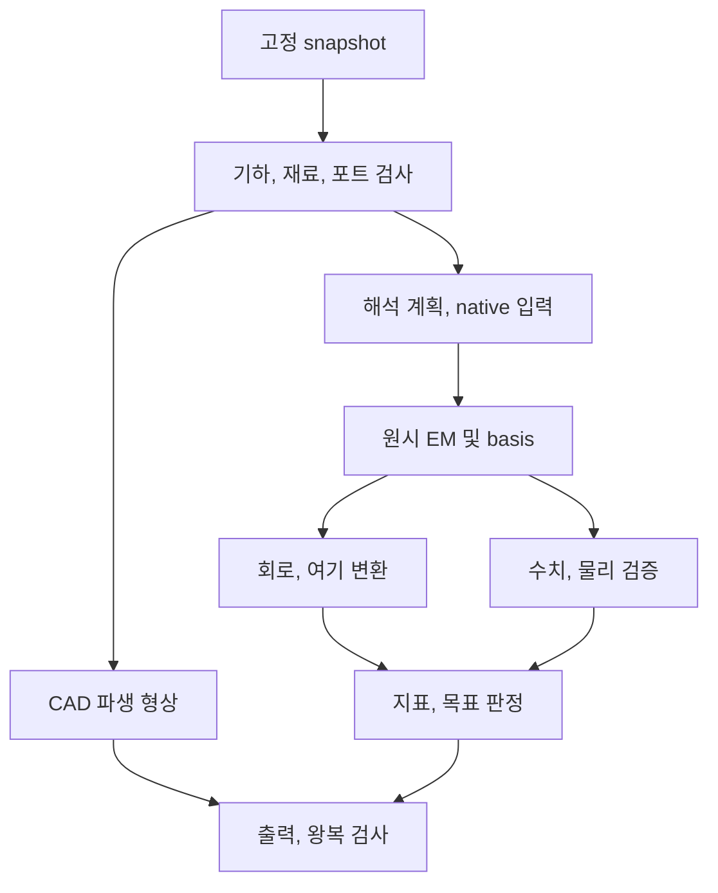

# RFAD 10 - 계산 파이프라인

개정: 3.4 / 2026-11-07 KST / 상태: 설계 기준선 승인 / 개발: 착수 전
역할: 입력에서 CAD, EM, 회로, 지표, 공차, 측정, 출력까지의 실행 순서와 유효성 전파
상태: **design baseline with open verification gates** - 구현, EM 실행, 실측 합격을 뜻하지 않는다.

관련 문서: [시스템 상태](04_RFAD_시스템_명세.md) ,  [데이터 계약](08_RFAD_데이터_모델과_파일_형식.md) ,  [수식](09_RFAD_수식과_물리_모델.md) ,  [solver API](11_RFAD_해석기_어댑터_계약.md) ,  [최적화, 측정](13_RFAD_최적화와_측정.md) ,  [검증](14_RFAD_검증과_수용_기준.md)

## 1. 전체 실행 원칙

한 개의 mutable 화면 상태를 곧바로 solver에 전달하지 않는다. 사용자가 고정한 **snapshot**에서 geometry, 재료, 급전, 환경, 수치 설정을 해석하고, 준비된 실제 native 입력을 불변 artifact로 남긴 뒤 실행한다. 동일 프로젝트의 2D, STEP, CAM, EM은 같은 semantic parameter graph와 entity UUID에서 파생된다. 그림을 mesh하고 STEP에서 다시 PCB 의미를 추측하는 흐름은 기본 경로가 아니다.

계산 상태는 서로 독립이다. `completed`는 실행 산출물 완성을 뜻한다. `current/stale/compatible_reuse/orphaned`는 설계 개정과의 관계이다. 수치 수렴, 물리 일관성, 목표 충족, 실측 상관 및 제품 승인은 각각의 evidence/assessment로 남긴다. 상태 enum과 job 전이는 [RFAD 04](04_RFAD_시스템_명세.md)의 단일 정의를 사용한다.

초기 추정, 회로 계산, 전체파, 실측, 대리모델의 모든 결과는 계산 종류를 가진다. 초기 seed는 solver가 없을 때도 계산할 수 있지만 `validated EM` 결과로 변하지 않는다. 현재 geometry에 필요한 solver가 없으면 가능한 작업과 불가능한 작업을 구분해 반환한다.

## 2. 단계별 입출력과 차단 조건

| 단계 | 사용 API | 출력 | 다음 단계 차단 조건 |
|---|---|---|---|
| P0 목적, 환경 확인 | API-001/002/027 | capability matrix, 프로젝트, 근거 | 지원 환경/자료 버전 미정은 해당 기능의 미검증 상태 |
| P1 단위, 표현식, snapshot | API-003/005/006 | canonical graph, SnapshotRef | 차원 불일치, cycle, dangling reference |
| P2 합성 후보 | API-007 | estimated seed, 가정, 불충족 제약 | 범위 밖 수식을 무조건 실행하지 않음 |
| P3 물리 geometry | API-008/006 | analytic 2D, B-rep, topology, mapping | gap/단선/층/short/invalid solid |
| P4 물성, 회로, 급전 | API-006/011 | 적용 epsilon/mu/sigma, loss, port basis | 필수값 결측, 미지원 모델, 불명확한 기준면 |
| P5 mesh, 경계, 기록계획 | API-011/012 | em_prepare 작업의 완료 산출물인 PreparationArtifact와 PreparedPlan | critical feature 소실, NF2FF 위반, 자원 부족 |
| P6 solver 실행 | API-013/014/015/028/029 | raw files, logs, exit cause | 실패, 취소, 발산, 불완전 파일은 valid result 등록 금지 |
| P7 native 정규화 | em_analysis의 postprocessing; API-016은 완료 결과 조회 | canonical channels와 변환 근거 | 파/진폭/FFT 규약 미정이면 해당 절대지표 차단 |
| P8 외부 network, 여기 | API-017/030 | derived S/Z/Y, a/b, field coefficients | conditioning, incompatible grid, basis 불완전 |
| P9 검증, metric, assessment | API-018/019 | 전력, 수렴, 목표 상태 | 미평가 구간, 불확실성, 미수렴은 별도 상태 |
| P10 study, 측정 | API-020/021/022 | sweep/Pareto/공차, 정렬된 측정 | oracle, 권한, 범위, 교정 결측의 명시적 제약 |
| P11 출력, 인계 | API-023/024/025/026 | generated_unverified -> verified_profile export | 개정, 단위, topology, 권리, checksum 오류 |

API 이름은 RFAD의 내부 operation 계약이다. 외부 라이브러리가 동일 이름의 함수를 이미 제공한다는 뜻이 아니다.

P5는 AnalysisPlan을 입력으로 하는 `TaskPlan.kind=em_prepare`이고 P6/P7은 준비 완료된 PreparedPlan을 입력으로 하는 `kind=em_analysis`다. API-012는 준비 작업 접수 시 TaskRef를 반환하고, 완료 event에서 PreparedPlan/PreparationArtifact를 전달한다. API-013에 em_analysis를 제출할 때 준비 중인 AnalysisPlan으로 대신할 수 없다. API-016 result.open은 조회이며 파일을 여는 동작이 새 정규화나 해석을 시작하지 않는다. 변환 버전이 달라져 다시 처리해야 하면 동일 PreparedPlan과 완결된 raw artifact를 참조하는 `execution_mode=postprocess_only` 작업을 명시적으로 요청한다. 필수 raw가 없으면 E_MISSING_ARTIFACT이며 새 solver 실행으로 자동 전환하지 않는다.

### P1 - canonical 값과 표현식

단위가 있는 수식은 토큰화, 문법, 차원을 검사한 제한된 expression evaluator로 계산한다. 임의 Python 코드나 shell을 평가하지 않는다. 종속 파라미터는 DAG topological order로 계산하고 cycle 경로를 사용자에게 보여준다. 입력 표시 단위 변경은 canonical 값이나 physical hash를 바꾸지 않는다.

snapshot은 project revision과 별도 ID를 갖는다. geometry build, solver plan, export는 snapshot ID와 content hash를 같이 받는다. 원문에서 가져온 값은 원래 단위, 원문 위치, extraction ID를 유지하고, 사용자 수정값은 source value를 덮어쓰지 않는다.

### P2 - 형상별 초기 합성

원호 seed는 반경, sweep, 선폭, 급전 위치를 먼저 만족시킨다. 동심 원형 보드에서 외곽 이격을 s로 잡는 단순 원호 구간은 `r_center = D_board/2 - s - w/2`라는 기하 제약을 사용할 수 있다. 원호 end cap, feed pad, 비동심/비원형 외곽은 별도 실제 거리 검사로 확인한다. `D`와 `Larc`를 동시에 고정하면 abs(theta)=Larc/r를 만족하도록 기존 sweep 방향을 보존해 갱신하며, 고정한 급전 끝점 또는 허용 영역과 충돌하면 가능한 후보가 없다고 반환한다.

IFA의 short와 feed 위치는 같은 길이 변수로 합치지 않는다. EQ-004 quarter/half-wave seed, EQ-005 microstrip, EQ-041 rectangular patch는 **초기값**이다. family별 topology, keepout, ground, feed, stackup, 유효범위는 [RFAD 22](22_RFAD_안테나_형상별_합성.md)를 따른다. 초기식 범위 밖에서는 검증된 다른 template 또는 수동 geometry로 전환할 수 있지만, 임의 epsilon_eff로 공진 주파수를 확정하지 않는다.

### P3 - 공통 geometry와 전기 연결

analytic centerline, width, cap/join, Boolean result와 net/layer/terminal graph를 함께 만든다. 정확 arc가 지원되는 출력에는 arc를 유지한다. tessellation은 EQ-002의 chord bound와 실제 변환 검사를 남긴다. 시각화용 mesh, CAD B-rep, EM discretization은 같은 source entity를 참조하지만 각자 tolerance와 approximation record를 가진다.

도체 union과 전기 graph가 불일치하면 물리 연결을 확인해야 한다. 시각적으로 닿는 선, 폭이 사라진 short, 비아가 통과하지만 연결되지 않은 층, import 후 서로 접촉한 다른 net을 차단한다. geometry 간소화는 별도 파생 projection이며 제거한 작은 fillet, 홀, 부품, 동박을 원본에서 삭제하지 않는다.

### P4 - 재료와 급전의 실제 소비값

물성값은 사용자 입력 또는 검토한 라이브러리 선택에서 오며 제품 상수가 아니다. [물성 입력 계약](08_RFAD_데이터_모델과_파일_형식.md#material-input-contract)에 따라 필수값 미정이면 P4에서 계산을 차단하되 기하 편집/저장은 허용한다. 사용자가 명시한 가정/추정 모델이 지원 범위와 유효 대역을 만족하면 탐색 계산을 진행할 수 있다. 값/모델/assumptions/provenance와 주파수/온도/출처 상태를 snapshot 및 plan에 고정하고 결과까지 전달한다. 입력 경로와 실행 완료를 실제 재료/제작/실측 검증으로 승격하지 않는다.

Dk/Df는 제조사, 등급, construction, 방향, 온도, 시험법, frequency 조건으로 선택한다. 모르는 Df=0, unknown thickness=기본값 같은 조용한 대체를 하지 않는다. design/process Dk와 measured/typical/보증값을 구분한다. layer별 mask, coverlay, 접착층, 도금, ferrite, 주변 플라스틱 및 도체 양면 roughness는 실제 범위와 모델을 가진다.

단일 fref의 tan_delta->kappa는 EQ-008의 narrowband equivalent다. kappa를 일정하게 두면 일반적으로 tan_delta가 1/f 형태로 변한다. R1의 지원 상수 물성도 입력값과 유효 대역을 선언한다. 주파수 곡선/분산 fit은 R2 범위를 유지하며, 해당 기능이 활성화된 광대역 경로는 raw material curves에서 검증된 passive dispersion fit을 만들고 다음 순서를 수행한다.

1. 원 측정 조건과 data band를 고정한다.
2. model family, 차수, weights, 제약과 optimizer seed를 기록한다.
3. epsilon'/epsilon" 각각의 잔차, 안정성, 수동성 조건, parameter covariance 또는 불확실성을 평가한다.
4. native Debye/Lorentz 매개변수로 변환한 뒤 다시 epsilon(f)를 계산해 domain 곡선과 비교한다.
5. native time-step/분산 update 안정성 fixture를 통과한 조합만 승인한다.

[openEMS 분산 문서](https://docs.openems.de/en/latest/concepts/dispersive.html)와 [conducting sheet 문서](https://docs.openems.de/en/latest/octave/autogenerated/CSXCAD/materials.html)를 사용하되 Python에서 없는 Octave helper를 가정하지 않는다. conducting sheet는 지정된 2D primitive와 물리 두께, 전도도 계약을 따르며 도체를 계산 편의를 위해 임의로 두껍게 하지 않는다. EQ-006의 delta/t 검사는 모델 선택의 근거이며 그 자체로 손실 오차를 보장하지 않는다.

각 port는 positive conductor, reference conductor, polarity, mode, area/line, excitation, Z0(f), terminal/load, physical/source/evaluation plane을 갖는다. microstrip, CPW, stripline, differential, modal port는 각기 다른 검증 envelope다. 데이터 필드가 있다고 solver 지원을 주장하지 않는다. 일반적인 lumped port로 대체할 때도 사용자가 선택한 명시적 approximation과 검증 범위가 필요하다.

### P5 - mesh, 경계, 관측량 계획

최대 f에서의 유효 파장 외에 폭, gap, curvature, short, 비아, 포트, 계면을 검사한다. mesh rule의 cells-per-wavelength 또는 growth ratio는 시작 정책이지 accuracy theorem이 아니다. mesh 생성 후 실제 간격, grading, critical feature connectivity를 측정한다. smoothing 함수의 요청 ratio가 항상 postcondition으로 보장된다고 가정하지 않는다. 근거: [openEMS mesh](https://docs.openems.de/en/latest/concepts/mesh.html).

PML/airbox와 대칭, 주기 조건은 물리 모델에 맞는 경우에만 선택한다. symmetry가 그라운드, 비대칭 급전, 환경, 여기에 의해 깨졌는지 검사한다. 실제 Deltat, time-step algorithm, 최대 step, 종료 조건, 잔류 에너지와 종료 이유를 보존한다. EQ-038의 일반 Cartesian CFL만으로 backend Deltat를 강제하지 않는다.

해석 시간 상한은 시뮬레이션의 물리 시간이고 worker wall-clock 예산은 실제 경과 시간이다. 두 값을 같은 필드로 저장하거나 openEMS MaxTime 하나로 치환하지 않는다. NrTS/물리 시간 상한/잔류 에너지 조건/사용자 취소/worker wall-clock 초과를 각각 종료 사유로 기록한다. engine이 사유를 확정하지 못하면 unknown으로 남긴다. 에너지 조건 충족도 mesh, boundary, 관측량 수렴을 대신하지 않는다. [openEMS 실행 설정](https://docs.openems.de/en/latest/python/openEMS/openEMS.html).

NF2FF 표면은 필요한 모든 radiating source를 감싸고 native 매질, PML 조건을 충족해야 한다. phase center, theta/phi 정의, 각도단위, 반경 및 적분 grid를 기록한다. frequency-domain field 기록은 나중에 사용할 정확한 주파수를 준비해야 한다. time-domain 기록도 source band, SNR, record length 밖으로 무제한 재평가할 수 없다. 근거: [openEMS NF2FF](https://docs.openems.de/en/latest/concepts/nf2ff.html).

### P6/P7 - raw 결과와 normalization

작업 제출 전 native input manifest와 예상 자원, budget을 확정한다. log, stdout, stderr, exit code, 실제 사용 memory/disk, time trace를 보관한다. cancel 요청을 받았다는 응답과 실제 process 종료는 별개다. checkpoint resume는 backend와 version/input hash가 보증하는 경우에만 허용하며, 새 run ID와 parent run을 남긴다.

completed/failed/cancelled/interrupted는 terminal 상태이고 `resume_eligibility=unsupported/eligible/ineligible`는 별도 속성이다. cancel과 완료가 경합하면 먼저 영속 확정된 terminal 상태를 유지한다. 실제 취소로 중단한 파일은 partial로 남기며 완료 manifest로 승격하지 않는다. 재연결 시 상태와 event cursor를 대조하고 오래된 event가 terminal 상태를 되돌리지 못하게 한다.

WSL에서는 host launcher 종료와 guest solver 종료를 구별한다. run UUID/nonce/lease를 가진 guest supervisor가 실제 process group 종료와 lease 해제를 확인하기 전에는 자원 예약 반환, 중복 실행, checkpoint 재개와 run 파일 정리를 하지 않는다. publish nonce만 바꾸는 fencing은 메모리 반환이나 기존 파일 쓰기 중단의 증거가 아니다. 연결 단절은 종료 증거가 아니며 자세한 소유권/복구 절차는 07/11을 따른다.

채널별 native V/I/E/H/S/a/b/Prad의 정의를 [RFAD 09 section 2](09_RFAD_수식과_물리_모델.md)와 [VT-021](14_RFAD_검증과_수용_기준.md#VT-021)로 검증한다. RMS 변환, r 정규화, FFT 계수, current 방향은 하나의 adapter boundary에서 수행한다. raw 파일은 변환값으로 덮어쓰지 않는다. phase/time convention이 미정이면 raw 표시만 가능하며 관련 절대지표는 `not_evaluated`이다.

포트별 excitation으로 얻는 N-port basis의 입사 행렬을 A, 응답 행렬을 B라 하면, 충분한 rank와 conditioning을 확인하고 B=SA를 푼다. 단순히 각 열을 같은 source amplitude로 가정하지 않는다. 서로 다른 reference impedance의 전압비를 곧바로 power-normalized Sij로 삼지 않는다. source spectrum이 작은 주파수는 유효 mask에서 제외한다.

P7에서 각 field excitation의 실제 입사파를 `basis_a[Nf,Nport,Nexc,2]`로 함께 저장한다. port ID 순서와 excitation ID 순서를 별도 보존하며, 마지막 축은 re/im이다. 이 배열과 raw complex fields의 amplitude, phase/time origin, reference plane, wave metadata가 같아야 한다. 동일한 source amplitude 또는 port 순서=excitation 순서를 가정해 배열을 생략하지 않는다. magnitude-only fields, 누락된 phase/normalization, 부족한 rank 또는 유효 band 밖의 값은 일반 loaded-field 합성에 사용할 수 없다. 실제 합성은 아래 P8의 a_req 복원->basis 계수 풀이->복소 field 합성->전력 수지 순서를 따른다. 시험은 [VT-022](14_RFAD_검증과_수용_기준.md#VT-022)의 비단위, 순서변경, rank 부족 fixture로 확인한다.

## 3. network와 loaded-field 계산

외부 network는 원시 EM 경계 밖에 있다고 선언된 연결만 포함한다. circuit topology, port reference, frequency grid를 맞추고 EQ-029/030의 block reduction을 검증된 scikit-rf/linear algebra로 계산한다. 더하기/곱하기 순서, current sign과 내부 종단을 기록한다. 일반 interconnect는 두 포트 cascade만으로 처리할 수 없다.

1. 모든 constituent network의 frequency coverage, Z0, s_def, port order를 검사한다.
2. 필요한 변환은 각각 불변 derived artifact로 생성한다. 원시 Touchstone는 유지한다.
3. 내부 연결/종단 matrix C를 **network 쪽 V/I continuity와 KCL**로 구성한다. complex Z0의 scalar load는 C=(ZL-Z0)/(ZL+Z0*)이며 load 쪽 Gamma=(ZL-Z0*)/(ZL+Z0)를 그대로 복사하지 않는다. 대안은 검증된 공통 real-positive Zref로 명시 renormalize 후 연결하는 경로이다. singularity, conditioning, KCL 잔차를 검사한다.
4. 외부 drive와 정합/종단 network를 푼 뒤, 요청 입사파를 **원 EM basis의 reference plane, Z0, wave convention**으로 복원하여 `a_req`로 저장한다. 파 변환과 plane 역변환의 chain을 기록한다.
5. `basis_a`의 실제 포트 순서와 excitation 열 순서를 정렬하고 **A_basis*c=a_req**를 푼다. rank, conditioning, residual, source-band valid mask를 검사한다. 일반 합성의 rank 부족, 정의 미확정, 변환 불가 또는 허용 residual 초과는 합성을 차단한다. 중복 excitation이 있는 경우 A의 null-space가 field에서도 수치오차 이내의 0인지 검사하고 모든 radiating drive가 포트 기저에 포함되는지 확인한다.
6. **동일한 c로 raw complex field basis를 합성**한다: F_total=sum_k(c_k*F_raw,k). raw basis에 a_req를 직접 곱하지 않는다. A_basis=I인 **unit-incident basis임을 사전 검증한 증거가 있는 경우에만** 각 포트 1 sqrt(W) 단위 입사에 대해 수치값 c=a_req/(1 sqrt(W))를 사용한다.
7. matching loss, 다른 외부 포트의 outgoing power, radiated power를 같은 power ledger에 올린다. 원 안테나 plane과 외부 정합망 입력 plane의 분모를 구별한다.
8. 선택 plane에 맞는 eta/G/realized gain을 다시 계산한다.

S의 renormalization은 물리적 종단 변경과 다르며 reference-plane shift와도 다르다. 위 4단계처럼 요청 drive를 원 EM 기저로 되돌리면 기존 field 배열을 그대로 사용한다. 대안으로 field basis 자체를 새 wave/plane에 변환할 때는 별도 파생 artifact와 동등성 증거를 남긴다. 두 변환을 중복 적용하지 않는다. 실제 pad/trace/port geometry, dielectric가 변하면 solver 입력을 다시 준비한다. 외부 이상 부하만 바꿔 얻은 성능을 새 실장 구조의 EM 검증이라고 부르지 않는다. 근거: [scikit-rf Circuit](https://scikit-rf.readthedocs.io/en/latest/tutorials/Circuit.html), [S renormalization](https://scikit-rf.readthedocs.io/en/latest/api/generated/skrf.network.renormalize_s.html).

R2의 matching synthesis(API-030)은 허용 topology, 최대 소자수, 부품 모델/BOM, 목표 mask와 budget을 받는다. topology search와 고정 topology의 값 조정을 구분한다. DNP, 0 ohm, tuner state, control code 및 assembly coordinate는 scenario와 network revision에 연결한다. 실제 layout 변경은 physical dependency로 전파한다.

## 4. 후처리와 판정

### 4.1 전력, 패턴

EQ-013/014에서 Pacc를 구하고 EQ-015의 loss ledger를 점검한다. 절대 Prad, eta가 준비되지 않았으면 S11이 좋아도 gain/efficiency를 생성하지 않는다. RMS Poynting과 scalar native Prad의 normalization을 맞춰 비교한다. PML absorbed power를 항상 radiation으로 가정하지 않는다.

패턴은 복소 벡터와 좌표, phase center, 거리, 여기 전력을 보존한다. magnitude normalized plot은 시각화 파생물이다. LHCP/RHCP 관찰 방향, co/cross reference polarization, axial ratio와 null mask를 명시한다. peak gain의 수렴 비교는 관측 angle/frequency grid가 같아야 한다.

### 4.2 UWB

단일 port의 impedance와 antenna pair transfer는 별도 data product이다. pair 위치, 거리, 편파, 설치환경, 측정/해석 plane, time origin을 기록한다. group delay는 unwrap한 Hpair 위상에서 계산하되 null, low-SNR, phase discontinuity를 표시한다. 거리보정 r/c, fixture delay, device calibration과 orientation-dependent antenna delay를 구분한다.

pulse 분석은 실제 source spectrum X와 적용 band weighting W를 받는다. real passband와 analytic/baseband 표현의 Hermitian completion/정렬을 구별한다. uniform f grid의 Delta_f가 time window를, 전체 bandwidth가 pulse resolution에 영향을 준다. zero padding은 새로운 물리 정보를 만들지 않는다. continuous Fourier spectrum 샘플을 NumPy backward IFFT에 넣으면 N*Delta_f를 곱하고, ortho/forward norm이면 각각 sqrt(N)*Delta_f와 Delta_f를 적용한다. FFT-order, carrier offset, time origin과 spectrum 단위를 기록한다. 불균일 grid의 직접 IFFT는 거부한다. N=4의 absolute waveform/Parseval fixture로 N배 amplitude 및 N^2 energy 오차를 검사하며 instantaneous waveform에 sqrt(2)를 자동 추가하지 않는다. fidelity와 peak time, ringing, 에너지 전달을 각각 보고한다. [PAPER-066/067](09_RFAD_수식과_물리_모델.md#EQ-020) 및 [Qorvo APS014](https://www.qorvo.com/products/r/ra007040)의 configuration-dependent delay calibration 범위를 따른다.

### 4.3 NFC/RFID/MIMO

NFC는 bare coil extraction, reader/tag loads 및 coupled operating volume를 별도 계산한다. 저주파 inductance 식의 유효 band와 self resonance를 확인한다. RFID는 assembled chip의 operating-point Zc와 antenna Za를 같은 plane에서 평가하며 선형 모델이 비선형 rectification을 모두 대신하지 않는다.

MIMO ECC는 복소 embedded patterns와 channel weighting으로 계산한다. S-only relation은 무손실 범위를 명시하고 scalar loss로 미지의 cross-loss term을 추정하지 않는다. 근거: [Dama et al.](https://onlinelibrary.wiley.com/doi/10.1155/2011/421691). 동시 여기의 Pacc/TARC는 전체 a,b를 사용한다. 배열 manifold의 좌표, 위상 기준, 스위치/케이블 보정은 필수이다.

## 5. 독립된 수렴 series

수렴 실행은 물리 snapshot을 고정하고 수치 설정 한 축을 바꾸는 계획이다. mesh series, airbox/PML series, transient duration/termination series를 별도로 저장한다. 각 비교는 target frequency/port/normalization, scenario를 맞추고 complex S, 공진 branch, 효율, gain, 필요한 field를 평가한다. numerical error와 측정/model error는 분리한다.

B 문서의 3 meshes, 1% 마지막 공진 변화, 0.02 complex S, 0.5 dB gain, 2 percentage points 효율은 [잠정 benchmark profile](14_RFAD_검증과_수용_기준.md#threshold-profiles)로 보존한다. 실제 지정 fixture, 비교 grid, 정의, 목적에 맞춰 R0에서 채택하기 전에는 보편 pass 기준이 아니다. 두 mesh가 모두 잘못된 모델에 수렴하는 경우를 막기 위해 [VT-030](14_RFAD_검증과_수용_기준.md#VT-030)의 독립 benchmark/실측 gate가 필요하다.

## 6. 명시적 sweep와 적응형 주파수 계획

### 6.1 AUG-001 - list/grid sweep

사용자가 고른 변수 목록, 값, 단위, bounds, constraint를 모두 sample table로 펼친다. factorial 수, 예상 비용, 중복 조합을 미리 보여준다. 각 sample에는 snapshot, geometry/material/network 차이, raw reuse 여부, result/실패 reason을 연결한다. 변수가 불법 geometry를 만들면 해당 point는 실패/제약 위반으로 남기고 좋은 성능 값을 대입하지 않는다. 중단, 재개는 미완료 point와 완료 point를 구별해 실행한다.

### 6.2 AUG-002 - adaptive frequency

주파수 점을 늘리는 것과 Maxwell 해를 새로 푸는 것은 같지 않다. 각 sample은 다음 provenance 중 하나를 가진다.

| 종류 | 실제 수행 | 새로운 EM solve? |
|---|---|---|
| `native_frequency_solve` | frequency-domain backend가 해당 점을 풂 | 예 |
| `native_transient_evaluation` | 이미 저장한 유효 transient를 추가 f에서 DFT 평가 | 동일 raw run의 후처리 |
| `native_recorded_field` | 저장된 특정 f field/NF2FF를 사용 | 해당 원시 기록에 의존 |
| `interpolated` | 원 계산점 사이 interpolation/rational fit | 아니오 |
| `surrogate_predicted` | 학습, 대리모델 예측 | 아니오 |

이 태그 이름은 데이터 계약의 sample provenance로 구현하며 `computed` 하나로 합치지 않는다. adaptive plan은 초기 end/anchor points, 최소 feature width에 대한 가정, error estimator, refinement strategy, heldout points, 최대 점수/solve시간을 가진다.

기본 알고리즘은 현재 실제 평가점에서 **복소** 응답 모델을 만들고, curvature, phase change, passivity residual, 목표 mask 근접, known resonance 주변 구간을 우선 세분한다. 선택 구간에 실제 backend 평가 또는 유효 native transient 평가점을 추가해 예측 residual을 확인한다. 반복해 기준을 충족하거나 예산이 소진되면 그 상태를 기록한다. 특정 interpolation 형태나 heuristic이 모든 숨은 high-Q 공진의 부재를 보장한다고 주장하지 않는다.

고Q 위험은 이중 문제이다. frequency-domain sparse grid는 좁은 peak를 건너뛸 수 있고, time-domain record가 짧으면 늦게 감쇠하는 성분 자체가 충분히 기록되지 않을 수 있다. 추가 DFT점/zero padding만으로 후자를 해결할 수 없다. residual energy, time-window sensitivity, 더 긴 실제 run, 독립 holdout 또는 known-pole benchmark를 사용한다. FD NF2FF가 요청 f를 기록하지 않았다면 새 기록/해석이 필요하며 S 보간으로 field를 만들지 않는다. [VT-023](14_RFAD_검증과_수용_기준.md#VT-023)에서 이 실패를 명시적으로 시험한다.

## 7. 최적화, 공차, 불확실성의 실행 계약

Geometry optimizer는 candidate->제약/토폴로지->capability->EM/network->metric->assessment 순서를 반복한다. 실행 budget과 실제 EM count, native 후처리 count, interpolation count를 별도로 센다. Pareto는 명시된 목적 방향, scale, 환경/대역 mask에서 계산한다. 단일 weighted score를 보편적 최적 안테나 등급으로 제공하지 않는다.

민감도는 finite difference step과 solver noise를 기록한다. step을 줄인 뒤 gradient가 불안정하면 값 대신 신뢰 부족 상태를 반환한다. resonance branch가 바뀌면 이를 추적하고 local derivative라는 주장을 제한한다.

공차는 제조사 범위, 분포, 상관관계의 근거를 가진 joint input model이다. 단순 min/max를 보고 정규분포를 임의 가정하지 않는다. 동일 random seed와 sample vectors를 저장하고 전체 N, pass, fail, invalid design, solver unknown을 분리한다. unknown은 분모에서 삭제하지 않는다. 관측상 가능한 pass 범위 `pass/N`부터 `(pass+unknown)/N`까지를 별도로 표시할 수 있지만 이것을 통계적 confidence interval로 부르지 않는다. IID 완전한 Bernoulli outcome에서만 EQ-036 Wilson 등 적용한 CI를 사용한다.

측정 불확실성, 제조 산포, 모델 불완전성은 다른 원인이다. covariance가 알려진 작은 연속 변동은 EQ-033으로 전파하고, 비선형, 공진 전환, 큰 변동은 검증된 sampling법을 선택한다. surrogate/AI는 학습 범위, holdout 오차, OOD, source/license, seed를 저장한다. 최종 제조 후보는 실제 solver/측정으로 다시 검증한다. AUG-003 자유 형상/역설계도 동일 geometry/제조 gate를 우회하지 않는다. 상세 목적과 UX는 [RFAD 13](13_RFAD_최적화와_측정.md)에 있다.

## 8. 측정 정렬과 모델 보정

Touchstone/CSV를 읽을 때 complex 형식, frequency units, Z0, port count/order, s_def metadata와 측정 조건을 검사한다. calibration method/standard/date, cable/fixture, reference plane, port extension/deembedding을 보존한다. 원본을 불변 보관한 뒤 변환 chain별 derived dataset을 만든다.

시뮬레이션과 측정을 비교하기 전에 geometry 개정, assembly state, 재질, 환경, 케이블, 좌표, 편파, 기준면, 주파수 band를 맞춘다. 맞출 수 없는 차이는 assumption으로 남겨 비교 해석에 포함한다. gain/효율/OTA는 VNA S11 교정만으로 검증되지 않으며 power, 거리, 각도, 편파, 기준 안테나 교정 및 불확실성이 별도로 필요하다.

보정 optimizer는 예를 들어 epsilon_r나 connector parasitic을 조정할 수 있지만 변경 자유도, 사전 bounds, 근거, training measurements를 기록한다. 같은 데이터를 맞춘 결과를 independent validation으로 부르지 않는다. 다른 시료/주파수/환경의 holdout을 남기며 model inadequacy를 숫자 하나의 재료값으로 숨기지 않는다. [JCGM 100:2008 section 5.2](https://www.bipm.org/documents/20126/2071204/JCGM_100_2008_E.pdf)의 상관된 uncertainty 원칙과 [VT-030](14_RFAD_검증과_수용_기준.md#VT-030)을 적용한다.

## 9. 캐시와 변경 전파

다음은 dependency 역할이다. 구체적 hash 필드명, canonical serialization은 [RFAD 08](08_RFAD_데이터_모델과_파일_형식.md)이 정한다.

| 변경 | geometry/CAD | raw EM | external network/여기 | metric/assessment | 출력 |
|---|---|---|---|---|---|
| 원호 반경, 폭, GND, 재질, 배터리 배치 | 재생성 | 실제 solver 입력 또는 근사 유효성이 달라지면 재실행 | 필요한 항목 재계산 | 재평가 | 재생성 |
| 실제 동박 두께 | 실제 CAD/제조 형상 재생성 | 소비된 sheet/volume 물성 또는 geometry가 달라지면 재실행. 입력 hash가 같아도 근사 유효성 재검사 | 필요한 항목 재계산 | 재평가 | 재생성 |
| mesh, PML, time-step, field recording | 물리 CAD 유지 | 새 run | 재계산 | 재계산 | 실행정보 포함 출력 갱신 |
| 고정 EM 경계 밖 L/C 값, 외부 termination | 유지 | network는 필요한 S/Z/Y로 재사용. field 출력은 충분한 complex basis가 있을 때만 | 재계산 | 확보한 출력만 재계산 | network/BOM 출력 갱신 |
| 기준 Z0, wave definition, reference plane 변환 | 유지 | raw 보존 | 새 파생 변환 | 관련 metric 재계산 | metadata 갱신 |
| 여기 위상, 전력 | 유지 | 선형 basis 유효할 때 재사용 | 새 a/b | field, power 재계산 | 결과 출력 갱신 |
| 목표 threshold, 가중치 | 유지 | 유지 | 유지 | assessment/Pareto 재평가 | 보고서 갱신 |
| 색상, 카메라, 표시단위 | 유지 | 유지 | 유지 | 수치 metric 유지 | 표시형식만 갱신 |
| 원문 권리, citation 메타데이터 | 물리값 미변경이면 유지 | 물리값 미변경이면 유지 | 유지 | evidence 상태 재검토 | package 권리/인용 갱신 |

기존 결과는 삭제하지 않고 현재 snapshot에 적용 가능한지 판정한다. stale result를 새 개정의 valid 결과로 overwrite하지 않는다. 물리값이 같은데 citation만 바뀐 경우와 material 데이터 자체가 바뀐 경우를 구별한다.

### 9.1 메모리와 취소 경계

각 단계는 file manifest와 작은 metadata로 연결하고 field/mesh 전체를 GUI나 NDJSON으로 복제하지 않는다. field 정규화, quadrature와 network 처리는 frequency/ROI chunk 단위로 수행하며 chunk 축과 전체 적분에 필요한 누적량을 명시한다. 표시용 downsampling을 원 데이터 또는 물리 적분으로 대체하지 않는다. hash 검증, CAD build, NF2FF 및 큰 측정 import는 worker에서 실행하고 취소 지점과 예상 peak memory를 계획에 포함한다. worker 입장 허용, UI 예약 메모리, bounded queue, idle worker 수명은 [아키텍처](07_RFAD_소프트웨어_아키텍처.md) 및 [데이터 계약](08_RFAD_데이터_모델과_파일_형식.md)을 따른다.

## 10. 실패, 부분결과, 인계

모든 계산은 성공 값 또는 구조화된 진단을 반환한다. 포맷/단위/정의역 오류, unsupported capability, 불완전 basis, ill-conditioning, solver failure, numerical inconvergence, physical inconsistency, 미평가 목표는 다른 원인이다. 문자열 메시지를 검사해 분기하지 않고 [API 오류 계약](11_RFAD_해석기_어댑터_계약.md)을 사용한다. `warning`을 무시한 exploratory run은 허용 조건을 명시하되 그 결과를 검증된 release evidence로 승격하지 않는다.

실패/취소의 부분 raw 파일은 조사용으로 보존할 수 있지만 complete manifest와 artifact type이 다르다. export는 `generated_unverified`에서 시작해 독립 reader와 EQ-039 검사 후 검증 증거를 갖는다. package에는 snapshot, 물성, solver/adapter/toolchain, raw/derived result, 출처, 미해결 GAP, 제조 산출물의 연결을 보존한다. 해당 라이선스가 허용하지 않거나 미확인인 원문은 기본 재배포에서 제외한다.

이 파이프라인의 완료 조건은 모든 결과를 하나의 녹색 표시로 바꾸는 것이 아니다. 사용자가 어떤 형상, 물성, 조건, 계산법, 검증을 근거로 결정을 내렸는지 독립적으로 추적하고 재실행할 수 있는 인계물이다.
