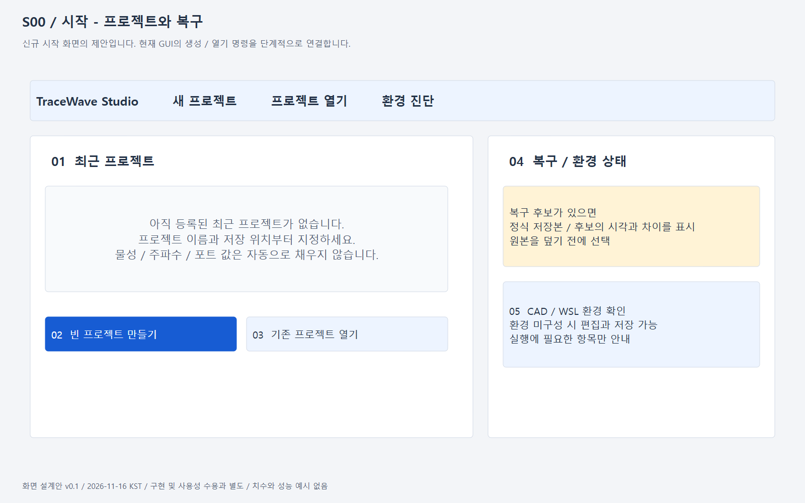
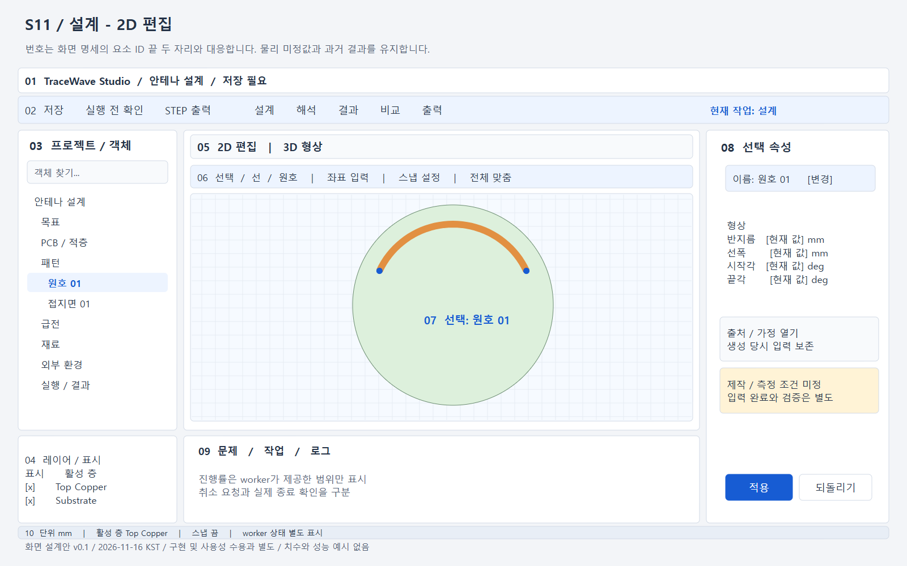
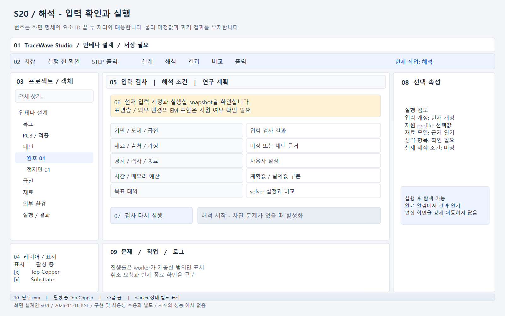
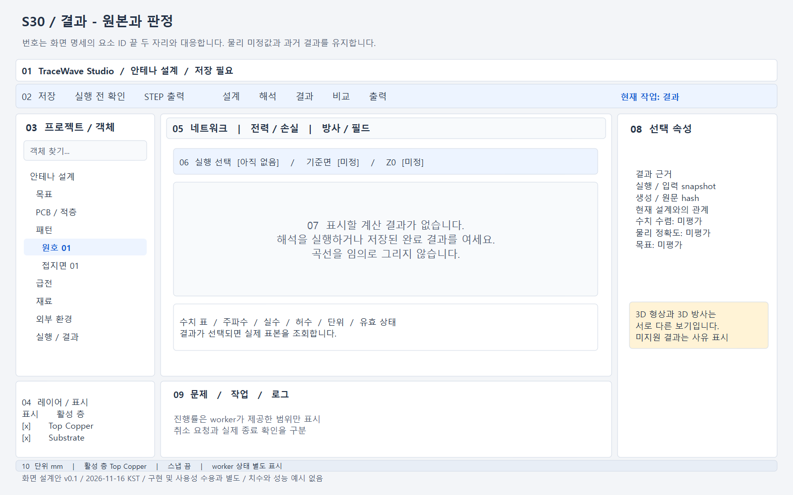
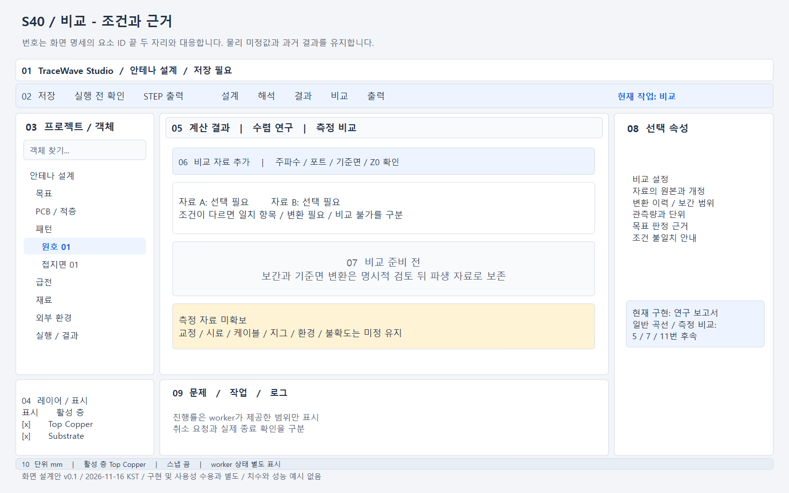
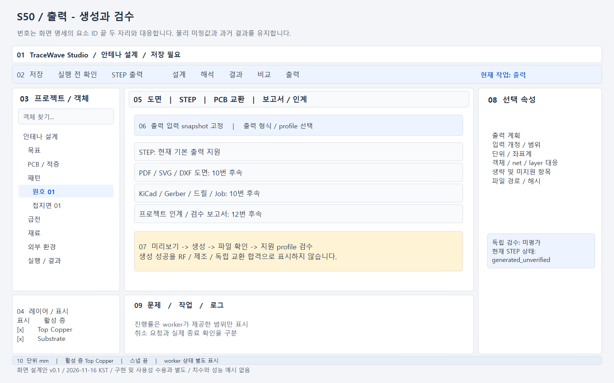
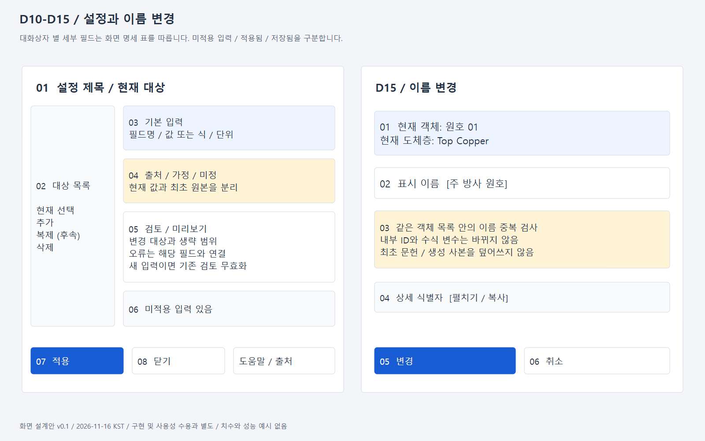

# Studio 화면별 상세 설계서

문서 ID는 TWS-SD-001이다. 화면 ID에 따라 조작, 입력과 출력, 실패 시 복귀 위치를 정의한다. 승인 시안 84개와 실제 Windows 개발 빌드의 대조 결과는 [화면 검수](../07_검증/425_화면_구분자와_문구_재검수.md)에서 확인한다.

이 문서의 S, D, P 번호는 2026-11-16에 정의한 화면 구조와 개선 목표를 식별한다. 실제 메뉴와 탭은 [Windows 화면 검수](../07_검증/425_화면_구분자와_문구_재검수.md), 이동과 복귀는 [전환 시나리오](04_화면전환_시나리오.md), 영속 이름은 [객체 이름 계약](05_객체이름과_선택연동.md)을 따른다. 번호가 붙은 와이어프레임은 요소 사이의 관계를 설명한다. 외형은 [구현 화면 기준](12_구현화면_설계기준.md)과 [84개 시안](16_전체화면_둘러보기.html)에서 확인한다.

## 1. 화면설계서 표기와 공통 규칙

화면은 `S`, 대화상자는 `D`, 도킹 패널은 `P`로 식별한다. 그림의 숫자는 `화면ID.W숫자` 배치 요소다. 같은 모양의 버튼이라도 실제 이벤트와 명령은 아래 명세를 따른다. 페이지 안에 존재하는 상세 탭은 새 프로젝트를 만들지 않는다.

| 공통 입력 | 공통 출력 / 보존 |
| --- | --- |
| 현재 프로젝트, 권위 개정, 선택 객체/결과, 지원 capability, 연결 상태 | 선택 문맥과 저장 상태를 표시. 이전 개정 결과는 당시 입력과 함께 보존 |
| 사용자 폼 초안, 활성 층, 단위, 카메라, 필터 | 초안/적용/저장 구분. 카메라와 패널 배치는 물리 명령이나 RF snapshot을 만들지 않음 |
| 작업 상태, 취소 의도, 마지막 조회 시각 | 확인한 상태만 표시. 연결 단절을 완료/실패/취소로 추측하지 않음 |

물리량은 필드 이름, 식 또는 값, 단위, 평가값, 상태, 근거를 연결한다. 빈 값/0/해당 없음/미지원은 구분한다. 현재 값과 최초 문헌 원문은 다른 필드이며 이름 변경/단위 표시만으로 과거 출처를 덮지 않는다. 미정값이 있어도 가능한 편집과 저장을 허용하고 해당 연산에 필요한 값만 검사한다.

파일 메뉴에서 새 프로젝트(Ctrl+N), 열기(Ctrl+O), 저장(Ctrl+S)을 시작한다. 편집 메뉴에서 실행 취소(Ctrl+Z), 다시 실행(Ctrl+Y 또는 Ctrl+Shift+Z), 객체 찾기(Ctrl+F), 명령 찾기(Ctrl+Shift+P)를 제공한다. F6과 Shift+F6은 패널 사이를 이동한다. F2 이름 변경은 선택한 객체에 적용한다. [실제 메뉴와 단축키](../../Code/ui/wxwidgets/studio_layout.cpp), [이름과 선택 검증](../07_검증/08_스튜디오와_정밀편집_검증.md)

## 2. 공통 Studio 프레임 S10

적용 화면: S11/S12/S20/S30/S40/S50. 공통 프레임은 그림의 W01~W10을 재사용한다. 화면 전환 동작은 전환 문서의 S10.C01/C02 및 SC-01~08과 연결된다.

| 요소 ID | 구성 / 기능 | 입력 / 출력 | 이벤트 / 이동 | 활성 조건 / 예외 |
| --- | --- | --- | --- | --- |
| W01 | 프로젝트 바 | 이름, 작업 개정, 저장됨/저장 필요/결과 불명 | 프로젝트 메뉴에서 생성/열기/저장/복구 | 열기 실패 시 기존 프로젝트 유지. 권위 상태 확인 전 저장 성공 표시 금지 |
| W02 | 작업 바 | 저장, 실행 전 확인, STEP 출력, 작업 탭 | 저장 명령 또는 S10/S20/S30/S40/S50 선택 | 이동만으로 적용/해석/출력 없음. 실행 버튼은 S20 검토를 먼저 열도록 개선 |
| W03 | 프로젝트 탐색 | 목표/기판/패턴/급전/재료/환경/실행, 검색 | 객체 선택, 관련 설정 열기, F2/문맥 메뉴 | 그룹 행을 실제 객체로 수정하지 않음. 변경 초안 처리 후 선택 전환 |
| W04 | 레이어 | 표시 여부와 활성 편집 층 | 체크는 표시, 행 선택은 활성 층 변경 | 표시/출력 포함/해석 포함을 분리. 숨긴 층으로 생성하지 않도록 명시 안내 |
| W05 | 중앙 내용 탭 | 작업에 필요한 편집/표/그래프 | 하위 탭 전환, 2D/3D 복귀 | 마지막 보기 복원은 후속. 미지원 탭은 필요한 조건과 범위를 설명 |
| W06 | 문맥 도구 | 해당 화면의 동작과 입력 | 아래 화면별 표 | 선택 대상과 입력 상태에 맞게 활성화하고 비활성 이유를 제공 |
| W07 | 주요 작업 영역 | 현재 데이터/미리보기/빈 상태 | 객체/자료 선택 및 확정 | 미리보기는 원본과 구분. 예시 곡선/가짜 진행률을 표시하지 않음 |
| W08 | 속성 / 근거 | 기본 필드, 단위, 출처/가정, 고급 상세 | 필드 편집, 적용/되돌리기, 출처 열기 | 변경 필드만 제출. 내부 UUID는 상세에서 복사 가능 |
| W09 | 문제/작업/로그 | 원인, 대상, 현재 개정, 실제 작업 단계 | 문제 위치 이동, 작업 상세/취소, 결과 열기 | 현재 화면을 완료 콜백이 강제로 전환하지 않는 방향으로 개선 |
| W10 | 상태줄 | 좌표/단위/활성 층/스냅/선택/연결 | 관련 설정 열기, 상태 설명 | 표시할 공간이 부족해도 차단 상태와 실행 취소 경로는 유지 |

레이아웃은 DIP와 시스템 글꼴 기준으로 배치한다. 넓은 창에서는 탐색-편집-속성 구조를, 좁은 창에서는 속성/문제의 탭 접기와 도구 overflow를 사용한다. 고정 크기 와이어프레임을 최소 지원 해상도나 실제 DPI 합격 증거로 사용하지 않는다.

## 3. S00 시작, 프로젝트와 복구

목적: 프로젝트 이름과 위치를 이해하기 쉬운 방식으로 선택한다. 진입: 앱 시작/프로젝트 닫기. 종료: 생성/열기 성공 후 S11. 최근 프로젝트/복구 비교 화면은 제안이며 현재는 경로 입력 중심이다. 단계: 4/12.

| 요소 | 기능과 입출력 | 이벤트 / 전환 / 예외 |
| --- | --- | --- |
| W01 최근 프로젝트 | 이름, 위치, 마지막 정상 저장 시각, 누락/잠금 상태 | 항목 Enter로 열기. 단순 선택이나 목록 조회로 파일 수정 없음 |
| W02 새 프로젝트 | 이름, 위치, 표시 단위 선호. 물성/주파수 기본값 없음 | 생성 검증 성공 후 S11. 중복/권한/잠금 오류는 입력과 함께 유지 |
| W03 열기 | 프로젝트 위치와 형식 검사 | 지원하지 않는 schema/손상은 구분해 안내. 원본 자동 덮어쓰기 금지 |
| W04 복구 | 정상 저장본과 복구 후보의 시각/변경 객체 | 비교 후 복구/원본 열기/취소. 복구 후보를 무조건 최신 정답으로 선택하지 않음 |
| W05 환경 | CAD/WSL 구성과 진단 | 환경 설정/진단으로 이동 후 S00 복귀. 미구성으로 편집/저장을 일괄 차단하지 않음 |

## 4. S11 2D 편집

목적: 읽기 쉬운 객체 이름으로 찾고, 치수/좌표/스냅을 사용해 정확히 편집한다. 진입: 설계 탭/문제 위치/프로젝트 열기. 출력: 기존 원자 명령과 새 개정. 단계: 4.

| 요소 | 기능과 입력 | 확정 / 이동 / 예외 |
| --- | --- | --- |
| W03 객체 트리 | 종류 아이콘 + `원호 01` 등 표시 이름. 검색/종류/층 필터 | 선택은 같은 개정의 속성/2D/3D와 연결. 이름은 D15로 수정 |
| W05 2D/3D | 2D와 S12 CAD 표시를 구분 | 미적용 초안/선택 보존 정책 적용. 3D로 이동한다고 자동 CAD 작업 시작하지 않음 |
| W06 선택/선/원호 | 생성 도구와 좌표 입력, 현재 층, 스냅 설정 | 클릭/드래그는 로컬 후보. 확정 때 서비스 명령 하나. Esc/캡처 손실은 취소 |
| W06 좌표/맞춤 | 좌표 입력은 정밀 입력, 전체/선택 맞춤은 보기 동작 | 지속 그리기 도구와 구분 배치. 이름을 생략해 역할이 불명확한 `좌표`, `맞춤`만 표시하지 않음 |
| W07 객체/끝점 | 선택/이동/끝점 핸들, 잠긴 표현식 필드, 스냅 위치 | 직접 편집 불가 이유 표시. 화면 근접 스냅을 전기 연결 합격으로 표시하지 않음 |
| W08 이름/형상/근거 | 이름, 반지름/폭/각도 등의 값 또는 식과 단위 | 적용 후 새 개정. 수식 결합 필드는 상수로 자동 교체하지 않음 |
| W09 문제 | 기본 연결/DRC/해석 입력을 검사 목적과 함께 표시 | 위치 이동, 현재 개정에서 재검사. 미평가를 통과로 표시하지 않음 |

현재 스냅/끝점, 모델 연관 치수, 회전/미러, 제한된 다각형 평면 연산, 이름 검색과 종류 필터를 연결했다. 정확한 지원 범위는 [정밀 편집 계약](../05_기능설계/02_설계편집/13_정밀편집과_평면연산.md), [캔버스 계약](../05_기능설계/02_설계편집/03_이차원표시와_직접편집.md), [이름과 선택 계약](05_객체이름과_선택연동.md)을 따른다. 모든 곡선/구속/필터 조합이나 도면 출력과 전체 UX 수용의 완료를 뜻하지 않는다.

## 5. S12 3D 형상

S12는 [전체 화면 목록](13_전체화면목록.json)에 독립 구현 시안으로 연결한다. 공통 프레임의 중앙을 ModelView로 구성하며 별도 앱이 아닌 같은 설계 작업 안의 하위 보기다. 상단에는 `3D 갱신`, `전체/선택 맞춤`, `표시 범위`, `입력 개정`을 둔다. 형상이 없는 경우 `아직 생성한 3D 형상이 없습니다`와 생성에 필요한 입력을 표시한다.

| 영역 | 기능 / 입출력 | 이벤트 / 예외 |
| --- | --- | --- |
| W05/W06 | 2D 복귀, 현재 설계로 갱신, 표시 입력 개정 | 갱신은 snapshot/CAD 작업. 오래된 표시 mesh에는 이전 조건 표시 |
| W07 | 회전/이동/확대, 바디 선택, 지원 범위의 단면/간극 | 병합 바디의 여러 원본은 대상 목록으로 선택하도록 개선. 면 번호를 영구 ID로 저장하지 않음 |
| W08 | 원본 객체, 층/재료, 표시/출력/해석 포함, 출처 | 표면층/외부 물체는 D13. 형상 접촉만으로 전기 접속 확정 금지 |
| W09 | CAD 준비/생성/검사/게시 및 실패 | 실패 시 마지막 정상 표시 보존. 다른 개정 mesh에서 현재 객체를 잘못 수정하지 않음 |

현재 GUI는 wxGLCanvas/OpenGL이며 OCCT worker가 만든 표시 mesh를 사용한다. 일반 공간 3차원 안테나 원본 편집/급전/EM 및 3D 방사 결과와 구분한다. CAD 기능과 10번 독립 STEP 검수는 별도다.

## 6. S20 해석 준비

목적: 실행 전에 실제 소비 입력과 지원 범위를 검토한다. 진입: 해석 탭/실행 전 확인. 단계: 6/8, 공통 데이터는 5.

| 요소 | 기능 / 입출력 | 이벤트 / 이동 / 예외 |
| --- | --- | --- |
| W05 | 입력 검사/해석 조건/연구 계획 | 조건은 D20, 연구는 D21. 목표 저장이 조건 채택을 자동 수행하지 않음 |
| W06 | 입력 개정, 지원 profile, 소비/근사/생략/차단 | 검토 범위 표시. 미지원 외부 EM 포함을 끄는 대체 동작은 사용자 명령으로만 처리 |
| W07 | 재료/급전/경계/격자/예산/주파수 검토 | 현재 개정 검사, 차단 위치로 이동. 결과가 오래되면 재검사 요구 |
| W07 실행 | 명시적 시작, 고정 snapshot/설정 | 접수 후 작업 ID를 P11에 표시. 중복 시작과 결과 불명 자동 재전송 금지 |
| W08 | 출처와 지원 모델, 실제 제작 조건 | 근거 펼치기. 미정 납품값을 탐색 물성으로 승격하지 않음 |

실행 중 S11 편집은 새 작업 개정에만 반영한다. 성공 알림의 `결과 열기`로 S30을 선택한다. 이는 현재 완료 시 강제 탭 선택을 개선하는 설계이며, 이미 구현됐다고 표시하지 않는다.

## 7. S30 결과

목적: 어떤 입력으로 계산했는지 확인하고 수치/물리/목표/제조/실측 상태를 별도로 판단한다. 진입: 결과 탭/완료 알림/과거 실행. 단계: 5/7/8.

| 요소 | 기능 / 입출력 | 이벤트 / 예외 |
| --- | --- | --- |
| W05 | 네트워크/전력/손실/방사/필드 | 지원 자료가 있는 탭만 실제 조회. CAD 3D 탭과 구분 |
| W06 | 실행/개정/포트/Z0/기준면/주파수/관측량 | 원본 선택과 파생 변환을 구분. 값/조건 없는 선택은 차단 이유 표시 |
| W07 | 그래프 + 같은 자료의 수치 표 + 마커 | 확대/범위 조회, 값/단위 복사. 표시 축소와 평가 원본 표본을 구분 |
| W08 | 출처, 시간 종료/수치 수렴/물리/목표/제조/실측 | 각각 미평가/미확립/조건부/판정 표시. 실행 완료 배지 하나로 합격 확대 금지 |
| W09 | 후처리/조회 상태 | 늦은 응답은 선택한 run과 요청 문맥 검사. 원본 오류 시 이전 정상 자료와 구분 |

실제 제품의 빈 상태에는 예제 S11 곡선을 넣지 않는다. 새 구현 시안의 채워진 결과는 설명용 데이터 고지가 있는 화면 설계이며 실제 결과나 기본값이 아니다. 빈 결과/자료 누락은 별도 시안으로 구분한다. 현재 지원은 단일 포트의 제한 그래프와 방사 조회이며 공통 복소 자료/Smith/3D 방사/필드/다중 비교는 후속이다.

## 8. S40 비교

목적: 다른 결과의 조건을 먼저 맞춰 비교의 의미를 보존한다. 진입: 비교 탭/결과 추가/연구 후보/측정 파일. 단계: 5/6/7/11.

| 요소 | 기능 / 입출력 | 이벤트 / 예외 |
| --- | --- | --- |
| W05 | 계산/수렴 연구/측정 | 현재 구현은 수렴 연구 보고서. 후속 일반 비교와 범위 표시 |
| W06 | 자료 A/B 추가, 포트/주파수/Z0/기준면 비교 | 추가는 원본 유지. 제거는 비교 집합에서만 제거하고 원본 삭제와 분리 |
| W07 | 조건 표, 곡선/차이/유효 구간, 판정 | 불일치는 비교 불가/변환 필요/조건부로 표시. 외삽/보간 자동 채택 금지 |
| W08 | 시료/교정/케이블/지그/환경/불확도, 변환 chain | 미정은 그대로 남겨 기능 시험과 실측 검증을 분리 |

완료 후보를 설계로 채택할 때에는 기존 프로젝트 변경 목록을 검토한 뒤 별도 원자 명령으로 적용한다. 비교 화면 진입이나 후보 행 선택만으로 원본을 바꾸지 않는다.

## 9. S50 출력

목적: 동일 입력 snapshot의 전달물과 검수 상태를 확인한다. 진입: 출력 탭/STEP 출력. 단계: 10/12.

| 요소 | 기능 / 입출력 | 이벤트 / 예외 |
| --- | --- | --- |
| W05 | 도면/STEP/PCB 교환/보고서와 인계 | 현재 STEP 이외 형식은 후속. 환경과 profile의 실제 지원으로 활성화 |
| W06 | snapshot, 출력 선택, 단위/좌표/레이어/net 매핑 | 미리보기에서 포함/누락/근사 확인. 화면 표시 선택과 별도 |
| W07 | 미리보기/생성/검수/파일 목록 | 생성 성공과 reader 검수 통과를 구분. 취소/부분 실패를 완성 패키지로 게시하지 않음 |
| W08 | 파일명/해시/크기/생성자/검수 도구와 버전 | 완료 폴더/보고서 열기. 원본 파일이 없어졌으면 누락을 표시 |
| W09 | 출력 작업/실패/독립 검수 | 같은 커널 재입력을 독립 CAD 검수로 승격하지 않음 |

현재 STEP은 `generated_unverified`다. `verified_profile`은 해당 교환 profile의 검수이며 RF/제조/실측 합격이 아니다.

## 10. D10~D15 설정 대화상자

위 설정 그림은 공통 요소의 구조 참고다. D10~D15의 각 입력과 하위 탭은 새 전체 화면 목록의 개별 시안을 사용하며 한 개의 공통 폼 그림으로 대체하지 않는다. 설정의 공통 요소는 W01 제목/대상, W02 대상 목록, W03 기본 입력, W04 근거, W05 검토, W06 초안 상태, W07 적용, W08 닫기다. 오른쪽 D15는 별도 W01~W06 번호를 사용한다. 현재 설정 적용 후 주 창을 갱신하면 프로젝트 root가 선택된다. 개선안은 호출한 객체/화면의 유효한 선택을 복원하며, 생성/삭제 시에는 적용 결과의 대상 또는 남은 부모를 선택한다. 닫힌 창의 콜백은 폐기한다.

| 화면 | W02/W03 입력 | W04/W05 출력 및 검토 | 적용 / 복귀 / 예외 |
| --- | --- | --- | --- |
| D10 목표 | 목표 이름/대역/표본/포트/Z0/지표 한계. 제약 편집은 D14로 연결 | 상태/출처, 명시 표본 수와 변경 필드 | target editor 경로. 1001개 지원 범위 유지. 단위만 바꿀 때 SI 원값 보존 |
| D11 문헌/후보 | 카드 버전, 기존 보드/층/목표, 치수와 가정 | 원문 locator, 기하/추정/해석/수렴/실측 축, 읽기 전용 후보 | 검토 hash와 같은 입력만 한 번 적용. 카드별 초안, 결과 불명 중 중복 생성 차단 |
| D12 기판/재료 | 제조업체/적층/층 대응, 관측 물성/직접 입력 | 출처 조건/충돌/미정, 단면/변경 목록 | 확인한 제안만 적용. 기존 사용자 값 보존. 조회 실패와 채택 실패 구분 |
| D13 적층/환경 | 층 z/두께 검토, 표면층/개구/시나리오/STEP 배치 | 단면, 원문 hash/단위/고체 수, 접촉/간극/미정 | 표시/STEP/EM 포함 분리. 미지원 EM 차단, 저장 후 봉인 사본 사용 |
| D14 제약/DRC | 크기/매개변수 범위, 기대 연결/절연, 제조 한계 | 검사 개정, 문제/미평가/사용 한계 | 검사와 설정 저장 별도. 문제 위치로 S11/입력 필드 이동 |
| D15 이름 | 현재 종류/층/이름, 새 표시 이름 | 중복/길이/문자 오류, 접힌 안정 ID | Enter/변경으로 한 명령, Esc/취소는 원래 선택. 이름만 바꾸고 물리값/출처는 유지 |

D15의 W01 대상, W02 새 이름, W03 영향/오류, W04 내부 상세, W05 변경, W06 취소가 [이름 명세](05_객체이름과_선택연동.md)의 UXN-01~12와 연결된다. 2026-11-17에는 기하/기판의 선택적 이름 저장과 F2를 연결했으며, 실행 범위는 [단계 4 검증](../07_검증/08_스튜디오와_정밀편집_검증.md)을 따른다. 이름 입력만으로 물리값/출처를 바꾸지 않는다.

## 11. 부가 화면과 승인 UI 전체 대응

부가 화면은 전환 문서의 D20~D23/P10~P13에서 이벤트를 정의한다. 추가 R1 기능의 진입을 다음과 같이 고정해 화면이 없다는 이유로 요구를 빠뜨리지 않는다. 상세한 필드/DTO가 필요한 항목은 [공통 계약](../02_시스템명세/08_공통구현_계약.md)과 기능별 계약을 함께 확정한 뒤 구현한다.

| 승인 UI | 진입 / 화면 | 기본 기능 / 현재와 후속 경계 |
| --- | --- | --- |
| UI-01 | S10 공통 프레임 | 탐색/도킹/선택/명령 찾기. 전체 키보드/접근성 수용 후속 |
| UI-02 | S00, 프로젝트 메뉴 | 생성/열기/저장/개정/복구. 최근/복구 비교 후속 |
| UI-03 | D10 | 목표 입력 구현, 관측/편파/기준면/목표 판정 후속 |
| UI-04 | D11 | 문헌/명시 기하/조건부 초기 후보 구현, 추가 지원은 근거 확인 후 |
| UI-05 | S11, D14/D15 | 정밀 편집/검사/이름. 구현 범위는 현재 계약과 구분 |
| UI-06 | S12, D13 | 3D CAD/단면/외부 부품. 일반 조립체와 임의 축 회전 후속 |
| UI-07 | D12/D13, 층 속성 | 적층/표면층/기본 비아. 제조 공정 전체 검수 후속 |
| UI-08 | D12, 재료 속성 | 원문/사용자 채택/손실 모델. 광대역 곡선과 고급 모델 지원별 후속 |
| UI-09 | 급전 트리 -> 포트 속성 | 현재 단일 포트 편집. 기준면과 외부 회로 연결은 5번 |
| UI-10 | 급전 트리 -> 외부 정합망 작업 | 기본 외부 RLC는 5번 후속, RF IC/가변 고급 상태는 승인 R2/R3 범위 |
| UI-11 | D13 | 기본 환경/설치. 배열/굽힘/일반 비평면 RF는 별도 장기 범위 |
| UI-12 | S20/D20 | 지원표/입력 검사/명시적 실행 |
| UI-13 | S20/D21 | 메시/예산/수렴. 현재 단일 축 수치 연구와 다축 설계 스윕을 구분 |
| UI-14 | P11/P12 | 큐/진행/취소/로그/권위 재조회 |
| UI-15 | S30 | network/전력/목표. 공통 데이터/평가 5/7번 |
| UI-16 | S30/D22 | 방사 조회와 향후 3D 방사/필드 7번 |
| UI-17 | S30의 지원 분석 탭 | UWB/NFC/RFID/MIMO/배열은 승인 후속. 빈 고급 설정을 R1에 강제하지 않음 |
| UI-18 | D21/S40/D23 | 수치 연구/후보/다축 스윕. 자동 최적화 전체 지원과 구분 |
| UI-19 | S40 측정 비교 | 원본 가져오기/교정/시료/기준면/불확도 5/11번 |
| UI-20 | S50 | 도면/STEP 출력과 독립 검수 10번 |
| UI-21 | S50 PCB 교환 | KiCad/Gerber/드릴/Job 10번, 독립 재입력 포함 |
| UI-22 | S50 보고서/인계 | 판정/출처/제한/파일 봉인 12번 |
| UI-23 | S00 환경, 도움말/진단 | worker/호환성/설치 12/13번. Linux GUI는 별도 후속 |
| UI-24 | D11/D12/W08 출처 | 원문/추출/충돌/채택 이력. 검색 목록과 실제 채택 원본을 구분 |

실제 제작/납품/급전 실장/측정 조건, 독립 RF 정확도 및 PERF 수용은 문서만으로 확정할 수 없다. 설계 결정과 외부 증거 의존성을 분리해 기록하고, 열린 항목을 제거하여 완료로 표시하지 않는다.
