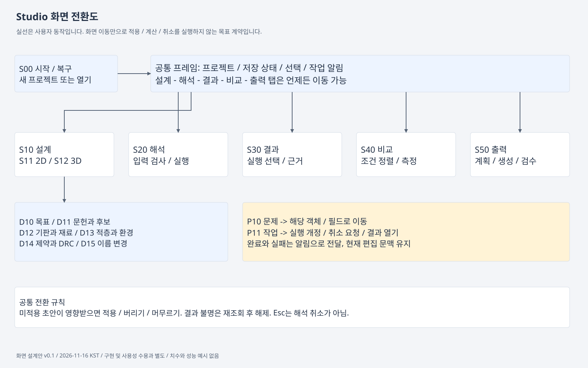
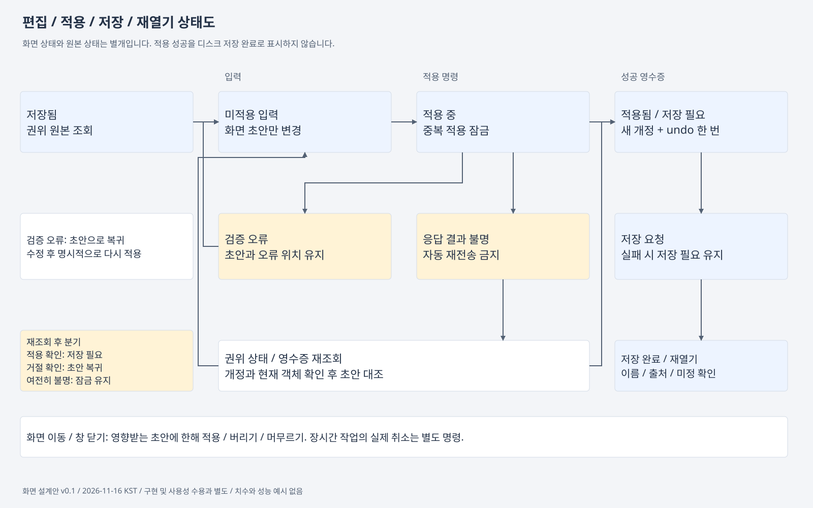

# Studio 화면 전환 시나리오

작성일: 2026-11-16 KST. 대상: Windows 11의 TraceWave Studio. 이 문서는 RFAD-D0-3.4를 구체화한 화면 설계이며, 별도 표시가 없는 행동은 앞으로 구현하고 검증할 목표다. 승인 원문과 과거 검증 기록을 변경하지 않는다. [화면 설계 안내](README.md), [사용성 및 접근성 검토](06_사용성과_접근성.md)를 함께 읽는다. 개별 화면의 외형은 [구현 화면 기준](12_구현화면_설계기준.md)과 [전체 화면 둘러보기](16_전체화면_둘러보기.html)를 따른다. 전환도는 페이지 사이의 진입과 복귀 경로를 나타낸다. 현재 빌드의 메뉴, 탭, 원본 조회 및 오류 복귀는 [84개 화면 검수](../07_검증/425_화면_구분자와_문구_재검수.md)에 기록했다.

초기 설계 대조 기준은 `2c88d26`이다. 스냅과 끝점 편집은 [초기 정밀 편집](../07_검증/08_스튜디오와_정밀편집_검증.md), 원호와 IFA의 선택 연동은 [Windows 편집 검증](../07_검증/259_윈도우_원호와_아이에프에이_선택편집_검증.md), 설치 설정의 복귀 동작은 [3D 선택 검증](../07_검증/260_윈도우_삼차원_설치설정_선택복귀_검증.md)에서 당시 상태를 확인할 수 있다.

## 1. 화면 이동의 기준

Studio는 하나의 프로젝트를 다루는 작업 공간이다. 상단 `설계 / 해석 / 결과 / 비교 / 출력`은 중앙 내용과 문맥 도구를 바꾸며, 프로젝트를 복제하거나 solver를 자동 실행하지 않는다. 왼쪽 탐색, 오른쪽 속성, 하단 문제/작업과 상태 표시는 같은 프로젝트 문맥을 유지한다. CAD 형상의 3D 보기와 RF 방사 결과의 3D 보기는 서로 다른 화면이다.

설계의 기준은 [승인 UI-01~24](01_화면과_사용자_경험_설계.md), [승인 GUI 구성](02_화면_선정과_성능_설계.md), [공통 계약 CC-001~012](../02_시스템명세/08_공통구현_계약.md)와 [기존 Studio 설계](08_스튜디오_화면계약.md)다. 새 화면 ID `S/D/P`는 탐색 설명용이며 승인 `UI-*`, 기능 `FN-*` 또는 저장 schema를 대체하지 않는다. 새 그림의 파일 번호도 별도 탐색 순서다. 하위 탭과 빈/오류/연결 불명 화면의 대응은 [전체 화면 목록](13_전체화면목록.json)에서 확인한다.

[편집 가능한 DrawIO](02_전환도원본/01_스튜디오_전체전환.drawio). 그림은 구현 목표도 포함한다. 작업 순서와 개별 화면의 확인 범위는 아래에 있다.

### 프로젝트부터 해석과 인계까지

1. 파일 메뉴에서 프로젝트를 만들고 설계 작업 공간으로 이동한다.
2. 2D에서 기판 외곽과 도체 패턴을 직접 그리거나 문헌/형상 후보를 적용한다. `설계 > PCB 및 CAM 원문 가져오기`에서 등록 제조사 동박이나 지원 PCB/CAM 원본을 선택할 수도 있다. [원문 수입 화면](25_기판교환과_원문수입_화면.md)
3. 적층, 기본 층의 두께와 재료, 마스크 및 필요한 외부 환경을 지정한다. 급전/기준 접지, Z0, 목표 대역을 입력하고 제약 및 연결/DRC를 확인한다.
4. 3D 갱신으로 층과 관통부의 높이, 외부 물체의 배치를 확인한다. 현재 개정의 3D 바디와 프로젝트 원본은 선택으로 연결한다. 해석과 STEP 출력은 동일 프로젝트의 입력 개정에서 별도로 시작할 수 있다.
5. 해석에서 주파수, 격자, 종료 조건과 필요한 방사 관측을 검토하고 실행한다. 결과 및 비교 작업 공간에서 S11/VSWR과 기록된 효율·방사를 확인한다.
6. 결과는 지원 형식에서 Touchstone/CSV/HDF5로 전달한다. 기계 모델은 STEP, 기술 도면은 PDF/SVG/DXF로 각각 출력한다. [결과 파일](../05_기능설계/05_출력교환/03_복소결과_파일교환.md), [기계·도면 출력](../05_기능설계/05_출력교환/04_연관도면과_출력재검수.md)
7. PCB 설계의 교환은 지원하는 KiCad 기판 또는 Gerber/Excellon 패키지를 사용한다. Altium은 CAM 수신 근거가 있다. 회로도와 턴키 실장의 BOM/배치 파일은 회로 설계 도구에서 작성한다. [기판 교환](../05_기능설계/05_출력교환/05_기판형상과_제조파일_교환.md), [Altium CAM 검증](../07_검증/224_알티움_도금홀과_슬롯_왕복검증.md)

## 2. 화면 목록과 현재 구현

| 화면 ID | 사용자에게 보이는 화면 | 구현 동작과 검토 근거 | 개선 또는 후속 범위 | 승인 연결 |
| --- | --- | --- | --- | --- |
| S00 | 시작 / 프로젝트 열기 | 파일 메뉴의 만들기/열기와 문자열 입력 대화상자. 열기는 등록 경로 `projects/이름`을 입력 | 최근 프로젝트, 찾기, 복구 후보, 환경 상태를 표시하는 시작 화면. 내부 경로 입력은 고급 상세로 이동 | UI-02, UI-23 |
| S10 | 설계 작업 공간 | 상단 작업 명령/설계 탭, 검색/종류 필터, 수평 도구와 작은 창 탐색/속성 탭 | 다중 모니터/DPI/도킹/재시작의 전체 작업 공간 복구 수용 | UI-01 |
| S11 | 2D 편집 | DesignCanvas, 속성/트리, 스냅/끝점, 모델 연관 치수/매개변수 결합, 회전/미러/제한된 다각형 연산 | 모든 곡선의 면 연산 변환, 도면 출력용 치수와 전체 편집/접근성 수용 | UI-05 |
| S12 | 3D 형상 | CAD 표시 메시, 선택, 단면과 투영, 실제 적층 및 외부 STEP 배치 | 표시 자료의 원본 개정을 확인한다. [단면 검수](../07_검증/425_화면_구분자와_문구_재검수.md) | UI-06, UI-07, UI-11 |
| S20 | 해석 준비 | 조건 입력, 저장한 해석 조건, 격자와 포함 형상, 종료 및 기록, 국부 격자와 격자 품질 검토 | 계산 예산과 미정 물성을 검토한 뒤 실행한다. [해석 전 검토](../07_검증/315_윈도우_해석전검토와_실제격자_검증.md) | UI-12, UI-13 |
| S30 | 결과 | S11/VSWR/Z, 공통 복소 자료, 표본 목표 평가, Smith, 2D/3D 방사·편파와 보존 필드 | 결과별 유효 전력·좌표·기준면 및 미기록 표본 설명과 접근성 | UI-15, UI-16, UI-17 |
| S40 | 비교 | 실행·후보·측정의 조건과 다중 곡선, 보존한 수렴 보고서 | 기준 PCB와 설치 상태의 동일 주파수·기준면·관측 방향 비교와 불확도 검수 | UI-18, UI-19 |
| S50 | 출력 | STEP, PDF/SVG/DXF, PCB/CAM, 후보 미리보기와 보존묶음·보고서/인계 | 독립 STEP 수신 및 대상 도구별 포함·변환 손실 검수 | UI-20, UI-21, UI-22 |
| D10 | 목표 / 대역 설정 | 다중 목표, 대역 프리셋, 명시 기준면, 단일 관측 방향과 편파의 표본 평가 | 일반 방향·편파와 조건 확장. 목표 저장과 해석 설정 변경은 독립 | UI-03 |
| D11 | 문헌 / 형상 / 초기 후보 | 카드 선택, 입력, 읽기 전용 2D 미리보기, 원자 적용 모달 | 후보/근거의 읽기 순서 개선. 문헌 부분 재현과 실제 성능 검증은 계속 분리 | UI-04, UI-24 |
| D12 | 기판 설정 / 자료 선택 | 제조업체/적층/물성 선택, 초안/검토/적용 모달 | 트리의 기판/재료와 일관된 진입 및 적용 후 대상 선택 복원 | UI-07, UI-08, UI-24 |
| D13 | 적층 / 외부 환경 | 층/표면층/설치 조건/외부 STEP의 편집과 미리보기 모달 | 포함/표시/해석 사용 상태를 문맥별 명확히 노출. 미지원 EM 포함은 계속 차단 | UI-06, UI-07, UI-11 |
| D14 | 제약, 연결 및 DRC | 제약/기대 연결/기본 규칙 편집 및 현재 개정 검사 모달 | 문제 위치, 관련 객체, 수정 후 재검사의 연속 동선 | UI-05, UI-09, UI-12 |
| D15 | 객체 이름 변경 | 트리 F2/문맥 메뉴/속성 이름에서 같은 editor.apply 사용. 영속 이름/임시 표시/안정 UUID 구분 | IME/긴 이름/고대비/다중 DPI의 전체 수용은 별도 검증 | UI-01, UI-05 |
| D20 | 해석 조건 | `AskNumbers` 대화상자에서 확인하면 실행으로 연결 | `조건 검토`와 명시적 `실행`을 분리. 목표 대역 채택도 변경 목록과 함께 표시 | UI-12, UI-13 |
| D21 | 연구 설정 / 실행 | 프로젝트 수치 연구의 비모달 창, 기존 창 재호출 시 앞으로 가져옴 | 일반 설계 스윕/다축 행렬/예산/명시적 재개와 후보 채택 | UI-18 |
| D22 | 방사 패턴 조회 | 기록 자료가 있는 결과에서 여는 비모달 조회 창 | S30의 방사 전용 내용과 일관된 연결. 3D 방사/편파/필드 전체 완성은 후속 | UI-16 |
| D23 | 수렴 연구 보고서 | S40에서 저장 보고서를 여는 읽기 화면 | 원본 조건/판정/실행으로 연결하는 비교 동선 | UI-18, UI-22 |
| P10 | 문제 | 입력 검사/DRC, 행에서 위치 이동 | 현재 개정 여부, 미평가와 차단 문제 구분, 필드 포커스의 일관된 복귀 | UI-01, UI-12 |
| P11 | 작업 | CAD/STEP과 해석의 실제 작업 상태 표 | 연구 포함 공통 작업 목록/상세/취소/복구. 확인되지 않은 백분율 표시 금지 | UI-14 |
| P12 | 로그 | 읽기 전용 로그 탭 | 사용자 설명과 기술 상세 분리, 복사/검색/작업 필터 | UI-14, UI-23 |
| P13 | CAD 출력 | 상태/작업 취소/완료 폴더와 상세 | S50 파일 검수와 연결. 파일 쓰기 성공과 독립 검수 성공을 별도 표시 | UI-20, UI-22 |

현재 상단 작업 버튼은 기존 중앙 notebook 페이지를 선택한다. `설계`는 항상 S11로 이동하며 직전 S12로 돌아가는 구현은 없다. S20/S40/S50은 실행 및 조회 진입을 모은 페이지이고 승인 설계의 모든 세부 화면을 구현한 상태가 아니다. 현재 S30에도 실행/취소 도구가 있어, 최종 설계의 S20 실행 준비와 역할 정리가 필요하다.

## 3. 화면별 구성요소와 이벤트 명세

다음 표의 구성요소 ID는 화면설계서의 추적 키다. 현재 wxWidgets control ID 또는 공개 service API 이름과 같다고 가정하지 않는다. `제안`은 구현 후 시험해야 하는 이벤트다. 버튼의 활성 조건이 충족되지 않으면 이유와 조건을 수정할 진입을 함께 제공한다.

| 화면 / 구성요소 | 표시 / 입력 | 버튼 또는 이벤트 | 출력 / 이동 | 활성 조건 / 예외 |
| --- | --- | --- | --- | --- |
| S00.C01 프로젝트 시작 | 프로젝트명, 최근 항목, 복구 상태는 제안. 현재 이름/등록 경로 문자열 입력 | 새로 만들기, 열기, 제안된 최근 항목 Enter | `project.open` 성공 후 S11과 프로젝트 root | service 연결 필요. 실패 시 이전 프로젝트를 성공한 것처럼 교체하지 않음 |
| S10.C01 공통 작업 바 | 프로젝트명/저장 상태, 설계/해석/결과/비교/출력 | 작업 탭 클릭 또는 키보드 선택 | S10/S20/S30/S40/S50 선택 | 탐색만으로 변경 명령/해석 실행 없음. 다른 프로젝트 열기는 작업 중 제한 |
| S10.C02 탐색/속성 | 종류별 객체 트리, 사람이 읽는 이름, 선택 속성/단위/출처 | 객체 선택, 기본/상세 펼치기, 적용 | 같은 ID의 선택 동기화, `editor.apply` 후 새 개정 | 초안이 사라지는 선택 변경은 5절과 동일한 정책. 이름 없는 객체 처리 개선은 제안 |
| S11.C01 문맥 도구 | 선택/선/원호 등 도구, 활성 층, 선폭, 스냅 상태 | 도구 선택, 클릭/드래그, 좌표 입력, Esc | 로컬 미리보기, 확정 시 기존 canvas 명령 | 현재 개정 장면과 수정 가능 필드 필요. 스냅/끝점은 작업 트리 변경 상태 |
| S11.C02 보기/레이어 | 단위, 확대/맞춤, 층 표시/활성층 | 휠/이동/맞춤, 표시 체크 | 보기 상태 변경 | 표시 숨김은 EM 제외나 객체 삭제가 아님. 보기 복원 영속화는 후속 |
| S12.C01 CAD 보기 | mesh/바디 대응, 원본 개정, 표시/포함 상태 | 3D 갱신, 전체 보기, 위에서, 입체 보기 | CAD 생성 작업 또는 카메라 변경 | 생성은 CAD 환경과 필수 기하 필요. 카메라 조작은 기존 mesh만으로 가능 |
| S20.C01 실행 전 확인 | 지원 상태/입력 문제, 조건/예산/고정 입력은 개선 예정 | 입력 검사, 조건 검토, 실행, 연구 | P10, D20, D21, P11 | 화면 진입은 실행 없음. 현재 조건 확인 직후 실행되는 경로와 제안 구분 |
| S30.C01 결과 탐색 | 결과 ID/개정/지표/축/그래프와 지원 값 표 | 지표 선택, 방사 조회, 비교에 추가 | 저장 결과의 그래프 변경, D22, S40 | 게시된 해당 자료 필요. 미기록 데이터는 미평가/미지원 |
| S40.C01 비교 대상 | 실행/측정/후보와 보존 수렴 보고서 | 보고서 열기, 추가/제거, 조건 비교 | D23 또는 공통 비교 결과 | 기준면/Z0/표본 등 불일치가 있으면 표시. 추가는 기존 결과를 삭제하지 않음 |
| S50.C01 출력 대상 | 형식/개정/포함/검수와 게시 파일 | 미리보기, 도면/CAM/STEP 출력, 재검수, 3D 갱신, 폴더 열기 | P13/별도 작업, S12, 완료 폴더 | 생성 지원/필수 기하 검사. 폴더는 게시 완료 파일이 있는 경우 활성 |
| D10.C01 목표 편집 | 이름, 대역/표본, 포트/Z0, 지표 한계/출처 | 추가/선택/삭제/변경 적용/닫기 | target editor 명령, 새 개정 | 변경 필드만 적용. 단위 변경만으로 SI 원값 손실 금지 |
| D11.C01 후보 작성 | 카드/기판/층/목표, 원문 치수/입력/가정, 2D 후보 | 카드 선택, 미리보기, 적용, 닫기 | `template.context`/후보/원자 적용, 최초 출처 사본 | 미리보기 후 입력 변경은 적용 잠금. 결과 불명 중 중복 생성 금지 |
| D12.C01 자료 적용 | 제조업체/원문/층 대응/물성/미정, 변경 목록 | 검색, 선택, 검토, 적용, 닫기 | PCB 선택 service의 원자 변경 | 사용자 수정값과 카탈로그 출처 분리. 원문 미정은 값으로 대체하지 않음 |
| D13.C01 적층/환경 | 층 위치/두께/표면층/설치/STEP 배치, 미정 조건 | 항목 편집/미리보기/적용/닫기 | physical setup 명령, 새 개정 | 표시 포함/STEP 포함/EM 지원 구분. 미지원 해석 포함은 차단 |
| D14.C01 규칙 | 목표 제약/기대 연결/제조 한계와 해당 개정 판정 | 편집/적용/검사/위치 이동 | 규칙 명령, P10/선택 위치 | 미지정 한계를 통과로 만들지 않음. 오래된 판정은 개정 표시 |
| D15.C01 이름 변경 | 현재 이름/종류/층, 새 이름. 제안 기능 | F2, 문맥 메뉴, Enter 적용, Esc 취소 | 같은 stable ID에 이름 변경, undo 가능 | 서비스의 중복/길이/문자 규칙 필요. 표시 fallback으로 원본 자동 변경 금지 |
| D20.C01 해석 조건 | 주파수/표본/격자/공기 여유/종료/선택 NF2FF | 현재 확인/취소, 제안 검토 후 실행 | 현재 StartSolver, 목표는 S20 검토 후 명시 실행 | 정수/범위/필수 조건 검사. 설정 화면의 제안값을 제조 물성으로 채택하지 않음 |
| D21.C01 연구 | 고정 입력, 변수/수치 조건/예산/후보 상태 | 생성/실행/취소/지원되는 재개 | 연구 service와 작업 상세 | 설계 스윕/수치 연구 종류 구분. 재개는 solver checkpoint 보장이 아님 |
| D22.C01 방사 조회 | 기록 주파수/방향/방사 지표와 현재 개정 관계 | 지원 조건 선택/조회/닫기 | `solver.radiation` 자료 표시 | 원본 기록 필요. CAD 3D와 다른 결과 화면 |
| D23.C01 보고서 | 원래 입력/수용 기준/판정/미확립 | 보고서 선택/열기/닫기 | 읽기 전용 보고서 | 과거 보고서를 현재 소스 검증으로 승격하지 않음 |
| P10.C01 문제 목록 | 상태/내용/객체/필드/검사 개정 | 검사, 행 Enter/두 번 클릭 | S11 또는 관련 입력 위치 | 대상 없는 문제는 일반 설명. 이전 개정 참조 재검사 |
| P11.C01 작업 목록 | 실제 단계/작업명/고정 입력/취소 상태 | 작업 선택, 상세, 명시적 취소 | 작업 상세 또는 현재 결과 | 취소 요청과 실제 종료 구분. 완료가 타이핑 포커스를 빼앗지 않는 동작은 제안 |
| P12.C01 로그 | 시간/작업/설명, 기술 상세 | 선택/복사, 제안 검색/필터 | 진단 확인 | 비밀값 제외. 로그 읽기는 재실행 아님 |
| P13.C01 CAD 출력 | 생성 개정/파일/상태/검수 전 표시 | 작업 취소, 완료 폴더 열기 | 취소 요청 또는 게시 파일 위치 | 이전 성공 결과는 후속 실패/취소에도 보존 |

## 4. 전환할 때 보존할 문맥

다음은 목표 동작이다. 새 표시 상태 모델에 정의하고 실제 구현/시험 결과를 별도로 연결한다.

| 문맥 | 같은 프로젝트의 화면 전환 | 프로젝트 전환 / 재열기 | 소유자와 경계 |
| --- | --- | --- | --- |
| 원본 개정, 출처, 미정값 | 변경하지 않음 | service가 연 프로젝트의 권위 상태로 대체 | Python service. 화면을 열었다는 이유로 물성이나 이름을 원본에 채우지 않음 |
| 선택 객체/층 | 안정 ID와 개정으로 유지. 대상 화면에 없으면 선택 이름/종류를 남기고 숨겨진 대상임을 안내 | 새 프로젝트에서 이전 ID를 적용하지 않음. 삭제된 선택은 부모 또는 미선택으로 복귀 | 표시 상태 모델. 트리 순번이나 Hex 문자열을 식별자로 사용하지 않음 |
| 2D 확대/이동, 3D 카메라 | 각 보기 상태를 따로 유지 | 복원 가능 여부를 검증한 개인 보기 설정만 사용. 원본 물리 snapshot과 분리 | GUI 표시 상태. 이번 문서로 영속화 구현 완료를 선언하지 않음 |
| 현재 도구/드래그 | 다른 화면 이동 전에 미확정 제스처 취소. 완료되지 않은 드래그를 적용하지 않음 | 취소 후 선택 도구로 시작 | CanvasGestureState 계열. Esc는 현재 도구/입력 취소이며 해석 취소 아님 |
| 속성 초안 | 단순 탭 이동만으로 적용/폐기하지 않음. 초안을 유지할 수 없는 대상 변경은 5절의 선택 제공 | 적용/폐기/계속 편집을 결정한 뒤 이동 | 폼 표시 모델. 임시 초안을 원본으로 저장한 것처럼 표시하지 않음 |
| 결과/연구 선택 | run/result/study ID와 원래 snapshot 유지 | 새 프로젝트 자료로 다시 조회 | 결과/작업 service. 이름 변경이나 화면 이동으로 과거 판정을 재작성하지 않음 |
| 포커스 | 새 화면의 제목/선택 항목 또는 첫 유효 조작으로 예측 가능하게 이동 | 열기 실패는 호출한 조작으로 복귀 | View. 비동기 완료 알림이 현재 타이핑 포커스를 빼앗지 않음 |
| 작업 실행 | 같은 프로젝트에서 보기/허용된 편집/저장을 유지 | 실행 또는 결과 로딩 중 프로젝트 전환은 현재 제한 유지, 사유와 작업으로 이동 제공 | JobTracker/AnalysisWorkflow. 전환 성공과 worker 종료를 혼동하지 않음 |

## 5. 공통 편집과 오류 상태

[편집 가능한 DrawIO](02_전환도원본/02_편집초안과_저장흐름.drawio). 아래는 GUI의 사용자 상태이며 저장 JobState enum을 새로 정의하지 않는다.

| 상태 | 표시와 허용 행동 | 이동 / 닫기 | 오류 처리 |
| --- | --- | --- | --- |
| 조회 중 | 기존 유효 화면 또는 대상 제목과 읽는 중 안내 | 읽기만 취소하고 원래 화면으로 복귀 가능 | 늦은 응답은 프로젝트/개정/대상/요청 세대 검사 후 폐기 |
| 미적용 입력 | 변경한 필드와 `미적용 입력`. 적용/되돌리기 | 단순 보기 이동은 초안 유지. 초안을 잃는 이동은 `적용하고 이동 / 입력 버리고 이동 / 계속 편집` 제공 | 잘못된 단위/범위는 필드와 문제 목록에 같은 오류, 초안 유지 |
| 적용 중 | 중복 적용 비활성화, 처리 중 상태 | 현재 계약처럼 응답 확인 전 일반 닫기 차단 | 단순 통신 시간 초과를 확정 거절로 표시하지 않음 |
| 적용됨 / 저장 필요 | 새 개정과 저장 필요. undo/redo 가능 | 명시적 프로젝트 교체/종료 시 저장 필요 상태 설명 | 저장 실패는 적용 성공을 취소하지 않고 이전 저장 개정을 구분 |
| 저장됨 | 현재 저장 개정이 일치 | 재열기는 service 데이터로 확인 | 완료한 출처/미정/명령 이력과 과거 결과 보존 |
| 개정 충돌 | 검토 기반이 바뀌었다는 설명 | 초안을 별도로 보존할 수 있도록 안내하고 최신 상태 다시 읽기 | 예전 미리보기의 적용 차단. 변경 내용을 자동 병합하지 않음 |
| 적용 결과 불명 | `적용 여부 확인 필요`, 쓰기 잠금 | 창을 닫고 권위 상태 조회로 복구 | 같은 변경을 자동 재전송하지 않음. receipt/현재 개정 확인 전 성공 또는 실패 단정 금지 |
| 서비스 연결 끊김 | 마지막 확인 상태와 확인 시점, 재열기 안내 | 읽을 수 있는 정보 유지, 쓰기 차단 | worker 종료/실패/취소 완료를 추정하지 않음 |

현재 구현 차이는 다음과 같다. 선택 변경/undo/종료에서는 주로 `미적용 입력을 버리고 계속` 확인을 사용한다. 저장, snapshot, 설정 화면 진입 및 실행 경로는 `HasDraft`이면 `ApplyCurrent`를 먼저 호출한다. 적용/폐기/계속 편집의 통일된 3가지 선택은 이 문서의 개선 계약이다. 설정 모달 적용 후에는 대체로 프로젝트 root를 다시 선택하므로 원래 또는 생성한 객체로 돌아오는 동선도 보강 대상이다. 저장과 snapshot을 한 행동으로 합치지 않는다.

## 6. 대표 화면 전환 시나리오

표의 `목표` 열은 구현할 행동이다. 현재 상태는 2절과 각 표 아래의 차이를 함께 따른다.

### SC-01. 새 PCB 설계 시작

| 순서 / 출발 | 클릭 위치 또는 입력 | 전제 | 도착 / 목표 표시 | 취소 / 실패 |
| --- | --- | --- | --- | --- |
| 1 / S00 | 새 프로젝트, 이름 입력 | project service 사용 가능 | S11 빈 작업 공간. 프로젝트명과 저장 상태, `기판 만들기`/`자료에서 시작` 안내 | 이름 오류는 해당 필드. 만들기 응답 불명 시 재시도 잠금 |
| 2 / S11 | 탐색 `기판 / 적층`의 설정 | 프로젝트 열림 | D12 또는 직접 기판 입력. 값이 없는 재료/두께는 미정 | 취소하면 S11의 선택/카메라/원본 그대로 |
| 3 / D12 | 자료 선택 -> 층 대응 -> 변경 검토 -> 적용 | 같은 개정의 검토 사양 | 새 개정, 기판/층 반영, 적용됨/저장 필요 | 원문 충돌이나 미정값을 임의 보완하지 않음 |
| 4 / S11 | 목표 설정 | 새 원본 개정 조회됨 | D10에서 목표 추가/수정 후 원래 S11로 복귀 | 목표만 저장해 solver 주파수나 곡선을 만들지 않음 |
| 5 / S11 | 직접 그리기 또는 문헌 후보 | 기판/활성 도체층 등 해당 도구의 필수 조건 | 직접 편집 또는 SC-02 | 비활성 도구는 부족 조건과 수정 진입 제공 |

현재는 S00 전용 최근 프로젝트 화면과 탐색의 문맥형 시작 동선이 없으며, 메뉴/왼쪽 버튼과 문자열 경로 입력을 사용한다. 미정 물성이 있어도 편집과 저장을 허용하고, 실제 값이 필요한 연산만 차단한다.

### SC-02. 문헌 카드에서 후보 만들기

| 순서 / 출발 | 클릭 위치 또는 입력 | 전제 | 도착 / 보존 | 취소 / 실패 |
| --- | --- | --- | --- | --- |
| 1 / S11 | `문헌 / 형상 / 초기 후보` | 프로젝트와 지원 capability | D11. 원래 선택/카메라를 복귀 문맥으로 기억 | 현재 미적용 속성은 5절 정책 적용 |
| 2 / D11 | 카드와 기존 기판/층/목표 선택 | 카드별 적용 조건 표시 | 근거/원문 치수/입력/생략/미정을 구분. 카드별 초안 유지 | 다른 카드로 이동해도 원래 초안을 임의 삭제하지 않음 |
| 3 / D11 | 후보 미리보기 | 입력 검사 통과 | 읽기 전용 2D와 생성/추정 상태. 아직 원본은 그대로 | 입력 변경 시 이전 검토 무효화. 오류는 해당 입력으로 이동 |
| 4 / D11 | 검토한 후보 적용 | 현재 개정과 검토 hash 일치 | 한 원자 명령으로 생성. 최초 출처 사본 보존 | 중복 적용 차단. 결과 불명은 조회로 확인 |
| 5 / D11 | 닫기 또는 생성 객체 편집 | 적용 결과 확인 | S11에서 생성한 객체 선택, 속성 및 출처 진입 | 현재 구현의 root 선택을 개선할 예정 |

기하 생성, 초기 추정, 해석, 수렴, 실측, 제조 검증은 별도 상태다. 원문에 없는 크기/재료/포트는 미정 또는 생략으로 남긴다. 후보의 문헌 이름은 객체 표시 이름의 제안 근거가 될 수 있지만 내부 ID와 원문 사본을 바꾸지 않는다.

### SC-03. 객체 편집, 이름 변경과 2D/3D 이동

| 순서 / 출발 | 클릭 위치 또는 입력 | 전제 | 도착 / 보존 | 취소 / 실패 |
| --- | --- | --- | --- | --- |
| 1 / S11 | 트리 또는 캔버스 객체 선택 | 현재 개정의 객체 존재 | 같은 stable ID의 속성. 사람이 읽는 이름/종류/층 표시 | 가려진 층은 자동 물리 변경 없이 표시 상태 안내 |
| 2 / S11 | F2 / 이름 변경 메뉴 / 속성 이름 | 이름 변경 기능 구현 후 | D15 또는 inline 입력, 기본 이름 선택 상태 | Esc는 원래 이름. 참조/출처는 그대로 |
| 3 / D15 | 새 이름 적용 | 서비스 이름 규칙 통과 | 같은 객체 ID의 표시 이름만 변경, undo/redo/저장 연결 | 충돌/금지 문자/길이 오류는 입력 유지. 표기 문자열을 참조 키로 사용하지 않음 |
| 4 / S11 | 끝점 드래그 또는 좌표/치수 입력 | 직접 수정 가능한 필드 | 미리보기 -> 확정 한 명령. 종속 값은 참조 안내 | Esc/취소는 원본 유지. 수식 종속을 묵시적으로 끊지 않음 |
| 5 / S11 | `3D 형상` | 기존 mesh 또는 생성할 CAD runtime | S12에서 같은 객체/바디 대응. 현재와 다른 개정은 이전 형상 표시 | 필수 기하 미정은 갱신 차단. 이전 mesh를 최신으로 표시하지 않음 |
| 6 / S12 | `2D 편집`, 다른 작업 후 `설계` | 동일 프로젝트 | 마지막 2D 카메라/층/선택 복원. 설계 진입은 마지막 사용한 2D/3D | 복원 대상 삭제 시 안전한 미선택과 이유 |

이름 변경은 제안이며 이번 문서 작성으로 기능이 추가되는 것은 아니다. 상세 이름 규칙은 별도 객체 이름 계약에서 관리한다. 2D 선택과 병합 3D body가 항상 1:1인 것으로 표시하지 않는다.

### SC-04. 문제에서 수정 위치로 이동

| 순서 / 출발 | 클릭 위치 또는 입력 | 전제 | 도착 / 보존 | 취소 / 실패 |
| --- | --- | --- | --- | --- |
| 1 / S11 또는 S20 | 입력 검사 / D14 검사 | 검사할 현재 개정 | P10 문제 목록. 검사 목적과 개정 표시 | 미정 제조 한계는 미평가, 0개 오류만으로 제조 합격 금지 |
| 2 / P10 | 문제 행 Enter 또는 두 번 클릭 | 진단의 객체/필드 참조 유효 | S11 선택/위치 강조 또는 D10~D14 관련 입력 | 과거 개정 문제는 현재 검사 안내, 같은 배열 순번의 다른 객체로 이동 금지 |
| 3 / 입력 화면 | 오류 필드 수정 및 적용 | 해당 필드 검사 통과 | 새 개정과 수정 위치 유지 | 원문/사용자 채택값을 구분하여 보존 |
| 4 / P10 | 현재 개정 재검사 | 새 개정 조회됨 | 새 검사 결과, 이전 판정은 과거 기록 | 재검사 실패를 문제 해결로 표시하지 않음 |

### SC-05. 실행 준비, 작업 중 편집과 결과 조회

| 순서 / 출발 | 클릭 위치 또는 입력 | 전제 | 도착 / 보존 | 취소 / 실패 |
| --- | --- | --- | --- | --- |
| 1 / S10 | 상단 `해석` | 프로젝트 열림 | S20. 조건, 지원 여부, 입력 문제를 확인. 이동만으로 실행하지 않음 | runtime 없음은 설치/연결 설명, 편집/저장은 유지 |
| 2 / S20 | 조건 편집 / 검토 | 목표와 solver 입력을 구분 | D20 또는 S20 상세에서 값/단위/예산/근거 검토 | 취소는 실행 없음. 목표 채택은 명시 동작 |
| 3 / S20 | 실행 | 미적용 입력 처리, 필수 입력과 지원 범위 충족 | 입력 snapshot 고정, P11 준비/실행/후처리. 실행 시점 개정 표시 | 차단 이유와 수정 위치 제공. 미정 물성 자동 생성 금지 |
| 4 / P11 | 설계/결과 보기 | 같은 프로젝트 | S11 편집/저장 가능, 작업은 고정 입력 유지 | 작업 중 프로젝트 전환 제한 이유 표시 |
| 5 / P11 | 해석 취소 | 취소 가능한 단계 | `취소 요청 중` -> 실제 종료 확인 뒤 `취소됨` 등 권위 상태 | 취소 전송 실패는 재시도 가능 여부 안내. Esc로 해석 종료 금지 |
| 6 / P11 | 완료 알림의 결과 보기 | 게시 완료 결과 존재 | S30, run/snapshot/현재 개정과 관계 표시 | 완료 시 입력 포커스 강제 이동하지 않는 것이 목표 |
| 7 / S30 | 지표/방사 선택 | 지원 데이터 존재 | 그래프/값 표 또는 D22. 이전 개정 결과 계속 열람 | 미기록 방사/필드, 부족 표본은 미평가. 그럴듯한 곡선 생성 금지 |

현재 D20 확인은 `StartSolver`로 바로 이어지고 시작/완료 시 S30을 선택한다. 향후 실행 전 검토와 완료 알림을 분리할 때도 기존 snapshot/plan/prepare/run 계약을 재사용한다. `completed`는 계산 작업 완료이며 격자 수렴/물리 정확도/실측 합격으로 번역하지 않는다.

### SC-06. 비교, 연구와 측정

| 출발 / 클릭 | 도착 / 목표 행동 | 현재와 후속 구분 | 되돌아갈 문맥 |
| --- | --- | --- | --- |
| S20 / 수치 연구 | D21에서 연구 조건/예산 검토, 명시 실행/취소/재개 | 기존 수치 연구 창 재사용. 일반 다축 설계 스윕은 계획 6번 | 원래 S20, 고정 base snapshot |
| S40 / 수렴 보고서 열기 | D23 읽기 화면에서 조건/기준/미확립 확인 | 현재 구현. 보고서 파일이 있다는 사실을 새 검증으로 취급하지 않음 | S40의 선택 보고서 |
| S30 / 비교에 추가 | S40에서 동일 조건 여부 확인 뒤 중첩 | 계획 5/7번. Z0/기준면/주파수/포트/좌표 불일치를 숨기지 않음 | 원래 result/run 선택과 축 범위 |
| S40 / 측정 자료 추가 | 원본 파일/시료/교정/기준면/불확도 검토 후 비교 | 파일 처리는 계획 5번, 실제 측정 문맥/판정은 11번 | 원본/변환 자료를 별도 선택. 취소는 원본/기존 비교 유지 |
| S40 / 후보 채택 | 후보 표의 `새 작업 사본으로 채택` -> 이름/경로/사유 -> 후보 검토 -> 별도 프로젝트 생성 | 9번의 완료된 grid_sweep 리터럴 후보. 현재 원본의 미적용 초안은 자동 적용하지 않음. 전용/기존 GUI 자동시험 및 실제 IFA 후보의 수동 채택/재열기 확인 | 원래 프로젝트/연구/과거 결과 보존. `새 사본 열기`를 명시한 뒤 S11로 이동 |

후보의 선택 순번/원문 Quantity와 실제 계산 재사용 순번의 source/pin을 구분한다. 새 프로젝트 생성과 열기는 별도 동작이고, 결과가 미확정이면 보존 요청의 영수증을 확인하기 전 재생성을 잠근다. 새 사본에서 undo 1회는 같은 새 프로젝트의 연구 기준 상태를 복원한다. 세 탭 구성과 원본 복귀/재연결/조회 실패는 [후보 채택 화면](23_후보채택과_새사본_화면.md), 실제 완료 증거는 [9번 검증 기록](../07_검증/21_후보채택과_원호아이에프에이_검증.md)을 따른다.

### SC-07. 출력과 독립 검수

| 순서 / 출발 | 클릭 위치 또는 입력 | 전제 | 도착 / 보존 | 취소 / 실패 |
| --- | --- | --- | --- | --- |
| 1 / S10 또는 S30 | 상단 `출력` | 프로젝트 열림 | S50의 형식/대상 개정/포함 목록. 진입만으로 생성하지 않음 | 해석 미완료도 도면/CAD 요구 조건을 충족하면 별도 생성 가능 |
| 2 / S50 | STEP 또는 향후 도면/CAM 형식 | 형식별 지원 및 기하 입력 | snapshot, 단위/좌표/포함/생략 검토 | 실제 두께/출력 포함과 화면 과장을 혼합하지 않음 |
| 3 / S50 | 생성 | 검토한 입력 일치 | P11/P13 작업. 생성 파일 목록과 `생성됨 / 검수 전` | 실패 산출물은 완료 파일로 게시하지 않음 |
| 4 / S50 | 독립 검수 / 결과 보기 | 지원 reader/profile | 계획 10번의 검사 결과. 생성/기하/교환/RF 검증 독립 | 현재 `generated_unverified`를 독립 합격으로 표시하지 않음 |
| 5 / S50 | 보고서/인계에 포함 | 파일 출처/권한/검수 상태 | 계획 12번의 포함 목록 및 누락 안내 | 미완료 패키지는 미완료 상태를 유지 |

현재 S50은 STEP/3D/폴더 진입 페이지다. CAD 형상 생성/복원은 S12를 선택할 수 있다. 최종 목표는 사용자가 요청한 보기만 바꾸고, 다른 화면에서 편집 중인 경우 완료 알림으로 결과 진입을 제공하는 것이다.

### SC-08. 저장, 재열기와 연결 실패

| 상황 / 출발 | 사용자 행동 | 성공 시 | 실패 / 중단 시 |
| --- | --- | --- | --- |
| 속성 초안 / S11 | 저장 | 초안 검증/적용 후 현재 개정 저장. 적용과 저장 단계 각각 표시 | 적용 오류면 원래 초안, 저장 오류면 적용된 새 개정과 이전 저장 개정 구분 |
| 설정 초안 / D10~D14 | 닫기 | 변경 없으면 원래 화면/호출 조작으로 복귀 | 변경 있으면 폐기 확인. 적용 중은 응답 또는 연결 상태 확인까지 닫기 제한 |
| 저장된 프로젝트 | 닫기 후 다시 열기 | 출처/미정/이름/명령 이력과 과거 결과를 service에서 읽음 | CAD/solver runtime 부재만으로 저장 원본/과거 결과 삭제 금지 |
| 변경 응답 시간 초과 | 상태 확인 / 재열기 | 권위 개정/영수증과 적용 내역을 확인한 뒤 편집 재개 | 자동 재적용 금지. 실행 중 worker의 실제 종료 미확인은 유지 |
| 실행 중 종료 | 명시적 창 닫기 | 사용자에게 작업 정리 상태 설명, 취소 요청과 종료 확인 | OS 강제 종료와 확인 불가 상황은 다음 열기에서 중단/결과 불명으로 안내 |
| 모니터/도킹 배치 오류 | 기본 배치 복원 | 조작 가능한 기본 도킹 배치, 원본 그대로 | 사용자 배치 저장/복원 전체 수용은 계획 12번에서 별도 시험 |

재열기 시 화면의 오래된 캐시로 원본을 덮지 않는다. 현재 `OpenProject`는 선택을 프로젝트 root로 시작하고 완료 CAD/solver 결과를 별도로 조회한다. 기존 카메라/선택/작업 탭을 재열기까지 완전 복원하는 것은 아직 보장되지 않으므로 개인 표시 설정 구현과 데이터 보존 시험을 구분한다.

## 7. 기능 개발과 함께 갱신할 연결표

기존 계획 번호를 유지한다. 한 기능을 구현할 때 진입, 정상 완료, 취소, 실패/결과 불명, 저장/재열기의 화면을 함께 갱신한다.

| 개발 완료 계획 | 이 문서에서 연결되는 화면 | 시나리오 보강과 확인 |
| --- | --- | --- |
| 4. 정밀 2D / Studio 작업 | S10~S12, D15, P10 | SC-01~04. 이름/스냅/끝점/치수/회전/미러/평면 연산과 선택/초안 복귀 |
| 5. 공통 결과 / 기본 회로 / 파일 | S30/S40 | SC-05/06. 복소 결과/외부 RLC/Touchstone/CSV/목표 평가의 입력과 표시 구분 |
| 6. 연구 / 다축 스윕 | S20/S40, D21, P11 | SC-06/08. 계획/예산/후보/취소/명시적 재개, 실패 후보 표시 |
| 7. 결과 분석 | S30/S40, D22 | SC-05/06. Smith/중첩/3D 방사/편파/필드의 선택과 데이터 부족 |
| 8. 독립 RF 검증 | S30/S40, D23 | 검증 근거/수렴 범위/미확립을 결과와 함께 표시 |
| 9. 목표 원호/IFA 튜닝 | D11/D13/D21, S30/S40 | 후보 채택/급전/환경 조건과 제작 후보 snapshot 연결 |
| 10. 도면 / CAD / EDA 교환 | S50, P13 | SC-07. 형식별 포함/손실/독립 reader 검수 |
| 11. 측정 비교 | S40 | SC-06. 교정/기준면/시료/불확도/환경 불일치 및 미확보 자료 |
| 12. 전체 UX / 복구 / 성능 / 인계 | 전체 | SC-01~08 연속 수행, 키보드/IME/DPI/고대비/포커스/장애/재열기 검수 |

13번은 RC10을 별도 PC에 설치하고 검수하여 마쳤다. 비평면 3차원 안테나의 모델링, 급전, 메시와 EM 검증은 장기 개발 범위다. 이 표의 화면은 새 GUI에서 사용자 동작과 결과를 대조할 기준으로 사용한다. [RC10 클린 PC 검수](../07_검증/427_알원_알시십_클린피시_수신과_수용.md) [리팩토링 순서](../09_개발계획/07_현행버전_완료후_리팩토링.md)

## 8. 시나리오 수용 기록 방법

각 SC별로 `설계만 / 부분 구현 / 구현됨 / 실제 GUI 확인 / 미확인 / 차단`을 기록한다. 이 상태를 solver나 물리 정확도의 상태로 재사용하지 않는다. 시험 기록에는 소스 commit 또는 작업 트리 식별, Windows/DPI/입력 방식, 사용 fixture, 시작/종료 화면 ID, 검증한 개정/선택/출처/미정 항목과 증거 경로를 남긴다. 문서 또는 모형 그림만 보고 `실제 GUI 확인`으로 바꾸지 않는다.

필수 관찰은 다음과 같다.

1. SC-01~03: 이름을 읽고 객체를 찾을 수 있으며 같은 객체의 선택/초안/출처를 잃지 않는다. 이름 변경 후 undo/redo와 저장/재열기에서도 ID 참조가 유지된다.
2. SC-04: 문제에서 올바른 객체와 필드로 이동하고, 이전 개정 문제를 현재 해결됨으로 오인하지 않는다.
3. SC-05/06: 탭 이동과 Esc가 실행/취소를 유발하지 않는다. 작업 완료와 물리/실측 검증을 구분한다.
4. SC-07: 생성 파일과 독립 검수 결과가 구분되고, 같은 snapshot의 포함/누락이 재열기 후에도 확인된다.
5. SC-08: 적용 성공/저장 실패/결과 불명/연결 끊김을 구분한다. 미정값과 과거 결과를 보존하고 변경을 중복 제출하지 않는다.
6. 모든 경로: 마우스와 키보드로 수행하고 현재 포커스가 보이며, 대화상자 종료 후 호출 위치 또는 명확한 결과 위치로 복귀한다. DPI/고대비 등의 자세한 조건은 [접근성 수용 항목](06_사용성과_접근성.md)을 따른다.

현재 확인 근거는 [작업 탭/페이지](../../Code/ui/wxwidgets/studio_workspace.cpp), [화면 조립](../../Code/ui/wxwidgets/studio_layout.cpp), [프로젝트/저장](../../Code/ui/wxwidgets/studio_project.cpp), [속성/이력](../../Code/ui/wxwidgets/studio_editing.cpp), [초안/활성화](../../Code/ui/wxwidgets/studio_controls.cpp), [설정 진입](../../Code/ui/wxwidgets/studio_design_setup.cpp), [설정 요청/닫기](../../Code/ui/wxwidgets/project_setup_dialog.cpp), [해석](../../Code/ui/wxwidgets/studio_solver.cpp), [CAD](../../Code/ui/wxwidgets/studio_cad.cpp), [연구](../../Code/ui/wxwidgets/studio_study.cpp), [연결/응답](../../Code/ui/wxwidgets/studio_session.cpp), [종료/연결 실패](../../Code/ui/wxwidgets/studio_lifecycle.cpp)다. 실제 시험 이력은 [개발 상태](../09_개발계획/02_개발착수와_현재상태.md)와 각 기능 runtime profile을 따르며 이 문서로 소급 수정하지 않는다.
