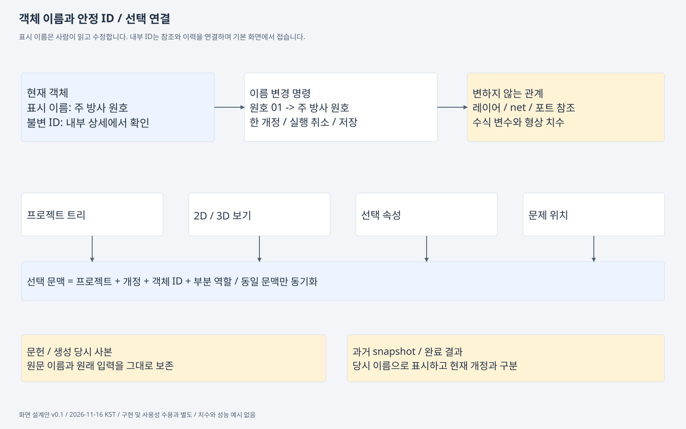

# 객체 이름과 선택 연동

작성일: 2026-11-16 KST

이 문서는 Studio의 객체를 읽기 쉬운 이름으로 찾고 수정하는 화면 설계다. 2026-11-17에는 자동 이름 생성, 기판/도형 이름 저장, 공통 표시와 기존 editor.apply 연결을 [객체 이름 서비스 계약](../05_기능설계/02_설계편집/14_객체이름과_표시계약.md)으로 구현했다. F2, 병합 바디 선택과 실제 Windows 화면의 수용 결과는 별도 단계 4 GUI 기록을 따른다. 서비스 구현과 전체 UX 검증 완료를 구분한다.

승인 근거는 [RFAD 05의 선택/접근성 및 2D/3D 화면 계약](01_화면과_사용자_경험_설계.md), [RFAD 01의 ADR-011 안정 UUID](../02_시스템명세/01_설계_결정과_범위.md)다. 기존 [속성 편집 계약](../05_기능설계/02_설계편집/02_속성편집과_실행취소.md), [저장 계약](../05_기능설계/01_프로젝트/01_프로젝트_명령과_저장.md)과 출처 보존 규칙을 유지한다. 화면 ID는 [화면 전환 시나리오](04_화면전환_시나리오.md)를 따른다. 트리/속성/급전 선택/문제 목록/이름 변경의 실제 배치는 [전체 화면 둘러보기](16_전체화면_둘러보기.html)를 사용한다. 시안 그림과 영속 저장 시험, 실제 GUI 검증은 서로 다른 근거다.

현재 3D 메시에서 도체 바디를 선택하면 기존 원본의 안정 ID를 사용한다. 병합 바디는 각 원본 이름을 표시하고 사용자가 고른다. 이전 개정의 메시를 클릭하면 현재 선택을 보존하고 3D 갱신을 안내한다. 비도금 홀처럼 2D에 별도 표시되는 기판 특징도 이름이 같은 원본 ID로 속성과 강조를 갱신한다. [Windows 원호와 IFA 검증](../07_검증/259_윈도우_원호와_아이에프에이_선택편집_검증.md)

표면층과 외부 설치 물체를 3D에서 고르면 해당 이름과 원본 ID의 적층/외부 환경 폼을 연다. 이 폼의 대상은 주 창의 편집 선택과 별도다. 조회 실패 또는 창을 닫은 뒤 주 창의 선택과 3D 강조를 다시 맞춘다. 물리 설정을 적용한 경우에도 계속 존재하는 설계 선택을 보존하고 다음 3D 갱신에서 바뀐 개정을 확인한다.

급전은 트리의 포트와 속성에서 이름 및 참조 도체를 편집할 수 있다. 4번의 남은 범위는 포트와 양단 도체, 관련 진단, 현재 2D/3D 표시를 같은 원본 ID로 탐색하는 동작이다. 형상 확인용 표식과 도체 선택을 구분하고 미정 참조와 오래된 메시의 사유를 표시한다. 키보드 이동 및 취소 시 기존 선택과 초점 복귀를 검증한다. [4번의 종료 조건](../09_개발계획/04_현행버전_남은작업.md)

## 1. 현재 상태와 해결할 문제

2026-11-16 점검에서 형상 목록의 `원호 패턴 a1b2c3d4`는 UUID 앞 8자를 붙인 표시였고 이름 입력란에서 변경할 수 없었다. 2026-11-17 구현은 서비스의 공통 표시 규칙으로 트리, 캔버스, 급전/연결 참조와 정밀 편집의 이름을 통일한다. UUID는 식별자 상세에 유지하고 주 이름으로 노출하지 않는다.

| 대상 | 현재 영속 이름 및 편집 | 실제 근거 | 후속 설계 |
| --- | --- | --- | --- |
| 프로젝트 | `metadata.name`, 이름/설명 원자 편집 | [editor.py](../../Code/src/rfad/application/editor.py), [project.py](../../Code/src/rfad/domain/project.py) | 기존 입력 유지. 트리/F2도 같은 명령 경로 사용 |
| 매개변수 | `name`, 이름 변경 가능. 표현식 변수는 별도 UUID 결합 | [editor.py](../../Code/src/rfad/application/editor.py), [parameter_graph.py](../../Code/src/rfad/domain/parameter_graph.py) | 사용자 이름과 식 안의 변수 별칭을 계속 분리 |
| 재료, 적층, net, 포트 | `name`, 속성 편집 지원. 같은 collection의 이름 중복은 거절 | [design.py](../../Code/src/rfad/domain/design.py), [editor.py](../../Code/src/rfad/application/editor.py) | 새 공통 진입점으로 기존 편집 기능 노출 |
| 기판 | 0.5의 선택적 `name`, 생성 시 `기판 01`, 기존 속성 이름 편집 | [design.py](../../Code/src/rfad/domain/design.py), [editor.py](../../Code/src/rfad/application/editor.py) | 무명 구버전 원본은 임시 표시이며 읽기만으로 이관하지 않음 |
| 선, 원호, 면, 패드, 비아 | 0.5의 선택적 `name`, 생성 시 종류/역할별 자동 이름, 속성 이름 편집 | [object_names.py](../../Code/src/rfad/domain/object_names.py), [canvas.py](../../Code/src/rfad/application/canvas.py) | 공통 label/name/name_state로 저장 이름과 임시 표시 구분 |
| 목표 | 목표 모델의 `name`, 별도 목표 편집 화면 | [targets.py](../../Code/src/rfad/domain/targets.py), [목표 편집 계약](../05_기능설계/02_설계편집/07_목표편집_서비스계약.md) | 목표 화면의 기존 이름을 재사용. 일반 도형의 별도 별명 생성 금지 |
| CAD 바디 | 원본 ID 목록을 가진 파생 바디. 내부 이름에 ID가 포함될 수 있음 | [bodies.py](../../Code/src/rfad/adapters/cad/bodies.py) | 화면은 원본 이름/병합 관계 표시. 저장된 STEP와 과거 바디 이름은 유지 |

`design.py`는 기판과 형상 필드를 정확히 검사하며 name은 0.5의 선택 필드로 허용한다. 현재 쓰기는 `rfad.project/0.5`이며 0.1~0.4도 읽는다. 실제 변경 명령의 복제본만 승격하고 migration 기록을 남긴다. 기존 파일과 템플릿의 생성 당시 원본 사본은 다시 쓰지 않는다. 알려진 명명 profile이 없는 과거 템플릿 사본은 당시 명명 규칙으로 검증한다.

## 2. 이름, 식별자와 물리 의미

[DrawIO 원본](02_전환도원본/03_객체이름과_식별자.drawio)

| 요소 | 화면 규칙 | 저장 및 연결 규칙 |
| --- | --- | --- |
| 사용자 이름 | 트리, 속성 제목, 툴팁, 도체 참조 목록, 현재 개정 문제 위치에 동일한 이름 표시 | 객체에 연결된 하나의 영속 이름. Python 서비스가 검증/명령/조회 담당 |
| 안정 ID | 속성의 `상세 > 식별자`에서 전체 값과 복사 동작 제공 | UUID 유지. 이름 변경으로 ID, 포트/넷/층 참조, 기하 연결을 바꾸지 않음 |
| 종류/역할 | 이름 옆 아이콘과 별도 속성으로 표시. 예: `방사 원호 / 원호 / 방사체` | `kind`, `role`은 이름과 별도. `접지`로 이름을 바꿔도 접지 net이나 role을 자동 지정하지 않음 |
| 표현식 변수 | 표시 이름과 `식의 변수`를 구분. 예: 이름 `기판 폭`, 식 `w / 2` | `w -> parameter UUID` 결합 유지. 이름 변경으로 식 문자열을 검색 치환하지 않음 |
| 과거 결과 이름 | `실행 당시 이름`과 snapshot/revision을 표시. 필요할 때 `현재 이름`을 별도 안내 | 결과 manifest, 과거 snapshot 및 출처 원문은 불변. 현재 이름으로 과거 자료를 덮어쓰지 않음 |

화면에 UUID를 주 이름 대신 노출하지 않는다. 진단 로그, API, 내보내기의 식별성은 유지한다. 상세 화면에서 식별자를 복사할 수 있어야 사용자 이름이 바뀌어도 문제를 추적할 수 있다.

## 3. 자동 명명

다음은 canvas 생성과 템플릿 후보, 새 포트 초안에 사용하는 기본 이름 규칙이다. 원시 geometry.set으로 받아들인 무명 객체는 기존 호환을 위해 계속 저장할 수 있다. 이름 배정은 물성, 치수, 연결과 검증 상태를 자동 확정하지 않는다.

| 생성 대상 | 첫 이름 예 | 비고 |
| --- | --- | --- |
| 기판 | `기판 01` | 현재 단일 기판. 여러 기판 지원을 의미하지 않음 |
| 선 도체 | `선 01` | 사용자 지정 이름이 있으면 그대로 사용 |
| 원호 도체 | `원호 01` | 반지름/주파수를 이름에 자동 삽입하지 않음 |
| 일반 면 도체 | `면 01` | 빈 영역과 도체의 의미는 별도 표시 |
| 명시적으로 접지 역할을 선택한 면 | `접지면 01` | 이름으로 접지 역할을 추론하지 않음 |
| 명시적으로 급전 역할을 선택한 선 | `급전선 01` | 포트 `급전 01`과 구분 |
| 패드, 비아 | `패드 01`, `비아 01` | 레이어 이동으로 이름을 다시 생성하지 않음 |
| 새 포트 | `급전 01` | 명명 가능성이 다중 포트 solver 지원을 의미하지 않음 |

1. 서비스가 생성 명령 안에서 이름을 배정하고 객체와 함께 게시한다. GUI는 미리보기 이름을 제시할 수 있지만 최종 번호를 소유하지 않는다.
2. 같은 프로젝트, 같은 collection 안에서 이름을 중복시키지 않는다. 모든 도형은 층이 달라도 같은 `geometry` 이름 범위를 사용한다. 재료 `동박`과 층 `동박`처럼 다른 collection의 같은 이름은 허용하고 화면에 종류를 함께 표시한다. 매개변수의 기존 이름 중복 검사도 유지한다.
3. 자동 번호는 해당 접두어의 현재 이름 중 가장 큰 정수 다음 번호로 제안한다. 최소 두 자리로 표시하며 100부터는 세 자리 이상을 허용한다. 임의 사용자 이름과 충돌하면 다음 번호를 찾는다. 사용자 이름을 자동으로 수정하지 않는다.
4. 기존 객체는 삭제, 정렬, 필터, 층 이동과 이름 변경 뒤에도 다시 번호를 매기지 않는다. 가장 큰 번호의 객체를 삭제한 뒤 새 객체가 같은 표시 번호를 받을 수는 있다. 새 UUID이며 삭제 객체를 복원한 것이 아니다. 전역 영구 일련번호를 약속하지 않는다.
5. 여러 객체를 생성하는 템플릿/붙여넣기는 후보 내부와 현재 원본의 이름을 함께 검사한다. 미리보기 뒤 다른 명령으로 개정이 바뀌면 재검토한다. 적용 시 이름을 몰래 바꿔 검토 hash를 무시하지 않는다.
6. 같은 expected_revision에서 동시에 생성 요청이 오면 단일 writer가 한 요청을 적용한다. 뒤의 stale 요청은 충돌로 반환하고 새 개정에서 다시 미리본다. 결과 불명 요청을 다른 이름으로 자동 재전송하지 않는다.
7. 실행 취소는 해당 객체 생성 또는 이름 변경 한 명령을 되돌린다. 다시 실행은 원래 UUID와 원래 배정 이름을 복원한다. 다른 편집으로 갈라진 redo 분기는 기존 이력 정책을 따른다.

표면층, 외부 환경 부품과 향후 비평면 3D 안테나 객체도 자기 모델의 영속 이름과 UUID를 사용한다. 현재 별도 적층/환경 화면의 이름을 일반 geometry와 중복 저장하지 않는다. 장기 비평면 안테나의 primitive/assembly 계층은 별도 계약 확장으로 정의한다.

현재 적층/환경 확장의 surface/scenario/part 이름 상한은 128자이며 UUID 중복은 차단하지만 같은 이름의 중복은 별도로 차단하지 않는다. 아래 256자/collection 중복 정책은 일반 도형 이름과 기존 속성 편집의 새 이름 입력에 적용한다. 물리 확장까지 통합할 때는 기존 128자 저장 계약과 중복 이름을 보존한 채 표시 구분 및 schema 호환을 먼저 정하고, 기존 이름을 읽기만 해서 거부하거나 변경하지 않는다.

## 4. 사용자 이름 입력 규칙

새 이름 입력의 길이는 기존 이름 필드와 맞춘 1~256 Unicode 문자이며 UTF-8 저장 상한도 함께 검사한다. 빈 문자열과 공백만 있는 이름, NUL, 줄바꿈, 탭 및 기타 제어 문자는 거절한다. 한국어, 영문, 숫자, 내부 공백과 일반 문장부호는 허용한다. 새 이름의 앞뒤 공백은 오류 위치와 수정 안내를 표시하고 몰래 잘라 저장하지 않는다. 기존 파일에 있는 사용자 이름은 열기만으로 정규화하거나 바꾸지 않는다.

정확히 같은 이름의 중복을 같은 collection에서 거절한다. 대소문자/Unicode 조합이 다른 유사 이름은 식별자가 다르며 자동 병합하지 않는다. 필요할 때 유사 이름 안내와 대상 미리보기를 제공하되 기존 문서 호환을 해치는 새 전역 정규화를 도입하지 않는다. 긴 이름은 트리에서 말줄임하더라도 포커스/툴팁/속성에는 원문 전체를 확인할 경로를 제공한다.

이름은 파일 경로로 사용하지 않는다. `/`, `:`, `..` 등을 포함한 이름도 도메인의 텍스트이며, 내보내기 파일명은 별도 안전한 이름 정책과 사용자 검토를 거친다. 저장 경로나 파일 이름을 이름 변경의 부수 효과로 이동하지 않는다.

## 5. D15 이름 변경 시나리오

후속 구현의 동일 동작 진입점은 객체 트리의 `F2`, 우클릭 `이름 바꾸기`, 속성 기본 영역의 `이름`이다. F2는 트리/객체 선택에만 적용하며 텍스트 입력 중이면 그 입력 컨트롤 동작을 우선한다. 이름 변경이 불가능한 그룹 행과 읽기 전용 과거 결과에는 이유를 표시한다.

| 순서 | 사용자 동작 | 화면/서비스 반응 | 실패 또는 취소 |
| --- | --- | --- | --- |
| 1 | S10/S11에서 `원호 01` 선택 후 F2 | D15에 이름과 종류/층을 표시. 현재 문자열 선택, 동일 UUID 유지 | 선택이 없어도 임의 객체 이름 변경을 시작하지 않음 |
| 2 | `2.4 GHz 방사 원호` 입력 | 변경 초안 표시. 아직 트리 원본이나 출처 사본을 수정하지 않음 | Esc는 이름 초안만 취소하고 원래 선택/포커스 복원 |
| 3 | Enter 또는 적용 | expected_revision/UUID와 변경한 이름만 한 명령으로 제출 | 빈값/중복/상한 오류를 입력칸 옆에 표시하고 초안 유지 |
| 4 | 성공 응답 | 새 개정의 이름을 조회하여 트리, 속성, 캔버스 안내, 참조 목록 갱신. `적용됨 / 저장 필요` | 지연 응답이 현재 선택을 다른 객체로 되돌리지 않음 |
| 5 | Ctrl+S 후 재열기 | 새 이름, UUID, 출처/미정값 유지 | 저장 실패를 `저장됨`으로 표시하지 않음 |

다른 속성 초안이 있으면 기존 편집 상태와 함께 `적용 후 이동`, `초안 버리기`, `돌아가기`를 제공하는 설계를 따른다. 각 필드를 따로 자동 저장해 이름만 반영하고 다른 초안을 잃지 않는다. 서버 결과가 불명이면 변경 입력을 잠그고 권위 상태를 재조회한다. 원래 명령의 접수 결과를 확인하기 전 같은 변경을 새 명령으로 제출하지 않는다.

현재 속성의 name 입력은 기존 편집 계약을 재사용한다. F2/선택/포커스 동작은 단계 4 GUI 구현과 실제 Windows 검증 기록에서 확인하며 서비스 시험 통과와 구분한다.

## 6. 기존 문서의 무명 객체

이름이 없는 과거 형상은 서비스의 읽기 전용 표시 변환에서 `원호 01`, `선 01` 같은 임시 표시 이름을 만든다. 기존 UUID 정렬을 사용하고 현재 영속 이름과 충돌하지 않는 번호를 배정한다. DTO의 name은 null, name_state는 temporary이며 속성 도움말에 `이름 미지정 / 임시 표시`를 알린다. 해당 개정의 정렬/필터를 바꾸어도 표시 이름은 같다.

임시 이름은 읽기 시 저장하지 않으며, 무명 객체의 구성 자체가 달라진 다른 개정에서는 번호가 달라질 수 있다. 고정할 이름은 사용자가 D15에서 명시적으로 적용한다. 프로젝트를 열거나 이름 목록을 조회하는 것만으로 revision, 원본 hash, 저장 필요 표시, undo 이력이 바뀌지 않는다. 명시 이관이 필요하면 원본 보존 사본과 변경 목록을 먼저 보여준다.

과거 snapshot에 없는 사용자 이름을 현재 이름으로 소급 삽입하지 않는다. 과거 문헌 카드의 생성 당시 객체 사본은 그대로 두고 현재 객체 이름 변경을 별도 이력으로 추적한다. 이름 변경만으로 문헌 재현/해석/수렴/실측 검증 배지가 승격되지 않는다.

## 7. 트리, 2D, 3D와 문제 위치 선택

현재 단일 선택은 [studio_editing.cpp](../../Code/ui/wxwidgets/studio_editing.cpp)의 `RefreshEditor`에서 트리/속성/2D/3D로 연결된다. [model_view.cpp](../../Code/ui/wxwidgets/model_view.cpp)는 바디의 원본 ID 목록으로 강조하고 여러 원본이 있는 바디는 후보 목록을 전달한다. [studio_cad.cpp](../../Code/ui/wxwidgets/studio_cad.cpp)는 이름으로 후보를 보여주고 사용자가 고른 UUID를 선택하며, 이전 개정의 3D 선택을 현재 편집 모델에 적용하지 않는다. [studio_validation.cpp](../../Code/ui/wxwidgets/studio_validation.cpp)는 현재 개정의 문제 경로에서 속성 위치로 이동한다. 전체 화면과 입력 장치의 선택/포커스 수용은 별도로 검증한다.

| 전환 | 후속 화면 규칙 | 보존/차단 규칙 |
| --- | --- | --- |
| 트리 -> 2D/속성 | 같은 UUID 강조, 속성 제목에 같은 이름 표시 | 숨김 층이면 `숨긴 층의 객체`와 `층 표시` 동작 제공. 물리 포함 플래그는 변경하지 않음 |
| 2D -> 트리 | 클릭한 객체 행으로 스크롤하고 필요한 상위 그룹만 펼침 | 이름으로 찾지 않음. 트리 전체 재생성 후 펼침/스크롤/포커스 불필요한 초기화 방지 |
| 트리 -> 3D | 같은 개정의 source ID가 포함된 바디 강조 | 병합 바디이면 `선택 객체를 포함한 병합 바디` 안내. 면 하나만 원본 객체라고 단정하지 않음 |
| 3D -> 원본 선택 | 원본이 하나면 직접 선택. 여러 개면 이름/종류/층 목록에서 고르게 함 | 첫 source를 정확한 클릭 원본으로 오인하지 않음. CAD face 번호를 영속 식별자로 사용하지 않음 |
| DRC/문제 -> 도면 | 현재 개정이면 관련 객체와 위치를 강조하고 상세 이유 표시 | 이전 개정이면 재검사 안내. 두 객체 간 간격 문제는 양쪽 이름 표시, 첫 객체만 고쳐도 해결된 것으로 표시하지 않음 |
| 과거 결과 -> 설계 | 결과 snapshot의 객체/이름을 읽기 전용으로 확인. 현재 객체가 남아 있으면 명시적으로 현재 위치 이동 | 현재 이름/현재 치수와 실행 당시 값 분리. 과거 결과 클릭으로 원본 개정을 덮어쓰지 않음 |
| 이름 변경 -> 연결된 화면 | 응답 revision을 확인한 뒤 이름 표시만 통일 | 카메라, 선택 UUID, 활성 층, 포트/넷 참조, 실제 기하/수량/미정값은 유지 |

이름 변경 후 기존 CAD/해석 결과의 재사용 여부는 서비스의 변경 영향 판정을 따른다. 화면은 이름만 바뀌었다고 실행 결과를 현재 개정과 같다고 표시하거나 재검증 합격으로 바꾸지 않는다. 결과 갱신 필요, 표시 중인 snapshot과 현재 revision을 함께 보여준다.

## 8. 수용 시나리오와 개발 연계

다음은 서비스와 실제 Windows 화면의 수용 시나리오다. 구현/실행한 항목은 [객체 이름 계약](../05_기능설계/02_설계편집/14_객체이름과_표시계약.md)과 단계 4 검증 기록에서 구분한다. 이 표 전체를 합격 기록으로 해석하지 않는다. [개발 완료 계획](../09_개발계획/03_개발완료_계획.md)의 4번과 연결하고, 7번의 다중 결과, 10번 출력 이름, 12번 전체 UX/접근성 검수로 이어간다. 원래 번호와 우선순위를 바꾸지 않는다.

| ID | 시험 절차 | 수용 조건 |
| --- | --- | --- |
| UXN-01 | 원호/선/면을 만들고 트리, 속성, 급전 도체 선택 목록을 비교 | 주 이름에 UUID 조각이 없음. 각 경로의 이름 동일, 상세 ID 복사 가능 |
| UXN-02 | F2로 한글 이름 입력, Esc 취소, 다시 적용 | 취소 시 revision 불변. 적용은 한 명령. 이름과 선택 UUID가 일치 |
| UXN-03 | 이름 변경 후 undo/redo, 저장, 서비스 재시작/재열기 | 원래 이름/새 이름, 같은 UUID와 이력 복원. 기존 snapshot 바이트 유지 |
| UXN-04 | 미정 물성/출처/표현식/포트 참조가 있는 형상/매개변수 이름 변경 | Quantity SI/status/source_refs, 식 원문과 bindings, 포트/넷 ID, 생성 당시 출처 사본 동일 |
| UXN-05 | 빈값/공백/제어문자/257자/같은 collection 중복/다른 층 동일 이름 입력 | 필드 위치 오류, 원본과 이력 불변. 256자 한글 이름은 저장 상한 안에서 통과 |
| UXN-06 | 같은 개정의 생성 두 건, 늦은 이름 변경 응답, 결과 불명 재조회 | 중복 이름/중복 객체 없음. stale 거절, 원래 접수 확인, 현재 선택 유지 |
| UXN-07 | 무명 구버전 파일 열기, 정렬/필터/재열기만 수행 | 해당 개정의 임시 이름 안정. 파일/hash/revision/저장 상태 불변 |
| UXN-08 | 두 층의 객체를 같은 이름으로 변경, 다른 collection의 같은 이름 선택 | geometry 중복은 거절. 다른 collection은 종류를 확인하며 UUID로 올바른 대상 선택 |
| UXN-09 | 병합된 3D 바디 선택과 이전 개정 3D 선택 | 원본 후보를 이름으로 선택. 과거 바디가 현재 원본을 오선택하거나 수정하지 않음 |
| UXN-10 | 숨긴 층의 문제 위치 이동과 과거 DRC 위치 이동 | 숨김 상태를 설명. 해석 포함 상태 불변. 과거 검사는 재검사 안내 |
| UXN-11 | 키보드만으로 이름 변경/중복 오류 수정, IME 조합 중 Enter, 긴 이름 및 고배율 | 조합 완료 전 의도치 않은 적용 없음. 이름/오류/버튼 접근 가능, 종료 후 포커스 복원 |
| UXN-12 | 가장 큰 자동 번호 삭제 후 재생성, 생성 undo/redo, 이름 변경 뒤 역할/층 변경 | 기존 객체 번호 유지. 새 UUID 구분, redo는 원래 이름, 역할 변경으로 사용자 이름 덮어쓰기 없음 |

실행 시 검증 기록에 commit, Windows 환경/배율, 프로젝트 fixture, 서비스 시험과 실제 GUI 조작 결과를 구분해 남긴다. 실패 사례는 ID에 연결하고 수정과 재검증 뒤 닫는다. 승인 원문과 과거 검증 기록의 합격 범위를 현재 이름 기능에 맞춰 소급 변경하지 않는다.
