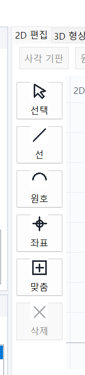
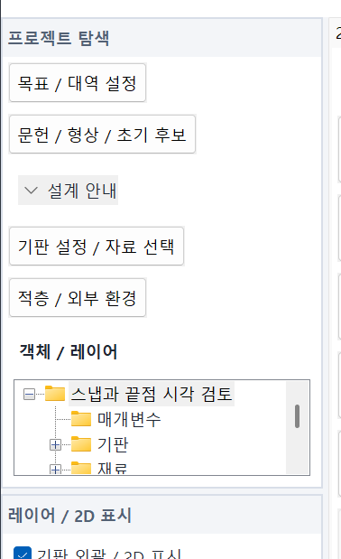

# Studio 사용성 검토와 접근성 수용 시나리오

검토 기준일: 2026-11-16 KST. 아래 UXA 표는 당시 화면/코드의 관찰과 수용 시나리오이며 해결 상태가 모두 미완료라는 현재 선언은 아니다. 2026-11-17에는 공통 배치/수평 도구/이름/검색/작은 창 탭/키보드 경로를 연결했다. 구현별 실제 수행과 남은 접근성 수용은 [단계 4 검증](../07_검증/08_스튜디오와_정밀편집_검증.md)을 따른다. 승인 기준선 RFAD-D0-3.4와 기존 개발 완료 계획의 번호를 유지한다.

## 검토 범위와 근거

사용자가 제공한 아래 두 부분 화면과 현재 작업 트리의 wxWidgets 코드를 대조했다. 부분 화면은 전체 창 너비, Windows 배율, 포커스 이동, 스크린리더 동작을 증명하지 않는다. 따라서 읽기 어려워 보이는 구성과 실제 접근성 실패를 구분한다. 이번 문서 작성은 새 GUI 실행 시험이나 성능 합격 기록이 아니다.

| 자료 | 확인할 수 있는 것 | 확인할 수 없는 것 |
| --- | --- | --- |
| [편집 도구 화면](01_그림자료/11_현재_도구영역.png) | 아이콘 위/문자 아래의 큰 버튼 6개, 생성/보기/삭제 도구의 동일한 시각적 무게, `좌표`와 `맞춤`의 짧은 이름 | 실제 포인터 표적 크기, 전체 창에서의 점유 비율, DPI별 읽기, 키보드/스크린리더 동작 |
| [프로젝트 탐색 화면](01_그림자료/12_현재_프로젝트탐색.png) | 위쪽의 긴 설정 버튼, 접힌 안내, 아래쪽 객체 트리의 짧은 표시 영역, 별도 레이어 패널 | 모든 객체의 이름, 펼친 안내 상태, 전체 프로젝트 탐색 시간 |
| [승인 화면 설계](01_화면과_사용자_경험_설계.md) | UI-01~24의 화면 계약, 키보드/IME/상태/선택 원칙 | 현재 제품의 구현 또는 수용 합격 |
| [승인 GUI/성능 설계](02_화면_선정과_성능_설계.md) | Windows 우선, DPI/도킹/접근성 검증 조건 | 이번 화면 변경의 성능 결과 |
| [기존 GUI 설계](08_스튜디오_화면계약.md), [화면 시안](09_스튜디오_화면시안.md) | 공통 토큰, Studio 작업 공간과 기술 구성 | 시안 전체 구현 완료 |

현재 코드는 이미 `FromDIP` 기반 크기, native 입력/트리/표, 고대비용 OS 색 경로, 필드별 이름/도움말, 오류 필드 이동을 갖고 있다. 이러한 기반을 재사용한다. 코드 경로가 존재한다는 사실은 100/150/200% DPI, IME, 보조 기술에서의 합격과 별개다. 진행 중인 스냅/끝점 변경도 전체 정밀 편집이나 접근성 완료로 올려 기록하지 않는다.

## 화면에서 먼저 고칠 점

| ID | 관찰 또는 코드 근거 | 사용자에게 생기는 부담 | 화면 설계와 수용 조건 | 연계 단계 |
| --- | --- | --- | --- | --- |
| UXA-01 | 편집 도구 화면. [drawing_rail.cpp](../../Code/ui/wxwidgets/drawing_rail.cpp)의 24 DIP 비트맵, 위 아이콘과 아래 문자, 최소 62 x 50 DIP 버튼 | 단순한 선/원호 선택에도 큰 세로 영역을 사용한다. 모든 버튼이 개별 카드처럼 보여 도구 묶음이 약하다. | 선택/생성 도구를 하나의 연속된 도구막대로 정리한다. 기본형은 아이콘+짧은 이름, 숙련자용 축약형은 선택 사항으로 둔다. 글자 크기를 줄여 공간을 확보하지 않는다. 좁은 창에서도 모든 명령을 메뉴/더 보기로 찾는다. | 4, 12 |
| UXA-02 | 같은 화면과 [studio_layout.cpp](../../Code/ui/wxwidgets/studio_layout.cpp)의 `선택/선/원호/좌표/맞춤/삭제` 나열 | `좌표`가 표시 방식인지 생성 명령인지, `맞춤`이 정렬인지 화면 확대인지 알기 어렵다. 삭제와 보기 명령이 그리기 모드처럼 보인다. | `좌표로 만들기`는 생성 메뉴, `전체 형상 맞춤`은 보기 도구, `삭제`는 선택 객체 동작으로 묶는다. 실행/토글/메뉴의 외형과 접근 가능한 상태를 구분한다. 도구 이름만 읽고 예상한 동작을 설명할 수 있는지 관찰한다. | 4 |
| UXA-03 | 프로젝트 탐색 화면과 [studio_layout.cpp](../../Code/ui/wxwidgets/studio_layout.cpp)의 설정 버튼 4개+안내+트리 | 설정을 마친 뒤에도 반복 설정 명령이 트리보다 먼저 보이고 객체 목록이 좁아진다. | 초기 프로젝트에는 중앙 시작 안내를 제공한다. 진행 중인 설계에서는 탐색 트리를 기본 주 콘텐츠로 두고 설정은 관련 노드의 열기 동작과 상단 설계 메뉴로 접근한다. 안내는 사용자가 다시 열 수 있어야 한다. | 4, 12 |
| UXA-04 | 같은 탐색 화면과 [studio_project.cpp](../../Code/ui/wxwidgets/studio_project.cpp)의 현재 분류 | `목표`, `문헌`, `기판`, `적층`, `형상`을 찾는 위치가 버튼과 트리에 나뉜다. | 목표, 기판/적층, 패턴, 급전, 재료, 환경, 실행/결과의 의미 있는 탐색 구조를 적용한다. 비슷한 경로도 동일 명령/초안으로 연결하며 중복 편집기를 만들지 않는다. 빈 그룹에는 가능한 다음 동작을 표시한다. | 4~7, 12 |
| UXA-05 | [_object_label](../../Code/src/rfad/application/editor.py)과 [canvas.py](../../Code/src/rfad/application/canvas.py)는 무명 형상에 종류+UUID 앞 8자를 사용한다. 첨부 탐색 화면에는 이 개별 행이 펼쳐져 있지 않다. | 사용자가 `원호 a1b2c3d4` 같은 식별자를 외워 도면/포트/문제 위치를 대응해야 한다. | `원호 1`, `급전선` 같은 표시 이름을 쓰고 사용자가 바꾼다. 트리, 속성, 포트 선택지, DRC, 2D/3D의 같은 객체는 같은 이름을 사용한다. 안정 UUID는 상세에서 복사할 수 있게 유지한다. 이름 정책과 이력/이전 프로젝트 호환은 별도 이름 계약을 따른다. | 4, 10, 12 |
| UXA-06 | [studio_project.cpp](../../Code/ui/wxwidgets/studio_project.cpp)의 트리 재구성과 선택 복원, 승인 UI-01/UI-05/UI-06 | 목록이 다시 채워질 때 펼침/스크롤/포커스가 바뀌면 연속 편집의 문맥을 잃는다. | 같은 개정에서 가능한 펼침/스크롤을 유지한다. 트리/2D/3D/속성/문제 이동은 안정 ID로 동기화하며 삭제된 선택만 해제한다. 이름 변경 뒤 선택이 다른 객체로 이동하지 않는지 확인한다. | 4, 12 |
| UXA-07 | [studio_workspace.cpp](../../Code/ui/wxwidgets/studio_workspace.cpp)의 레이어 선택은 활성 층, 체크는 2D 표시이며 tooltip에 의미가 있다. | 체크를 끄면 해석에서도 제외된다고 오해하거나 활성 층과 표시 층을 혼동할 수 있다. | `활성 층`과 `2D 표시`를 라벨/아이콘/상태로 구분한다. 해석 포함 여부는 별도 물리 설정으로 보인다. 숨긴 층의 객체를 선택하면 위치와 숨김 상태를 알리고 임의로 물리 포함을 바꾸지 않는다. | 4, 12 |
| UXA-08 | [workspace_bar.cpp](../../Code/ui/wxwidgets/workspace_bar.cpp)와 [studio_workspace.cpp](../../Code/ui/wxwidgets/studio_workspace.cpp)의 작업 탭/중앙 페이지 | 작업 탭과 중앙 페이지의 이름/선택 표시가 일치하지 않으면 현재 위치를 놓친다. | 상단은 설계/해석/결과/비교/출력의 단일 작업 위치를 보여준다. 중앙에는 해당 작업의 하위 보기만 둔다. 단순 탭 이동으로 실행/입력 확정/출력 생성이 발생하지 않는다. 비어 있는 결과에는 실행 또는 기존 결과 열기의 다음 행동을 표시한다. | 4~7, 10, 12 |
| UXA-09 | [editor_panel.cpp](../../Code/ui/wxwidgets/editor_panel.cpp)의 기본/상세, 필드 이름, 오류 스크롤/포커스 경로 | 좁은 속성 패널에서 값, 단위, 출처 상태를 따로 읽거나 오류 필드를 찾기 어렵다. | 이름/입력/단위는 같은 논리 행을 유지한다. `미정`, `출처 값`, `사용자 수정`, `초기 추정`은 텍스트로 구분한다. 출처 상세는 접되 출처가 있음을 요약한다. 오류에서 펼쳐진 상세와 해당 필드 포커스를 확인한다. | 4, 12 |
| UXA-10 | [studio_controls.cpp](../../Code/ui/wxwidgets/studio_controls.cpp)의 동작별 활성/비활성 제어, 첨부 화면의 회색 삭제 | 비활성 상태만 보여서는 선택 없음/미지원/서비스 연결 끊김 중 이유를 알기 어렵다. | 버튼 옆 문맥 안내 또는 선택 상세에 이유와 복구 동작을 표시한다. 비활성 위젯의 tooltip에만 이유를 두지 않는다. 실행할 수 없을 때도 명령 의미와 원인을 키보드로 확인할 수 있어야 한다. | 4, 12 |
| UXA-11 | [studio_theme.cpp](../../Code/ui/wxwidgets/studio_theme.cpp)의 고대비 색 분기, [drawing_rail.cpp](../../Code/ui/wxwidgets/drawing_rail.cpp)의 생성 시점 비트맵 | 공통 면 색과 아이콘/캔버스/선택 강조의 갱신 시점이 달라질 가능성이 있다. | 앱 실행 중 OS 고대비 변경과 DPI 이동을 확인한다. 아이콘/글자/포커스/선택/비활성 상태를 모두 검수한다. 레이어 색과 경고 색만으로 의미를 전달하지 않는다. 이 코드 검토만으로 실제 결함 또는 합격을 단정하지 않는다. | 4, 7, 12 |
| UXA-12 | [workspace_bar.cpp](../../Code/ui/wxwidgets/workspace_bar.cpp)의 `workspace.*`, [studio_layout.cpp](../../Code/ui/wxwidgets/studio_layout.cpp)의 `canvas.snap` 등 시험/내부 이름 | 보조 기술이 사용자 명령 대신 내부 이름을 노출할 가능성을 확인해야 한다. 현재 실제 낭독 결과는 미확인이다. | 자동화용 ID와 사람이 듣는 명령명/역할/상태를 분리한다. `저장`, `스냅, 켜짐`, `설계, 선택됨`처럼 현재 동작을 설명하는 이름을 실제 보조 기술에서 확인한다. | 4, 12 |
| UXA-13 | 승인 UI-01의 F6, Tab/Shift+Tab, 명령 찾기. 현재 코드의 native 위젯과 개별 포커스 이동 | 키보드가 캔버스나 도킹 패널에 머물거나 재조회가 포커스를 빼앗으면 작업을 이어가기 어렵다. | 패널 간 F6/Shift+F6, 패널 내부 Tab/Shift+Tab, 트리 방향키/Enter의 경로를 명시한다. 도구 전환과 대화상자 종료 뒤 호출 위치로 돌아온다. 현재 모든 경로의 구현/실제 검증을 가정하지 않는다. | 4, 12 |
| UXA-14 | 승인 UI-05, [design_canvas.cpp](../../Code/ui/wxwidgets/design_canvas.cpp)의 Esc 처리와 [studio_lifecycle.cpp](../../Code/ui/wxwidgets/studio_lifecycle.cpp)의 종료/취소 | 입력 취소와 해석 중단을 같은 의미로 처리하면 초안/작업을 잃을 수 있다. | Esc는 현재 드래그/생성/이름 편집을 취소한다. 해석 취소는 작업 상세의 명명된 명령으로 요청하고 실제 종료 확인까지 `취소 요청 중`을 유지한다. 저장/적용/닫기 동작은 화면 시나리오의 초안 정책을 따른다. | 4, 6, 12 |
| UXA-15 | 승인 UI-15/UI-16 및 현재 작업/결과 기본 화면 | `완료`가 형상 생성, 해석, 수렴, 실측 중 무엇의 완료인지 모호해질 수 있다. | 단계명+상태를 표시한다. `형상 생성 완료`, `해석 계산 완료`, `수렴 미검증`, `실측 미검증`을 구분하고 이전 설계 결과의 개정을 함께 표시한다. 제작/측정 미정값과 개별 RF 미확립을 숨기지 않는다. | 5~12 |
| UXA-16 | 승인 UI-01/UI-15/UI-21, 문제 목록의 활성화 이벤트와 오류 필드 이동 코드 | 문제 행에 위치/해결 행동이 없으면 로그를 읽고 원래 화면을 다시 찾아야 한다. | 문제 행은 상태, 사람이 읽는 객체 이름, 이유, `위치로 이동`을 제공한다. Enter로 같은 개정의 객체/필드를 선택한다. 오래된 검사에는 재검사를 제안하고 현재 설계로 억지 연결하지 않는다. | 4, 8, 10~12 |
| UXA-17 | 승인 UI-01과 현재 wxAUI 도킹 배치 | 모니터 이동/작은 화면에서 속성/명령이 잘리거나 접힌 패널을 찾지 못할 수 있다. | 작은 작업 영역은 속성/문제를 탭으로 접고 주요 명령을 overflow에 남긴다. `기본 배치 복원`으로 모든 필수 패널에 접근한다. 레이아웃 설정은 RF 원본과 별도로 저장한다. | 4, 12 |
| UXA-18 | 승인 UI-03/UI-08/UI-18 및 기존 프로젝트 출처 계약 | 친절한 예시값이나 초기 안내가 실제 제작값으로 저장되면 사용자의 판단 근거를 잃는다. | 설명용 placeholder와 저장값을 구분한다. 예시를 채택할 때 출처/가정/적용 범위를 명시한다. 저장/재열기 뒤에도 미정값과 사용자 수정 여부를 보존하고 검증 상태를 승격하지 않는다. | 4~12 |

## 구현 시안과의 연결

이 표의 개선 방향을 [구현 화면 기준](12_구현화면_설계기준.md)과 [전체 화면 둘러보기](16_전체화면_둘러보기.html)의 실제 컨트롤 배치로 구체화한다. 큰 세로 버튼과 탐색 위의 반복 설정 버튼은 줄이고, 객체 이름/단위/초안/다음 행동을 고정된 문맥에서 읽게 한다. 1920 x 1080 기본 보기와 1366 x 900 작은 보기 설계는 별개이며 작은 화면에서 글자를 일괄 축소하지 않는다. 그림의 키보드 포커스 표시와 고대비 설계만으로 아래 실제 수용 시험을 통과 처리하지 않는다.

## 밀도와 시각 위계의 적용안

아래 값은 화면 구현을 시작할 때의 내부 설계안이다. 승인된 성능 기준 또는 접근성 합격 수치로 해석하지 않는다. 글꼴과 OS 접근성 설정이 필요한 크기를 우선한다.

- 4 DIP 간격 단위와 8/12/16 DIP 그룹 여백은 기존 공통 테마를 재사용한다. 같은 역할의 버튼은 크기, 아이콘 선 굵기와 라벨 위치를 통일한다.
- 기본 도구는 32~36 DIP 높이의 가로형 아이콘+이름을 출발점으로 검토한다. 모든 도구를 아이콘만으로 줄이는 방식은 기본값으로 삼지 않는다. 실제 텍스트 최소 크기와 클릭 표적 검수가 우선이다.
- 왼쪽 탐색은 객체를 찾는 공간, 오른쪽 속성은 선택 객체의 값을 바꾸는 공간으로 둔다. `생성`, `보기`, `검사`, `실행`은 공간 또는 그룹 제목으로 구분한다.
- 장식 경계를 모든 버튼마다 추가하기보다 작업 그룹 사이의 여백과 제목으로 위계를 만든다. 선택됨은 배경색뿐 아니라 눌림 상태/표시선/접근 가능한 상태로 나타낸다.
- 도면의 도체/기판 색, 선택 강조, DRC 경고를 서로 구별한다. 밝은 색 배경 위의 작은 밝은 글자와 비활성 글자도 실제 화면에서 읽기를 확인한다.
- 긴 객체 이름은 말줄임하더라도 선택 속성과 키보드로 접근 가능한 상세에서 전체 이름을 읽고 복사할 수 있게 한다. 전체 이름을 tooltip에만 두지 않는다.

## 실제 Windows 수용 시나리오

아래 항목은 실행할 시험 계획이며 현재 모두 `대기`다. 이전 GUI 회귀의 통과 수를 아래 시나리오의 실행 결과로 옮기지 않는다. 시험 때 빌드/커밋, OS, 표시 배율, 작업 영역의 실제 크기, 입력 방법, 결과 증거를 함께 기록한다.

| 시험 ID | 절차 | 통과 조건 | 관련 문제 |
| --- | --- | --- | --- |
| UXA-T01 | 새 프로젝트에서 마우스로 안내를 따라 목표/기판/형상에 접근하고, 안내를 접은 뒤 트리에서 다시 연다. | 같은 편집기로 돌아오며 초안이 중복 생성되지 않는다. 트리가 목록 탐색의 주 영역이고 안내를 다시 열 수 있다. | UXA-03, 04, 08 |
| UXA-T02 | 키보드만으로 프로젝트 열기, 좌표로 원호 생성, 객체 선택/이름 변경, 저장, 재열기를 수행한다. | F6/Tab/방향키/Enter로 모든 동작에 접근하고 포커스가 보인다. IME 조합 중 Enter가 이름/물리 입력 적용으로 오인되지 않는다. | UXA-02, 05, 06, 13, 14 |
| UXA-T03 | 선택/선/원호 도구를 바꾸고 생성 중 Esc, 선택이 없는 삭제, 좌표 생성과 전체 보기 명령을 확인한다. | 현재 모드와 다음 입력이 읽히고 취소는 영구 명령을 만들지 않는다. 삭제 비활성 이유와 보기 동작을 구분한다. | UXA-01, 02, 10, 14 |
| UXA-T04 | 긴 한글 이름 객체 20개 이상을 트리에서 펼치고 선택/수정/새로고침/undo/redo한다. | 선택과 펼침/스크롤이 가능한 범위에서 유지된다. 같은 이름 정책이 트리/속성/포트/문제에 적용되고 참조는 UUID로 유지된다. | UXA-05, 06 |
| UXA-T05 | 100/150/200% 배율에서 창을 줄이고 확대하며 배율이 다른 모니터로 이동한다. | 주요 명령이 잘리거나 숫자/단위가 분리되지 않는다. overflow와 패널 탭으로 조작 가능하고 기본 배치 복원 후 화면 밖 패널이 없다. 시험하지 못한 조합은 제외 사유를 기록한다. | UXA-01, 09, 17 |
| UXA-T06 | OS 고대비를 앱 실행 전과 실행 중 각각 켜고 선택/포커스/비활성/오류/캔버스 핸들을 확인한다. | 글자와 아이콘을 식별하고 선택/포커스와 물리 색의 의미를 구별한다. 밝은/어두운 고대비 팔레트를 실제 사용 범위별로 기록한다. | UXA-07, 11 |
| UXA-T07 | Windows Narrator로 저장, 작업 탭, 스냅, 트리 객체, 입력 값/단위/오류, 작업 상태를 이동하며 읽는다. | 사람이 읽는 이름/역할/상태가 나오고 내부 `workspace.*` 식별자만 읽히지 않는다. 알림이 반복되어 편집 내용을 가리지 않으며 변경 상태에 접근할 수 있다. | UXA-09, 12, 13, 15 |
| UXA-T08 | 필수 물성을 미정으로 둔 상태에서 입력 검사, 오류 위치 이동, 상세 펼침과 필드 수정을 수행한다. | 상태와 수정할 필드가 함께 보이고 Enter로 이동한다. 미정값을 임의 채우지 않는다. 검사 이후 개정이 바뀌면 오래된 결과를 알려준다. | UXA-09, 15, 16, 18 |
| UXA-T09 | 층을 숨긴 뒤 활성 층/선택 객체를 바꾸고 2D/3D/문제 행을 오간다. | 표시와 해석 포함이 바뀌지 않는 경계를 이해할 수 있고 같은 객체를 가리킨다. 숨김과 이전 개정 3D를 명시한다. | UXA-06, 07, 15 |
| UXA-T10 | 실행 중 다른 작업 탭으로 이동하고 취소 요청, 연결 끊김, 재열기 경로를 시험한다. | 작업을 자동 재실행하지 않는다. 실제 종료가 확인될 때까지 취소 요청과 종료를 구분하고 이전 완료 결과를 보존한다. | UXA-08, 14, 15 |
| UXA-T11 | 사용자 수정값, 출처 사본, 실제 제작/측정 미정값이 있는 설계에서 이름/배치/표시만 바꾸고 저장/재열기한다. | 표시 편의 변경으로 물성/출처/미정 상태를 변경하거나 과거 결과의 검증 상태를 승격하지 않는다. | UXA-05, 07, 18 |

키보드/보조 기술 시험은 화면 캡처만으로 대체하지 않는다. 자동 GUI 시험은 반복 가능한 선택/명령/저장 검증에 사용하고, 실제 읽기 순서/IME/고대비/포커스/조작 의도는 관찰 기록을 남긴다. 작업 성공 여부, 사용자가 헤맨 위치, 도움말을 연 이유와 오해한 용어를 기록하되 실험하지 않은 사용성 시간이나 만족도를 만들지 않는다.

UXA-T02의 일부인 F6과 Shift+F6 이동은 실제 Windows Studio의 wx 키 바인딩에 이벤트를 전달하여 포커스를 확인했다. [패널 포커스 검증](../07_검증/137_키보드_패널이동_윈도우_검증.md)

2026-11-21에는 실제 키 입력과 Windows 접근성 트리에서도 탐색에서 속성으로 이동하는 흐름을 확인했다. 접근성 값 지정으로 넣은 한글 이름의 적용, Ctrl+S와 재열기가 통과했다. 결과 비교는 선과 점 모양 및 원본 설명을 함께 제공한다. 2D와 결과 그래프는 OS 고대비 색을 사용하도록 보강했다. 실제 Windows에서 밤하늘 대비 테마로 Studio를 열고 실행 중 일반 테마로 돌아오는 흐름을 확인했다. Studio를 열어 둔 채 밝은 사막 대비를 적용하고 되돌릴 때의 2D와 저장 결과도 확인했다. 긴 출력 근거, 탐색, 레이어 행과 그래프의 확인 범위를 기록했다. 기술 도면은 출력 작업 영역의 키보드 검토 후 Enter로 취소하고 Alt+G로 명시적으로 생성하는 흐름도 검증했다. 추가 화면 상태, 실제 IME 조합, 낭독과 서로 다른 모니터 배율 전환은 별도 검수가 필요하다. [대비 테마 검증](../07_검증/204_윈도우_대비테마와_가독성_검증.md), [기술 도면 키보드 검증](../07_검증/200_기술도면_키보드생성_검증.md) [키보드와 결과 표시 검증](../07_검증/152_키보드와_결과표시_접근성_검증.md)

F6 순환에 상단 작업 영역을 포함한다. 탐색에서 Shift+F6으로 현재 작업 버튼에 초점을 둔다. 상단에서 좌우 방향키는 작업 영역과 가운데 화면을 함께 바꾸며, Home은 설계, End는 출력으로 이동한다. 화면 전환이 끝나면 작업 버튼에 초점을 유지한다. [실제 Windows 전환](../07_검증/182_스튜디오_작업영역_키보드전환_검증.md)

기술 도면의 출력 확인 창은 취소를 초기 동작으로 사용한다. 생성 버튼 또는 Alt+G로 검토한 파일 생성을 확정한다. [실제 Windows 출력 시험](../07_검증/200_기술도면_키보드생성_검증.md)

## 개발 중 갱신 규칙

기능 구현 단위마다 해당 UXA와 화면 시나리오를 연결한다. `현재 관찰 -> 설계 -> 구현 -> 실제 검증`을 별도 상태로 유지하고, 구현이 끝난 항목은 근거 파일/시험/화면을 추가한다. 실패 또는 미검증 조건은 다음 검토에서 그대로 이어간다.

개발 완료 계획 4번에서는 탐색/이름/편집/선택을, 5~7번에서는 결과/연구/비교를, 8~11번에서는 검증/출력/측정을 해당 기능과 함께 갱신한다. 12번은 통합 수용 단계다. 사용성 기록을 12번까지 미루지 않으며, 이 표를 기존 개발 순서를 대체하는 새 우선순위 목록으로 사용하지 않는다. Linux GUI와 비평면 3차원 안테나 해석의 장기 로드맵도 현재 Windows PCB 화면의 구현 완료로 합치지 않는다.
