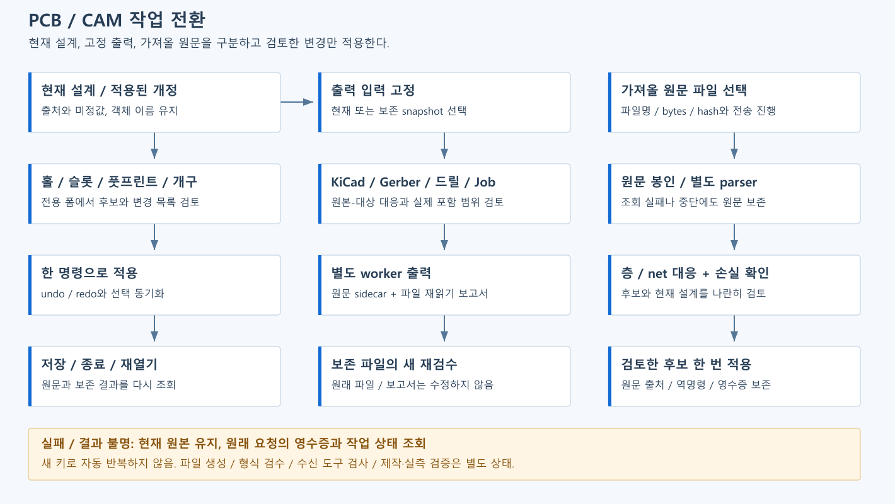

# 25. PCB/CAM 교환과 원문 수입 화면

작성일: 2026-11-17. 완료 계획 10번의 PCB 기계 원본과 교환 화면을 정의한다. [51 PCB/CAM](03_구현시안/51_기판_제조파일교환.png), [70 Gerber](03_구현시안/70_거버_교환.png), [71 드릴](03_구현시안/71_드릴_교환.png)의 공통 Studio 배치와 네 가지 형식 탭을 사용한다. 84장 시안은 변경하지 않고 현재 기능의 입력/상태/오류 계약을 별도로 추가한다.

기능과 유한 지원 범위는 [기판 형상과 제조 파일 교환](../05_기능설계/05_출력교환/05_기판형상과_제조파일_교환.md)을 따른다. 아래 흐름의 구현, 실제 GUI 확인과 전체 UX 수용은 서로 다른 상태다.

[편집 가능한 DrawIO](02_전환도원본/11_기판교환과_원문수입.drawio), [벡터 그림](01_그림자료/17_기판교환과_원문수입.svg).

## 1. 공통 화면과 기계 객체 편집

Studio의 프로젝트/레이어 탐색, 가운데 작업 탭, 오른쪽 속성, 아래 문제/작업/로그를 유지한다. 기본 명칭은 원호, 패드, 홀, 풋프린트 등 사람이 읽는 이름이며 안정 UUID는 상세 식별로 남긴다. 새 기능의 큰 버튼을 탐색 패널에 계속 쌓지 않는다.

기계 객체 편집은 종류별 목록과 전용 폼을 사용한다. 원형 홀, capsule 슬롯, 직선 내부 절삭, 마스크/페이스트 이미지 층과 개구, 풋프린트/금지 영역의 입력 항목을 구분한다. 선택/F2 또는 메뉴의 명시 동작에서 같은 폼으로 진입한다. 도체가 아닌 홀이나 개구를 도체층의 가짜 객체로 선택하지 않는다.

완성 전체 길이, 폭, 도금 두께와 실제 공구 지름은 별도의 라벨/단위/미정 상태를 가진다. 폼 전환으로 기존 출처를 지우거나 미정 입력에 0을 채우지 않는다. 검토 탭은 현재/후보 캔버스, 변경 필드와 이유를 표시한다. 적용은 한 번의 원자 명령이고 이후 undo/redo와 선택 동기화를 따른다.

## 2. 내보내기 네 탭

상단 `출력 > PCB / CAM`에서 KiCad/Gerber/드릴/Job 탭을 제공한다. 같은 snapshot과 같은 패키지에 대한 서로 다른 관점을 보여준다. 탭 이동만으로 다시 계산하거나 일부 층을 자동 내보내지 않는다.

| 영역 | 표시 내용과 동작 |
| --- | --- |
| 입력 | 보존 snapshot의 이름/개정/시각. 현재 미적용 초안과 구분 |
| KiCad | 보드 또는 선택한 풋프린트, 원본 층/객체와 대상 층, 포함/생략 의미 |
| Gerber | 실제 원본 층과 파일 역할/파일명, 선택한 표시 층의 기하 |
| 드릴 | 완성 홀/슬롯, 도금 분류, 명시 도금 두께와 실제 공구 미정 |
| Job | 패키지에 요구되는 원본 층/외곽/drill과 보존 원문/검수의 관계 |
| 오른쪽 조건 | 원점/단위, 원문 상태, 파일 검수/수신 검수/제조·실측 미확립 구분 |
| 하단 동작 | 내용 검토, 생성, 완료 기록 선택과 새 재검수. 불명 요청 복구 |

미리보기는 실제 서비스의 해석형 경계를 사용한다. 단순 장식 예시 안테나를 선택 프로젝트의 결과처럼 표시하지 않는다. 표시 층 변경은 내보낼 층 변경이 아니므로 출력 검토 hash와 별개다. 원본 층과 대상 파일명은 서비스가 제공하며 GUI에서 순서/단위/파일 규칙을 다시 계산하지 않는다.

단독 풋프린트의 그림은 해당 부품의 소유 객체만 표시하고 배치 원점/회전을 제거한 로컬 좌표를 사용한다. 기판과 다른 부품을 실제 출력 포함 대상으로 보이지 않는다. 하면이라는 이유로 추가 미러를 적용하지 않는다. 원래 배치/넷 의미와 원문 사본은 sidecar에 보존하며 파일 자체의 의미와 구분한다.

출력이 끝나면 실제 생성 형식과 파일별 검수 범위를 표시한다. KiCad의 실제 재열기/재채움 시험을 TraceWave parser 성공 배지와 같은 의미로 표시하지 않는다. 출력 성공 후 목록 조회가 실패하면 목록만 다시 읽고 출력을 중복 접수하지 않는다.

## 3. 가져오기 네 탭

가져오기는 현재 개정에 적용할 작업이므로 출력의 고정 snapshot 선택과 분리한다. 기존 작업 공간에서 모달 전용 도구로 열고 종료 후 원래 페이지/선택으로 돌아간다.

| 탭 | 사용자 동작과 서비스 결과 |
| --- | --- |
| 원문 파일 | 형식과 파일 선택, 파일명/bytes/전송 진행. 이전 전송을 파일명과 시각으로 다시 선택 |
| 층 / net 대응 | 서비스가 제공한 원문 대상과 현재 기판/층/net을 명시 대응. 미연결도 null을 명시 |
| 후보 / 손실 확인 | 현재/후보 기하와 변경 목록. 각 원문 보존 손실 항목을 개별 확인 |
| 보존 원문 | 파일 hash/크기, parser 적용 범위, 미정 물성/제작 조건과 원래 보고서 참조 |

정상 순서는 원문 선언, 청크 전송, 봉인/읽기, 명시 대응, 후보 검토, 적용이다. 업로드/읽기가 끝났다는 사실을 설계에 적용됐다는 상태로 표시하지 않는다. 원문 읽기와 적용은 기존 단일 출력 슬롯과 영수증 ledger를 사용한다.

새 원문 읽기에 실패하거나 미지원 형상이 발견돼도 현재 원본을 바꾸지 않는다. 원문 파일과 실패 이유를 보존하고 해당 항목을 자동 단순화하지 않는다. 원문에 없는 적층/유전율/도금/공구값을 GUI의 편의 기본값으로 채우지 않는다.

## 4. 복구, 수명과 접근성

| 상황 | 화면 동작 |
| --- | --- |
| 편집 개정 변경 | 기존 후보/적용 가능 상태 해제, 현재 개정과 대응을 다시 검토 |
| 전송 응답 불명 | 원래 요청을 보존하고 영수증 조회. 새 키로 같은 청크/접수를 반복하지 않음 |
| parser 실행/취소 | 하단 작업 상태와 원문 전송 상태를 구분. 종료 확인 전 완료로 표시하지 않음 |
| 적용 성공 후 화면 조회 실패 | 이미 적용한 사실을 유지하고 현재 원본을 다시 읽음. 중복 생성 차단 |
| 창 종료/프로젝트 전환/늦은 응답 | 수명/프로젝트/개정/요청 세대를 확인해 오래된 콜백 폐기 |
| 저장 후 runtime 없는 재열기 | 원본/수입 기록/보고서 조회는 유지. 새 parser/출력만 환경 부족으로 차단 |
| 좁은 창 | 표/폼을 스크롤하고 필수 동작과 진단을 읽을 수 있는 최소 크기 유지 |

폼은 키보드로 이동 가능하고 라벨과 단위를 나란히 표시한다. 색상에만 의존하지 않고 사용/미정/차단/미적용 상태를 글자로 나타낸다. 기본 화면에서 큰 JSON, UUID나 내부 소스 파일 경로를 사용자 이름 대신 쓰지 않는다. 상세 원문은 검토 목적의 별도 영역에 둔다.

## 5. 검증 경계

서비스 시험에는 바이트/출처 보존, 잘못된 hash/소유권/offset, 한 명령 적용과 역명령, 원문 컨테이너 부재 복원, runtime 없는 재열기를 포함한다. GUI 시험은 실제 Windows의 폼/선택/미리보기/표시 단위, 중복·불명 요청, 저장·재열기와 같은 원본 대조를 포함한다.

전체 DPI/스크린리더/다중 모니터/도킹 복구와 앱 전체 사용성·성능은 12번에서 이어간다. 이 화면의 기능이 연결됐다는 이유로 84개 전체 화면, 일반 EDA의 모든 형식/제조 공정, STEP 독립 kernel 또는 R1 전체 수용을 완료했다고 표시하지 않는다.
