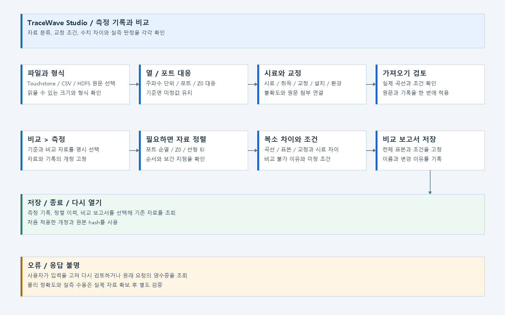

# 26. 측정 기록과 정렬 비교 화면

완료 계획 11번의 화면 계약이다. Studio의 상단 작업 탭, 왼쪽 자료와 기록 선택, 가운데 실제 결과 그래프, 오른쪽 조건과 판정, 아래 문제/작업/로그를 사용한다. 화면에는 선택한 자료의 곡선과 조건을 표시한다. 측정 데이터가 아직 없으면 다음 동작이 있는 빈 상태를 표시한다. [시안 47](03_구현시안/47_측정_비교.png)

[편집 가능한 DrawIO](02_전환도원본/12_측정기록과_정렬비교.drawio) / [벡터 그림](01_그림자료/18_측정기록과_정렬비교.svg)

## 1. 가져오기

| 탭 | 표시와 동작 |
| --- | --- |
| 파일과 형식 | Touchstone/CSV/HDF5를 선택하고 파일 이름/형식/입력 상태를 확인한다. [시안 46](03_구현시안/46_측정자료_가져오기.png) |
| 열 / 포트 대응 | 주파수 단위, 파 정의, Z0, 열과 포트를 명시한다. 원문에 없는 기준면은 미정으로 표시한다. [시안 66](03_구현시안/66_측정자료_열대응.png) |
| 시료와 교정 | 자료 분류, 시료/취득/교정/설치/환경과 불확도를 편집하고 명시한 근거를 연결한다. 주파수는 Hz/kHz/MHz/GHz 중 읽기 쉬운 단위를 제공한다. [시안 67](03_구현시안/67_시료와_교정.png) |
| 가져오기 검토 | 서비스가 읽은 복소 표본/조건/기록을 확인하고 사용자가 적용한다. 입력과 검토 결과가 달라지면 다시 검토한다. [시안 68](03_구현시안/68_측정자료_가져오기검토.png) |

별도 측정 기록 편집에서도 같은 폼을 사용한다. 설계 스냅샷과 첨부는 이름과 상태로 선택하며 내부 ID는 기록 조회의 상세 정보로 남긴다. 기록을 고치면 새 개정이 만들어지고 앞선 개정은 과거 비교 근거로 조회할 수 있다. 첨부의 보관과 기록에 연결하는 동작은 각각 명시한다.

## 2. 측정 비교

비교의 기준과 비교 자료에 각각 데이터와 선택적인 측정 기록을 지정한다. 같은 데이터에도 서로 다른 시료 기록 개정이 있을 수 있다. 조건 표에는 각 원문과 근거 상태를 보이며 두 자료가 모두 미정인 조건은 미정으로 표시한다. 공통 차트의 지표/주파수 표시를 재사용한다. 시료와 교정 차이 및 실측 판정은 복소 차이와 구분해 읽을 수 있도록 표시한다.

정렬 도구에서 적용할 연산과 순서를 선택하고 검토한다. 포트 순열, 명시 기준 임피던스, 선형 RI 보간이 현재 범위다. 새 자료의 보간 표본과 원래 표본을 출처로 구분하며 보관된 정렬 이력에서 입력과 계보를 조회할 수 있다. 외부 보정 이력은 사용자가 제출한 처리와 근거로 표시한다.

비교 보고서 저장은 선택한 원본과 기록 개정, 포트 대응, 조건과 표본 전체를 고정한다. 과거 이력 화면은 실제 저장된 표본과 조건을 페이지로 읽는다. 다시 열면 해당 기록이 처음 만들어진 개정으로 원본을 조회한다.

## 3. 입력 실패와 재열기

미적용 초안이 있는 상태에서 닫기나 다른 작업으로 이동하면 폐기 여부를 확인한다. 중복 적용을 막고 응답 불명에서는 원래 요청 영수증을 조회한다. 영수증이 만료됐거나 발견되지 않으면 현재 상태를 확인하는 안내를 제공한다. 저장과 다시 열기 뒤 현재와 과거 기록을 선택할 수 있다.

입력과 실행의 한도, 미정값, 정렬 및 물리 정확도 범위는 [측정 기록 계약](../05_기능설계/04_해석결과/09_측정기록과_정렬비교.md)을 따른다.
