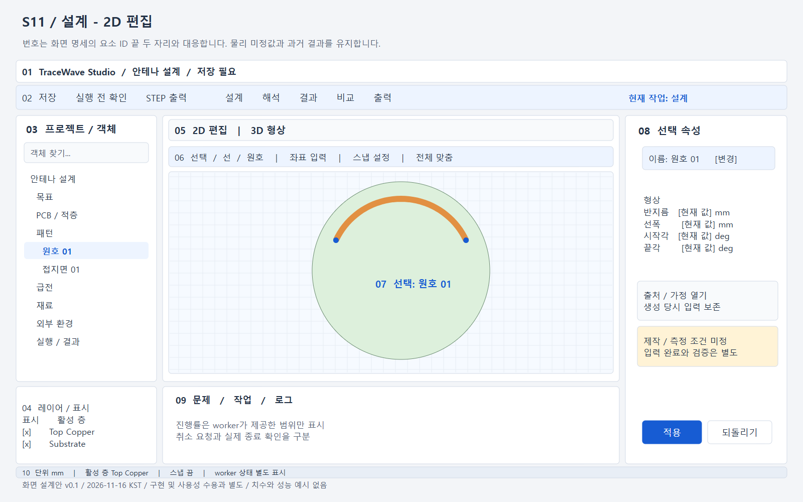

# Studio 화면 설계 문서

문서 묶음: TWS-SD-0.1. 작성일: 2026-11-16 KST. 대상: Windows 11의 내부 검증용 Studio.

이 폴더는 화면설계서, 화면 목록, 구성요소 명세, 이벤트와 화면 전환, 사용성 검토 및 편집 가능한 그림을 함께 관리한다. RFAD-D0-3.4를 구체화하는 개발 설계안이며 새로운 승인 기준선이나 GUI 구현 완료 기록이 아니다. 이미 구현한 동작과 제안한 동작은 각 문서에서 구분한다.

## 읽는 순서

| 문서 | 담는 내용 |
| --- | --- |
| [화면별 상세 설계서](03_화면별_상세설계.md) | 화면 ID, 목적, 그림 번호, 입력/출력, 버튼 이벤트, 활성 조건, 예외, 복귀 및 구현 단계 |
| [화면 전환 시나리오](04_화면전환_시나리오.md) | 현재 코드의 이동 방식, 목표 전환, 초안/선택/카메라/작업의 보존, 정상/취소/실패 시나리오 |
| [객체 이름과 선택](05_객체이름과_선택연동.md) | 사람이 읽는 자동 이름, 이름 변경, 안정 ID, 저장/재열기, 과거 출처 보존 및 선택 동기화 |
| [사용성 및 접근성 검토](06_사용성과_접근성.md) | 첨부 화면과 코드에서 확인한 문제, 개선 이유, 키보드/IME/DPI/고대비 검수 |
| [설계 변경 및 검수 기록](07_화면설계_갱신과_검수.md) | 문서/그림/코드/시험 동시 갱신 방법, 단계별 추적과 이번 문서 검수 범위 |

화면별 그림의 요소 `W01` 등은 배치 위치를, 전환 문서의 `C01` 등은 행동 묶음을 나타낸다. 이 번호를 wxWidgets control ID나 공개 API ID로 사용하지 않는다. 승인 문서의 `UI-01~24`와 기능 `FN-*`는 유지한다.

위 그림은 배치와 기능 명세를 위한 새 와이어프레임이다. 현재 앱 스크린샷이나 검증된 안테나가 아니다. 배치 설명에 실제 물성/주파수/성능의 기본값을 넣지 않았다.

## 그림과 DrawIO 원본

| 그림 | 편집 원본 | 벡터 / 이미지 |
| --- | --- | --- |
| Studio 전체 전환 | [DrawIO](02_전환도원본/01_스튜디오_전체전환.drawio) | [SVG](01_그림자료/01_스튜디오_전체전환.svg) / [PNG](01_그림자료/01_스튜디오_전체전환.png) |
| 초안, 적용, 저장, 재열기 | [DrawIO](02_전환도원본/02_편집초안과_저장흐름.drawio) | [SVG](01_그림자료/02_편집초안과_저장흐름.svg) / [PNG](01_그림자료/02_편집초안과_저장흐름.png) |
| 이름과 ID, 선택의 관계 | [DrawIO](02_전환도원본/03_객체이름과_식별자.drawio) | [SVG](01_그림자료/03_객체이름과_식별자.svg) / [PNG](01_그림자료/03_객체이름과_식별자.png) |
| S00 시작과 복구 | [DrawIO](02_전환도원본/04_시작과_복구.drawio) | [SVG](01_그림자료/04_시작과_복구.svg) / [PNG](01_그림자료/04_시작과_복구.png) |
| S11 설계와 2D 편집 | [DrawIO](02_전환도원본/05_설계와_이차원편집.drawio) | [SVG](01_그림자료/05_설계와_이차원편집.svg) / [PNG](01_그림자료/05_설계와_이차원편집.png) |
| S20 해석 준비 | [DrawIO](02_전환도원본/06_해석준비.drawio) | [SVG](01_그림자료/06_해석준비.svg) / [PNG](01_그림자료/06_해석준비.png) |
| S30 결과 | [DrawIO](02_전환도원본/07_결과조회.drawio) | [SVG](01_그림자료/07_결과조회.svg) / [PNG](01_그림자료/07_결과조회.png) |
| S40 비교 | [DrawIO](02_전환도원본/08_결과비교.drawio) | [SVG](01_그림자료/08_결과비교.svg) / [PNG](01_그림자료/08_결과비교.png) |
| S50 출력 | [DrawIO](02_전환도원본/09_출력과_검수.drawio) | [SVG](01_그림자료/09_출력과_검수.svg) / [PNG](01_그림자료/09_출력과_검수.png) |
| D10~D15 설정과 이름 변경 | [DrawIO](02_전환도원본/10_설정과_이름변경.drawio) | [SVG](01_그림자료/10_설정과_이름변경.svg) / [PNG](01_그림자료/10_설정과_이름변경.png) |

DrawIO는 각 상자/문자/선을 개별 셀로 편집할 수 있는 비압축 XML이다. 이미지 한 장을 붙여 넣은 파일이 아니다. [draw.io의 XML 편집 설명](https://www.drawio.com/docs/manual/advanced/diagram-source-edit/)과 [SVG 출력 설명](https://www.drawio.com/docs/manual/export/export-to-svg/)에 따라 편집/재출력할 수 있다. SVG에는 HTML foreignObject나 외부 폰트/이미지 의존성을 넣지 않았다.

문서 도구 [render_screen_design.py](../../Code/tools/documentation/render_screen_design.py)가 같은 도형 정의에서 DrawIO와 SVG를 만든다. 원본 도형을 코드로 갱신할 때 사용하며, DrawIO에서 수동 수정한 내용을 이 도구가 역으로 읽지는 않는다. 수동 편집을 채택하면 생성기에도 반영하거나 수동 관리로 명시적으로 전환한 뒤 그림을 재출력한다.

## 현재 화면 근거

사용자가 2026-11-16에 제공한 [도구 영역](01_그림자료/11_현재_도구영역.png)과 [프로젝트 탐색](01_그림자료/12_현재_프로젝트탐색.png)을 원본 크기로 보존했다. 이미지 파일명에 있는 시각은 사용자 파일 이름이며 자동 시험 시각으로 사용하지 않는다. 그림의 문구를 별도 개발 지시로 해석하지 않는다.

현재 GUI 구현 근거는 `2c88d26` 및 작업 트리에 남아 있는 스냅/끝점 변경이다. 문서 작성 중 제품 코드를 새로 변경하거나 실제 Windows 조작 시험을 추가로 수행하지 않았다. 화면 설계안, 정적 코드 검토, 과거 실행 증거와 이번 그림 검수를 구분한다.

기술 구성은 wxWidgets + wxAUI + 사용자 정의 2D DesignCanvas + wxGLCanvas/OpenGL ModelView다. Python 서비스가 원본/명령/단위/물리 판단을 소유한다. 장기 비평면 3차원 안테나 해석은 현재 3D CAD 보기 및 PCB 패턴 해석과 구분한다.

## 기존 설계의 현행 편집본

- [RFAD 05 - UI, UX 상세 명세](01_화면과_사용자_경험_설계.md)
- [GUI 선정과 성능 설계](02_화면_선정과_성능_설계.md)
