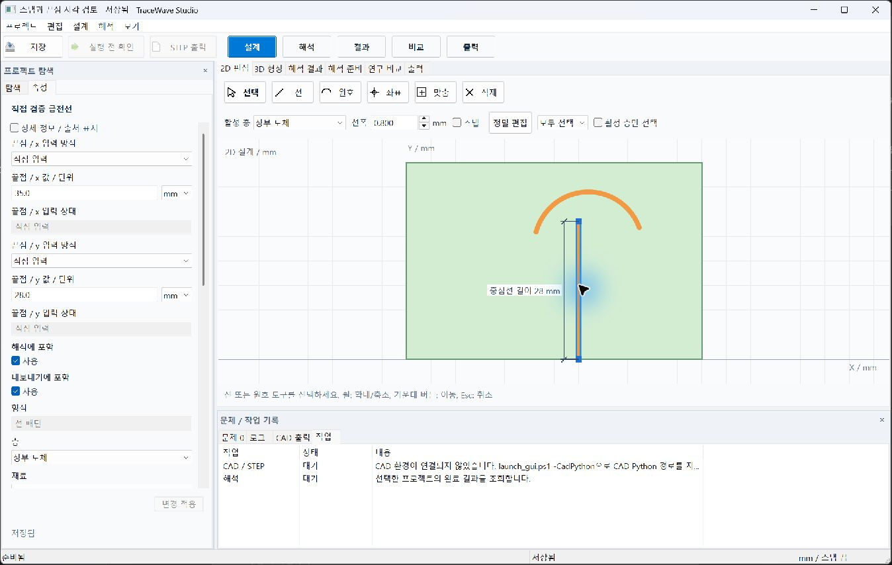
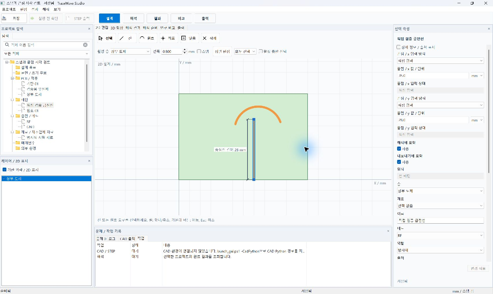
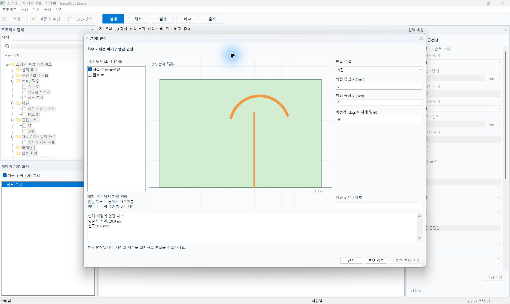
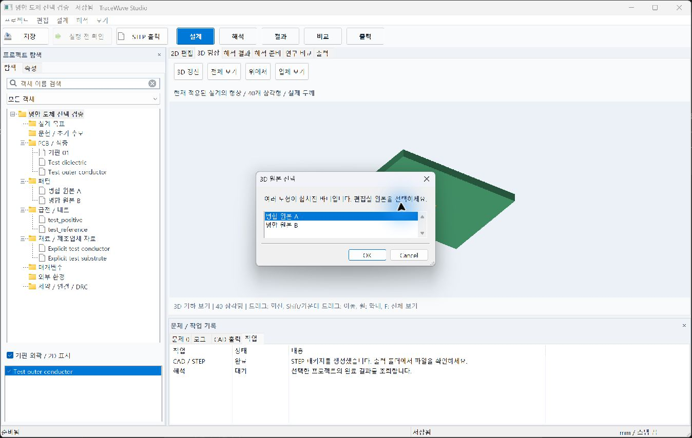
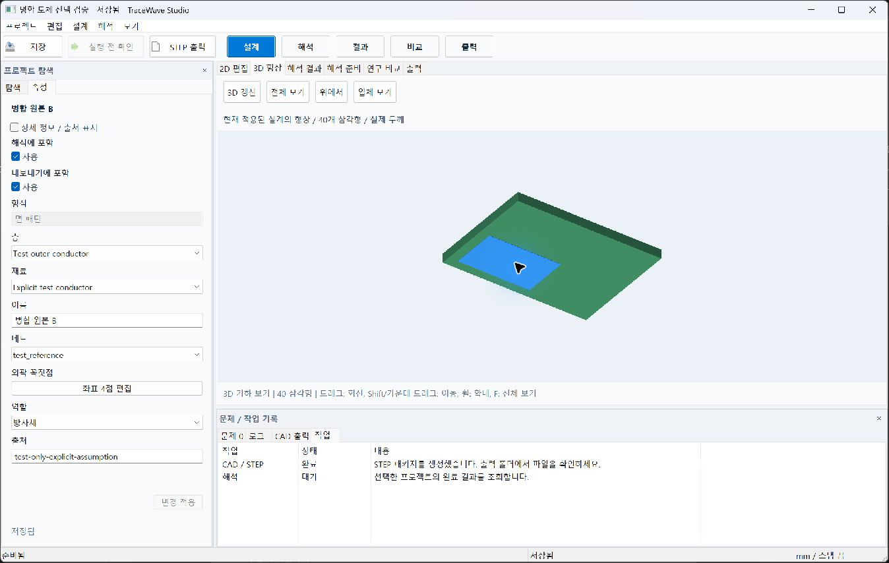
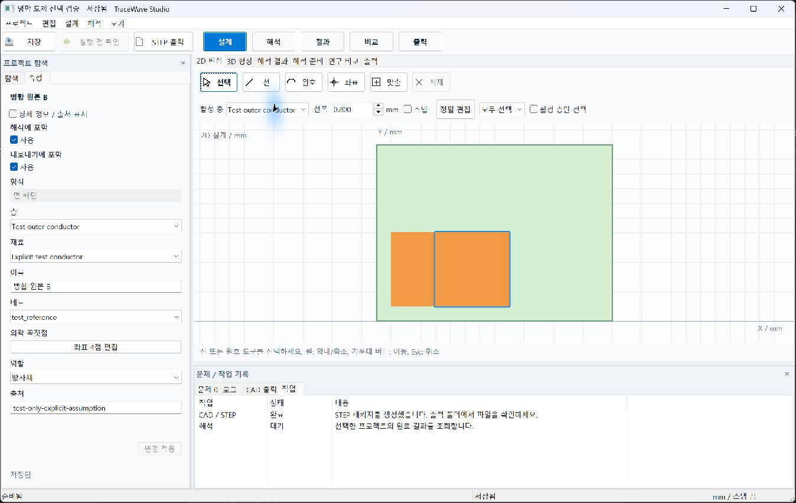

# Studio 공통 화면과 정밀 편집 검증

검증일: 2026-11-17 KST. 대상: `d0cfa79` 이후 완료 계획 4번의 공통 화면, 이름과 정밀 편집 변경.

## 범위와 현재 계약

84개 시안 가운데 S10/S11/S12/D15 및 작은 창 편집 배치와 연관된 기능을 실제 wxWidgets에 연결했다. 전체 84개 화면의 기능이나 전체 R1 수용 완료를 뜻하지 않는다. [정밀 편집 계약](../05_기능설계/02_설계편집/13_정밀편집과_평면연산.md), [이름 계약](../05_기능설계/02_설계편집/14_객체이름과_표시계약.md)과 [구현 화면 기준](../04_화면설계/12_구현화면_설계기준.md)을 따른다.

공통 작업 명령, 수평 도구, 이름 검색과 종류 필터, 작은 창의 탐색/속성 탭, F6/Shift+F6와 기본 배치 복원을 연결했다. 영속 이름은 UUID/출처/물리 역할과 분리한다. 과거 무명 객체의 읽기 이름을 조회만으로 원본에 저장하지 않는다.

정밀 편집은 현재 개정의 연관 치수, 명시 값/매개변수 결합, 회전/미러, 같은 층/넷/역할의 다각형 합집합/교집합/차집합/오프셋을 제공한다. 후보는 읽기 전용이며 검토 hash를 다시 검사하고 원본과 결과 사본을 한 명령으로 보존한다. 빈 결과/참조 파손/미정값/자원 상한 초과를 몰래 수정하지 않는다.

## 실행 기록

Windows 11, CPython 3.12의 저장소 `.venv`, wxWidgets Release와 별도 Python 서비스를 사용한다. 다각형 엔진은 고정한 Shapely 2.2.0/GEOS 3.14.1이다. 실제 GUI 프로세스의 이벤트 시험과 운영체제 직접 조작을 구분한다.

| 시점 / 검사 | 결과 |
| --- | --- |
| 첫 커밋 이후 종료된 기준 서비스 회귀 | 899개 수집, 804개 통과, 95개 환경 제외, 452.441초. `07_스냅과_끝점_검증.md`의 첫 커밋 당시 진행 중인 실행이며 새 정밀 편집 통과 수와 구분 |
| 공통 화면 첫 통합 빌드 | Release 빌드 성공 |
| 공통 화면 초기 GUI 회귀 | `test_gui_process.py` 7개 통과, 35.906초 |
| 정밀 서비스/실제 GEOS/stdio 집중 시험 | 26개 통과, 27.770초. 원자 명령/이력/없는 엔진/원문 사본과 봉인 hash 포함 |
| 첫 전체 서비스 회귀 | 922개 실행, 실패 2개/오류 1개/환경 제외 87개, 538.556초. 아래 세 원인을 수정한 뒤 다시 실행했으며 이 실행을 통과로 기록하지 않음 |
| 보완 후 정밀 집중 시험 | 30개 통과, 32.972초. 별도 실행의 전달 결과이며 원본 로그 파일은 수집하지 못함 |
| 보완 후 정밀 GUI 집중 시험 | `test_gui_precision_process.py` 2개 통과, 28.030초. 실제 창에서 이름/후보/다중 선택/평면 연산/이력/저장과 재시작 검사 |
| 최종 전체 서비스 회귀 | 939개 실행, 852개 통과, 87개 환경 제외, 555.691초. `Code/.local/studio-step4-service-final.log` |
| 최종 전체 GUI 회귀 | 25개 실행, 23개 통과, 실제 WSL 계산 2개 제외, 434.867초. `Code/.local/studio-step4-gui-final.log` |
| 최종 CTest | 9개 통과, 0.32초. 실제 실행 출력의 전체 시간과 `Code/build/windows-release/Testing/Temporary/LastTest.log`의 9개 성공 기록 대조 |
| 최종 요구 추적 감사 | 메타데이터/근거 갱신 후 14개 통과, 1.354초. 요구 141개, AC 404개, 세부 사례 407개, 기능 46개, VT 30개, 공개 API 30개 연결. 전체 수용 합격 선언은 0개 |
| 최종 문서 정합성 | 현재 Markdown 121개, 링크 7297개 검사, 깨진 링크 0개. 승인 원문 27개 hash 유지, 문서 폴더 27개/번호 파일 432개, 구조 그림 10개 검사 |

첫 전체 회귀의 오류는 감사가 참조한 이 문서가 아직 작성되지 않은 시점에 실행된 경우였다. 실패 2개는 capabilities 조회에서 선택 평면 엔진의 NumPy를 즉시 불러온 문제와 과거 schema 시험이 새 읽기 대상 0.4를 거절해야 한다고 가정한 문제였다. 근거 문서를 추가하고 선택 엔진을 필요한 연산 때만 불러오도록 바꿨다. 호환 시험은 0.3/0.4의 목표 의미를 보존하여 읽고 미래 0.6을 거절하도록 수정했다. 오류 기록을 지우거나 성공으로 바꾸지 않고 최종 전체 재실행과 분리한다.

서비스 회귀의 환경 제외에는 격리 CAD/native solver/실제 GUI/WSL/Linux 전용 조건이 포함된다. 최종 GUI 회귀는 Windows Release 실행 파일과 별도 CAD 환경을 연결했으며 실제 CAD 시험도 포함한다. 별도 GUI 실행의 통과 수를 서비스 회귀 통과 수에 더해 하나의 총계로 만들지 않는다. GUI에서 제외한 두 시험은 실제 openEMS 계산/방사 결과이며 이번 변경으로 새 FDTD나 실물 측정을 수행한 것은 아니다.

집계, 기준 커밋, 조건과 확보한 로그의 SHA256은 [기계 판독 실행 기록](09_스튜디오와_정밀편집_실행기록.json)에 보존한다. 기준은 `d0cfa79a361ca396467e6d3c79c98c1a6e6e8ab2` 이후 작업 트리이며 최종 게시 커밋의 hash로 앞선 실행을 소급 표시하지 않는다. `.local` 로그와 빌드 산출물은 개발 환경의 비추적 파일이며 기록 JSON에 전체 로그를 포함한 것은 아니다.

## Windows 직접 조작과 보존 확인

최종 실행 파일의 실제 Windows 창에서 캔버스 선택 직후 F2 이름 창을 열고 취소했다. 작은 창의 1348 x 854 캡처에서는 속성의 mm 단위가 잘리지 않고 수직 28 mm 치수가 도형에서 떨어져 표시되는 것을 확인했다. 1707 x 1019 캡처에서는 왼쪽 탐색/레이어와 오른쪽 속성의 넓은 배치를 확인했다. 정밀 편집 창에서 현재 28 mm 길이와 0.5 mm 폭, 배치 후 현재 형상 맞춤도 확인했다. 이 캡처 크기는 현재 검증 환경의 픽셀 수이며 모든 해상도/DPI의 지원 보장은 아니다. 아래 이미지는 실제 실행 화면이며 84개 설계 시안의 그림과 구분한다.

별도 시험 workspace에서 한글 이름 변경, 중심 (30, 20) mm의 90 deg 회전과 GUI 저장을 직접 수행했다. 독립 서비스로 다시 열어 `Code/.local/studio-step4-manual.json`의 15개 대조 항목을 확인했다. 기판/적층/재료/포트/목표/매개변수/네트/제조 규칙/연결, 안정 ID, 한글 이름, 비선택 도형, 선 수량의 출처, 회전 당시 원본 사본과 기존 확장이 보존되었다. 이 확인은 대상 시험 프로젝트의 저장/재열기 범위이며 임의 프로젝트 전체나 실제 제작 조건의 확정을 뜻하지 않는다.

수동 fixture의 선 좌표 `source_refs`는 빈 목록이었다. 비어 있지 않은 출처와 제작 Df 등 미정 상태의 보존은 `test_gui_precision_process.py`와 `test_precision_service.py`의 별도 fixture 검사로 구분한다. 이 시험들은 명시 출처가 있는 매개변수/좌표와 미정 물성을 사용하며 현재 값, 원본 사본과 저장 후 결과를 대조한다.

별도 `.local/studio-step4-merged` workspace에서는 같은 net의 사각 도체 두 개를 실제 OCCT로 병합 출력한 뒤 새 GUI에서 다시 열었다. 현재 개정의 총 40개 표시 삼각형을 읽은 3D 뷰에서 병합 도체를 클릭하면 원본 A/B 선택 창이 열렸다. B를 선택한 뒤 속성 탭의 B 이름과 파란색 3D 도체, 2D로 전환한 뒤 오른쪽 원본 B의 테두리, 탐색 탭의 B 선택이 일치했다. 병합 표시 바디 하나를 원본 객체 하나라고 추측하지 않고 사용자에게 실제 원본 후보를 제공하는 경로를 확인했다.

수동 저장/재열기 시험의 15개 결과, 병합 CAD 생성 manifest와 여섯 실행 화면의 SHA256도 기계 판독 기록에 포함한다. 병합 도체의 선택 확인은 실제 생성 형상의 표시/선택 경로이며 독립 STEP 수신 CAD 검수나 RF 해석 정확도 검증은 아니다.

## 검토와 보완

정밀 창의 초기 배율을 위젯 배치가 끝난 뒤 계산하도록 바꿨다. 선택 객체가 바뀐 동안 이전 치수가 남지 않도록 개정/객체 ID를 확인한다. 작은 창의 속성 탭 전환 후 캔버스 초점을 유지하고, 좁은 속성 폼은 라벨 위/값과 단위 아래로 배치한다. 현재 개정과 다른 3D mesh의 클릭은 기존 원본 선택을 유지한다.

## 수용 경계

일반 편집 60 fps/대형 장면 30 fps, 모든 DPI/IME/스크린리더/다중 모니터와 배치 영속화의 수용은 완료 계획 12번에 남는다. 일반 기하 구속 솔버는 R2, 기술 도면 출력은 10번이다. 승인 원문과 과거 실행 기록은 수정하지 않는다. 참고자료 내부 파일은 변경하지 않는다.

제작/급전 실장/시료/교정/측정 조건은 자료 확보 전까지 미정이다. RO4350B 국부 도체 손실 변화 2.788446%의 초기 2% 기준 미확립과 GHz PTH 독립 정확도 미확립을 유지한다. 이 편집 검증은 RF/제조/실측 정확도 검증이 아니다.
