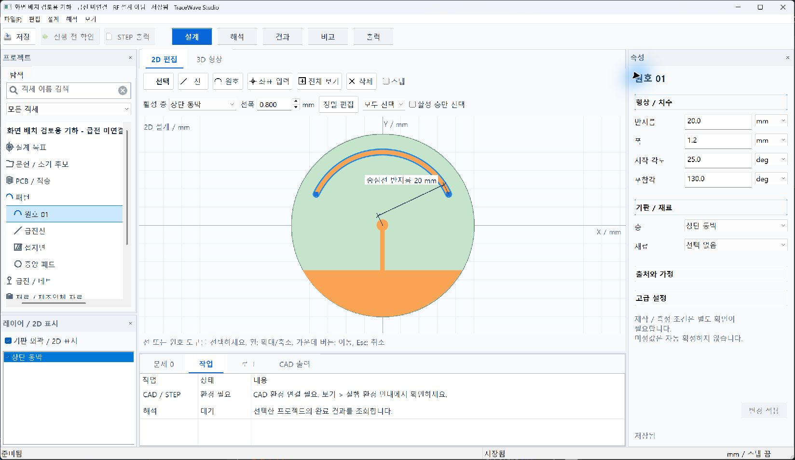
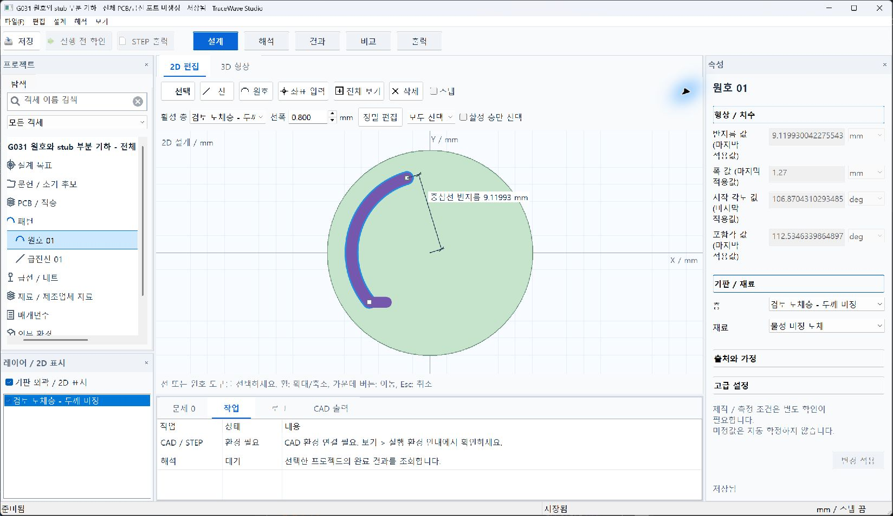

# 화면 시안의 공통 외형 반영 검증

검증일: 2026-11-17 KST. 대상: `4abd952e19a9f46e9c9b1610fecc61290c7d78a9` 이후 공통 Windows GUI 외형 변경. 이 기록은 [앞선 정밀 편집 검증](08_스튜디오와_정밀편집_검증.md)을 수정하거나 대체하지 않는다.

## 시안과 구현의 대조

[구현 화면 설계 기준](../04_화면설계/12_구현화면_설계기준.md)의 글자 크기, 간격, 탐색/캔버스/속성 비율과 [2D 편집 시안](../04_화면설계/03_구현시안/04_이차원_설계.png)을 실제 wxWidgets 표시 계층에 반영했다. 이 변경은 공통 외형의 첫 교정이며 84개 시안 전체 구현이나 모든 UX 수용 완료를 의미하지 않는다.

| 항목 | 실제 구현 |
| --- | --- |
| 글자와 조작 크기 | 시스템 GUI 글꼴을 유지하며 본문 최소 11 pt, 더 큰 시스템 글꼴 우선. 도구 높이 최소 36 DIP, 작업 하위 탭 최소 40 DIP |
| 공간 배치 | 넓은 창의 탐색 280 DIP/속성 342 DIP 기본 폭, 하단 작업 192 DIP. 시작 창은 작업 영역을 넘지 않는 1660 x 960 DIP 선호 크기. 기존 작은 창 탐색/속성 전환 유지 |
| 작업 전환 | 상단 설계/해석/결과/비교/출력 구분 유지. 설계에서 2D/3D만 보이도록 하위 탭 그룹 분리. 기존 페이지 객체와 논리 번호를 유지하여 전환 중 입력/GL 상태를 버리지 않음 |
| 탐색 | 34 DIP 행 높이, 객체 이름과 종류 아이콘, 검색/필터/선택 연결 유지. 첫 장면 조회 전 도형은 공통 패턴 아이콘이며 이후 선택 갱신부터 종류별 표시 |
| 속성 | 형상/치수, 기판/재료, 출처와 가정, 고급 설정으로 구분. 원호 중심/이름/네트/역할/포함 플래그와 입력 방식은 고급 설정에 접고 기본 치수/층/재료와 제작/측정 확인 안내를 노출. 원호 sweep_angle은 포함각으로 표시. 원래 서비스 필드와 출처/상태를 제거하지 않음 |
| 표시와 작업 상태 | 시안의 밝은 배경/청색 선택/연녹색 기판/동박 표시색 적용. 작업 표 행 높이 확대. 하단은 문제/작업/로그/CAD 출력 순서로 표시하며 기존 논리 번호 유지 |

탭의 그림은 작은 `wxAuiTabArt` 구현으로 그리며 실제 탭 입력과 초점은 `wxAuiNotebook`이 담당한다. 입력, 콤보, 트리, 표는 native wxWidgets 컨트롤이다. 서비스 단위 환산, 수량 계산, 명령과 원본 저장 동작은 이 외형 변경의 대상이 아니다. 속성 그룹을 접어도 초안을 삭제하거나 변경 목록에서 제외하지 않는다.

## 실행과 결과

Windows Release 실행 파일과 저장소 `.venv`의 Python 서비스로 확인했다. 시점은 2026-11-17 02:34~02:51 KST이며 최종 게시 커밋 이전 작업 트리에서 실행했다. 같은 작업 트리에는 완료 계획 5번의 Python 서비스 개발 변경도 있었으므로 실행 환경을 순수한 이전 커밋이라고 표시하지 않는다. 아래 GUI 검사는 기존 편집/프로토콜/정밀 편집 경로이고 새 네트워크 기능 수용 시험은 아니다.

| 검사 | 결과 |
| --- | --- |
| `cmake --build --preset windows-release --parallel 8` | 성공. 공통 탭의 마지막 수명/표시 순서 보완 후 전체 의존 재빌드 |
| `ctest --preset windows-release` | 9개 통과, 1.36초 |
| 속성 상세 재분류 전 GUI 회귀 | 9개 통과, 68.272초. 기존 출력 이름의 실행 파일 사용 |
| 속성 상세 재분류 후 최종 GUI 회귀 | `.venv/Scripts/python.exe -m unittest test_gui_process test_gui_precision_process -v`, 9개 통과, 83.430초. `RFAD_GUI_EXE`는 아래 별도 이름 실행 파일, `PYTHONPATH=src;tests` |
| `git diff --check -- Code/CMakeLists.txt Code/ui/wxwidgets` | 공백 오류 없음 |
| 실제 Windows 창 직접 조작 | 원형 기판 프로젝트 재열기, 트리에서 원호 선택, 읽을 수 있는 이름/단위/치수와 선택 강조, 전체 보기, 하단 작업 상태 확인 |

GUI 회귀에는 실제 서비스와 저장/재시작, 오류/미정/원본 출처 보존, 이름/정밀 편집/평면 연산의 기존 검사가 포함된다. 이번에 작업 전환 후 동일한 페이지 객체 유지, 최소 글꼴과 보이는 하위 탭 수, 속성 그룹 접기 전후 변경 목록 동일성 검사를 추가했다. CTest와 GUI 시험을 합산해 서비스 전체 회귀 수로 표시하지 않는다. 전체 서비스 회귀나 실제 WSL 계산을 이 외형 교정에서 새로 실행한 것은 아니다.

사용자가 앞선 창을 확인 중이어서 종료하거나 기존 실행 파일을 덮어쓰지 않았다. 최종 보완은 CMake가 생성한 기존 `build.ninja`를 포함하는 비추적 `visual-review.ninja`에 동일 GUI link rule을 복사하고 출력 이름만 `tracewave_gui_visual.exe`로 바꾸어 빌드했다. `ninja -C build/windows-release -f visual-review.ninja -j 8 bin/tracewave_gui_visual.exe`가 성공했고 재실행 시 추가 빌드가 없음을 확인했다. 빌드 설정/소스/정적 wx 라이브러리는 같으며 제품의 CMake 출력 규칙은 변경하지 않았다.

| 산출물 | SHA256 |
| --- | --- |
| `Code/build/windows-release/bin/tracewave_gui.exe` | `94aa337113fb50f8a0055bb040aeb75dca42e02c983d2b7bf081f3502ce2b39e` |
| `Code/build/windows-release/bin/tracewave_gui_visual.exe` (최종) | `a5c252848015ed2db57e4c6cf20a4668b7e3ecede424c4a58133637ae906defd` |
| `Code/.local/studio-visual-shell-gui.log` | `091a7df2ec6140e1638d34db471f03cf4c6a8424b5e24e89d9a1f053927e5e8b` |
| `Code/.local/studio-visual-shell-ctest.log` | `0053afacc8bbe4c145afe24e4fb238cb320dae2170d25bd5840a900797c2bde1` |
| `Code/.local/studio-visual-shell-review-gui.log` (최종) | `b65a0df8a6afc1110b13569030a092602007f8c5cf9e64c72531e4b34c22a322` |
| [실제 공통 화면](02_실행화면/07_시안반영_공통화면.jpg) | `896599534284c7caf52e7468e095758a8b73876c986f10319d74ef93836ccc0a` |
| [G031 부분 기하의 실제 속성](02_실행화면/08_문헌카드_부분기하_속성.jpg) | `a8ee358cb34a077e4ea659d39d6d0c725fef8683137791d24bb1da1fa7dbbbe4` |

빌드와 `.local` 로그는 개발 환경의 비추적 파일이다. 실행 파일을 변경한 후 위 hash를 새 실행에 그대로 사용하지 않는다.

위 최종 GUI 검사와 캡처 후 공통 C++ 파일에 저장소 `.clang-format`을 적용했다. 이 마지막 편집은 공백/줄바꿈/정렬을 맞추는 포맷이며 기능 변경을 추가하지 않았다. 위 실행 파일 hash는 포맷 전 검증에 사용한 바이너리의 hash로 유지한다.

## 실제 화면과 미확립 범위

아래 화면은 명시적으로 만든 화면 배치 검토용 기하이다. 위쪽 원호는 중앙 선/패드 및 아래 면과 연결되지 않았다. 실제 nRF51822 비콘이나 G031 안테나의 재현, 완성된 급전 또는 RF 설계가 아니다. 제목과 프로젝트 설명에도 이 제한을 표시한다.

실제 캡처는 1648 x 954 픽셀이다. 반지름 25 mm 원형 기판과 반지름 20 mm/폭 1.2 mm 원호 등 명시 기하를 만든 별도 시험 프로젝트다. 원문 시안 파일에서 데이터를 추출하거나 실제 안테나를 재현했다고 표시하지 않는다. 재료/네트 등 선택하지 않은 조건은 선택 없음으로 유지하고 임의 물성을 넣지 않았다. 해석과 CAD 작업의 미연결 상태도 화면에서 그대로 표시한다.

별도 `Code/.local/g031-partial-gui-20261117-60e7f6a4` 프로젝트에서는 기존 G031 문헌 카드로 만든 원호/stub 부분 기하를 새 실행 파일로 열었다. 원호 선택 시 반지름 9.11993 mm와 폭 1.27 mm의 마지막 적용값, 매개변수 결합에 따른 읽기 전용 입력, 물성/두께 미정 표시를 확인했다. 이 프로젝트의 반지름 12 mm 검토용 기판은 원문 전체 PCB 외곽 재현이 아니며 전체 PCB/급전 포트를 생성하지 않았다. 도형 이름 `급전선 01`은 stub 도형의 이름으로, 포트 생성이나 RF 급전 검증 완료를 뜻하지 않는다.

캡처는 도구가 반환한 JPEG 원본이며 글자/형상 보정을 하지 않았다. 작은 글자의 일부 획이 얇게 보이는 현상은 native 제목 표시줄에도 있으므로 이 손실 압축 이미지만으로 앱 글꼴 결함이나 전체 가독성 합격을 확정하지 않는다.

운영체제 메뉴와 native 컨트롤 외형, 현재 기능의 추가 도구 행은 시안과 픽셀 단위로 동일하지 않다. 3D 소형 동시 보기나 아직 연결되지 않은 후속 화면을 그림으로 덮어 구현된 것처럼 보이지 않는다. 모든 DPI/고대비/스크린리더/IME/다중 모니터/배치 영속화와 전체 성능 수용은 남아 있다. 실제 제작/급전 실장/시료/교정/측정 조건은 자료 확보 전까지 미정이며 새 RF/FDTD/실측 검증은 수행하지 않았다.

기본 작업 표의 CAD 상태는 짧은 연결 필요 안내로 표시하고 개발 실행 경로/옵션은 보기 > 실행 환경 안내로 옮겼다. 이 안내 창은 구성 상태와 현재 개발판 실행 절차를 설명하며 실행 환경을 변경하는 설정 기능이 구현됐다는 뜻은 아니다.
