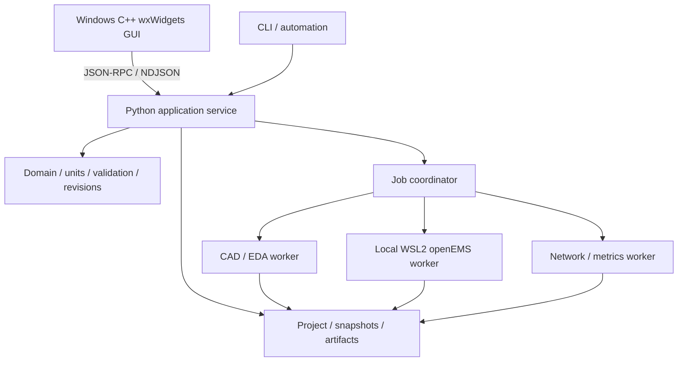

# TraceWave Studio 개발 영역

2026-11-07 사용자의 개발 착수 지시에 따라 제품 개발을 시작했다. GUI를 포함한 제품 소스, 빌드 설정과 시험은 이 `Code` 아래에서 관리한다. 승인된 설계 기준선은 `RFAD-D0-3.4`, 승인 커밋은 `6ebeda156e9d31b893bf69046550f5df9b16dc64`다. `01_Docs`의 착수 전 표기는 그 기준선 승인 당시 기록이며 현재 진행 상태는 [개발 상태](docs/development_status.md)에서 관리한다.

구현 파일별 책임과 상태 처리 규칙은 [코드 구조](docs/code_structure.md)에 정리했다. GUI의 표시/입력 정책과 비동기 상태, 프로젝트 저장/이력과 worker 산출물 처리를 별도 모듈로 관리한다.

[개별 손실 정밀도와 PTH 분할](docs/pcb_loss_precision.md)은 유전체/평면 도체/비아의 전류 기여율과 중복 없는 합계, 격자/임계 구간/종료/곡선의 독립 연구를 제공한다. 연구 GUI는 개별 손실 기준과 별도 비아 전력을 표시하며 실제 제작/측정 미정값을 유지한다.

[RO4350B 후속 손실 연구](docs/ro4350b_loss_refinement.md)는 초기 2% 기준을 유지하며 격자/국부 세분화를 다시 검사한다. 기본 실행 예산을 유지하는 명시적 확장 profile과 단일 Box 재료 분할 가속을 제공하고 원시 필드 생산자와 후속 계산기 출처를 구분한다.

수집한 PCB 물성/적층 자료는 [카탈로그 조회 계약](docs/pcb_catalog_contract.md)에 따라 오프라인 SQLite로 변환하고 업체/제품/적층/물성 조건별로 검색한다. [PCB 선택과 적층 적용](docs/pcb_selection_contract.md)은 프로젝트 소유 출처 사본, 개별 물성 선택/사용자 수정값, 업체별 적층 초안과 원자적 적용 API를 제공한다. 기존 직접 입력과 wxWidgets 제조업체 검색/선택/적층 미리보기를 지원한다.

제조업체와 적층을 선택하면 해당 층의 두께와 Dk/Df를 함께 제안한다. 같은 적층과 원문 층의 관측만 연결하고 공개값, 미정, 후보 충돌과 근사 입력 필요를 구분한다. [GUI의 제안 사용](docs/pcb_selection_gui.md)은 기존 입력을 보존하며, 페이지를 나누어 확인한 제안을 명시적으로 재료 초안에 추가한다. 제안값은 실제 납품 물성이나 해석 대역의 보증값이 아니다.

[JLC 제작 후보와 탐색 모델](docs/jlc_manufacturing_selection.md)은 RO4350B 2층의 공식 자료, 미정 납품 물성과 별도 근사 입력을 구분한다. 출처 기반 탐색 모델의 CAD/STEP/openEMS/결과 재열기를 검증했으며 제조 및 측정 정확도는 후속이다. [재료 손실 모델](docs/material_loss_models.md)은 총 Df와 독립 전도도의 중복 가산을 방지하는 명시적 모델 선택을 설명한다.

## 시스템 구성

앞으로의 전체 작업 순서와 단계별 완료 조건은 [개발 완료 계획](docs/completion_plan.md)을 따른다. 기존 7/8단계 권장 목록을 대체하며, 재부팅 뒤 환경 확인과 실행 명령은 [재부팅 후 개발 재개](docs/reboot_resume.md)에 정리했다.

2번의 [승인 요구/구현 대조](docs/implementation_audit.md)와 [공통 계약](docs/shared_contracts.md), [Studio GUI 설계](docs/studio_gui_design.md)를 정리했다. 요구/AC 연결은 실제 수용 합격과 구분하며 기능별 코드/시험/누락 범위를 추적한다.

3번의 첫 구현으로 [사용자 목표 입력](docs/target_contract.md)을 추가했다. 목표 대역/주파수 표본/port/Z0와 명시적 지표 한계를 저장하고 재열기/undo/redo를 제공한다. 쓰기는 프로젝트 0.3이며 기존 0.1/0.2 원본과 snapshot은 보존한다. 목표 저장은 solver 설정 변경이나 성능 평가가 아니다. GUI에는 공통 라이트 스타일과 도구 줄바꿈을 적용했다. 이어 [다중 목표 편집과 원호/IFA 템플릿 화면](docs/target_template_gui.md)을 연결했으며 [템플릿 계약](docs/template_contract.md)에 따라 명시 치수를 2D 미리보기 후 한 명령으로 적용한다. 출처와 최초 입력을 보존하고 기존 직접 편집/undo/redo를 유지한다. 목표 주파수 기반 자동 합성과 물리 성능 평가는 후속이다.

목표 화면 배치와 구현 범위를 구분한 [완성형 UI 시안](docs/ui_concept.md)도 함께 관리한다.



위 그림은 승인된 목표 구조다. 현재 환경 진단, 단위/미정값, 제한 표현식과 의존 그래프, 기판/적층/재료/선/원호/net/단일 포트 데이터, 목적별 입력 검사, 프로젝트 명령/저장/불변 스냅샷을 구현했다. wxWidgets GUI에서 매개변수/표현식과 설계 속성을 편집하고 사각/원형 기판, 미정 도체층/유전체층, 선/원호, 재료/net/단일 포트를 생성한다. 중앙 2D 캔버스의 선택/이동/삭제도 같은 서비스 명령과 영속 undo/redo를 사용한다. GUI의 STEP 출력과 3D 갱신은 불변 스냅샷을 별도 호스트 CAD worker에 전달한다. Open CASCADE 고체와 AP242 STEP/B-rep를 생성하고 같은 고체에서 파생한 표시용 mesh를 wxGLCanvas로 표시한다. WSL2 guest supervisor와 openEMS 도파관 adapter를 연결해 불변 계획/준비 XML/실행/취소/원시 결과 저장 및 독립 후처리를 구현했다. 이어 사각/원형 PCB의 사용자 물성/선/원호/단일 급전 투영과 GUI 해석 실행/취소/S11/VSWR/임피던스 그래프를 연결했다. 접지 polygon/빈 영역, 원형/회전 패드, 중공 PTH와 IFA 급전선/단락부를 저장/GUI/CAD/해석에 연결했다. 선택적 NF2FF 기록/후처리와 방사 패턴 조회는 [방사 계산 계약](docs/pcb_radiation.md)을 따른다. 실제 IFA 정확도와 방사 수렴/실측 대조는 후속이다. [해석 worker 계약](docs/solver_contract.md)과 [도체/급전 확장](docs/copper_features.md)을 참고한다.

속성 화면은 미적용 입력, 적용 후 저장 필요, 저장됨을 구분한다. 한글 속성 이름, 값과 단위의 같은 행 배치, 입력 방식별 표시, 상세 식별자 접기와 오류 필드 이동을 제공한다. 현재 구현과 승인된 최종 화면 방향의 구분은 [GUI의 UX 구현 방향](ui/wxwidgets/README.md#ux-구현-방향)을 따른다.

작업 공간은 wxAUI로 탐색, 2D 편집/3D 형상 탭, 속성, 문제/로그/CAD 출력을 배치한다. 선은 시작/끝 클릭, 원호는 중심/시작/끝 방향 클릭으로 만들며 Shift로 CW를 선택한다. 정확한 좌표와 원호 각도는 `좌표 입력` 대화상자에서 지정한다. 현재 그리드는 표시만 제공하고 마우스 스냅은 구현하지 않았다. `해석 입력 검사`는 현재 revision의 누락 입력과 수정 위치를 보여주며 실제 solver 실행이나 RF 성능 판정을 수행하지 않는다.

| 구성 | 역할 | 배치 |
| --- | --- | --- |
| C++ wxWidgets GUI | 프로젝트 트리, 속성 입력, 2D/3D 표시, 선택, 결과와 작업 상태 | `ui/wxwidgets/` |
| Python 서비스 | 원본 도메인, 입력 검증, 명령, revision, hash를 단일 기준으로 관리 | `src/rfad/domain/`, `src/rfad/application/` |
| PCB 자료 카탈로그 | 오프라인 자료 변환, 원문/조건/출처 보존, 읽기 전용 SQLite 검색과 작은 상세 DTO | `src/rfad/catalog/`, `application/catalog_api.py`, `cli/catalog.py` |
| 저장과 작업 관리 | 단일 writer journal, 불변 snapshot, 자료 처리/CAD 작업의 별도 실행, 취소/복구와 파일 봉인 | `src/rfad/storage/`, `application/projects.py`, `application/cad_jobs.py`, `application/native_process.py` |
| CAD/EDA worker | 사각/원형 유전체와 선/원호/polygon/pad/중공 PTH 고체, AP242 STEP/B-rep 및 원본 의미 sidecar. 제조 출력은 후속 | `src/rfad/adapters/cad/`, `tools/cad_worker.py`; EDA adapter는 후속 |
| EM worker | WSL2 도파관 참조와 사용자 PCB 단일 포트의 계획/준비/실행/취소/결과 봉인 및 원시 후처리 | `src/rfad/adapters/solvers/openems/`, `application/solver_jobs.py`, `application/wsl_process.py`, `tools/openems_worker.py`, `tools/wsl_supervisor.py` |
| 후처리와 CLI | 결과 계산, 측정 비교, 동일 서비스의 자동화 | 후속 `physics/`, `adapters/networks/`; 현재 `cli/` |

GUI 안에 Python이나 solver를 내장하지 않는다. GUI에는 표시용 데이터의 파일 참조와 안정된 객체 ID를 전달하고 CAD B-rep와 큰 결과 배열은 worker/파일에 둔다. 표시 mesh의 파일 읽기/SHA256 확인/해석은 GUI의 별도 thread에서 수행하며 같은 검증 바이트를 소비한다. wxGLCanvas는 형상을 열 때 생성한다. 시작할 때 CAD/NumPy/solver 전체를 로드하지 않는다. 단위/물리식/원본 정규 해시를 GUI에서 중복 구현하지 않는다.

CAD는 양수 두께와 명시적 z 위치를 사용하고 원호를 선분으로 근사하지 않는다. substrate/copper는 별도 body이며 같은 층/net/재료의 도체만 병합한다. 실제 STEP schema와 mm 단위, 안정 body 이름, 체적/중심/외곽/두께/단면을 재입력으로 확인한다. 같은 OCCT kernel의 reader이므로 독립 kernel 검증은 아니며 결과는 내부 기하 검증용 `generated_unverified`다. 미정 RF 물성은 원본 sidecar에 보존하지만 미정 필수 기하 치수는 출력 전에 차단한다. 상세 범위는 [CAD/STEP 계약](docs/cad_contract.md), 실행과 복구는 [worker 연결 경계](docs/worker_integration.md)를 따른다.

R1은 Windows 11 x64 wxMSW와 로컬 WSL2 worker를 우선한다. Linux native/headless worker의 R0 검증은 유지하고 Linux GUI는 후속이다. Qt 계열은 사용하지 않으며 유료 GUI 부품을 필수로 요구하지 않는다. 일반 60 fps/대형 30 fps 및 전체 프로세스 메모리 목표는 아직 실측 전이다.

## 현재 실행 방법

서비스 구현은 Python 3.12 표준 라이브러리만 사용한다. 아래 명령은 `Code`에서 실행한다. `tools/setup_python.ps1`은 서비스 .venv와 별도 .venv-cad를 구성한다. [Python 환경](docs/python_environment.md), [wxWidgets 빌드/실행](ui/wxwidgets/README.md), [WSL 재개 절차](docs/wsl_environment.md)를 참고한다. 재부팅 후 전용 Ubuntu 24.04 배포 실행과 Linux 서비스 시험을 완료했다. 해석 환경의 구성/검증 상태는 [Linux 환경](docs/linux_environment.md)을 따른다.

```powershell
$env:PYTHONPATH = 'src'
.venv/Scripts/python.exe -X utf8 -m rfad doctor --output .local/runtime-doctor.json
.venv/Scripts/python.exe -X utf8 -m unittest discover -s tests -v
.venv/Scripts/python.exe -X utf8 -m rfad serve
.venv/Scripts/python.exe -X utf8 -m rfad serve --workspace .local/projects-workspace
```

고정 WSL 도파관 worker는 `serve --workspace .local/openems-worker-workspace --openems-wsl`로 연결한다. `tools/verify_openems_worker.py --workspace .local/openems-worker-verification/manual-001 --report .local/openems-worker-verification/manual-001.json --exercise-cancel`은 두 격자의 실제 준비/해석/후처리/저장/재열기/취소를 검증한다. 기존 Qt 없는 WSL 설치와 native 감사 파일이 필요하며 [지원 API와 범위](docs/solver_contract.md)를 따른다. GUI의 해석 입력 검사 버튼과 사용자 안테나 해석은 이 참조 실행과 구분한다.

GUI 빌드 후 `$env:RFAD_GUI_EXE`에 실행 파일의 절대 경로를 지정하면 실제 GUI 시험도 함께 실행한다. 2026-11-10 2D 경계 보완본의 Windows 전체 227개가 스킵 없이 76.152초에 통과했다. Linux는 227개 중 220개 통과/Windows GUI 7개 스킵으로 30.312초였고 native CTest `canvas_geometry` 1개도 0.13초에 통과했다. 이후 실제 창에서 확인한 도구막대/DPI 배치 보완과 GUI 재검증 근거는 [개발 상태](docs/development_status.md)를 따른다. 편집 계약은 [선택 속성과 실행 취소](docs/editor_contract.md), [2D 표시와 직접 편집](docs/canvas_contract.md)에 있다.

GUI는 `.\tools\launch_gui.ps1`로 실행한다. 설치된 `.venv-cad`가 있으면 자동 연결하며 다른 환경은 `-CadPython <실행 파일 경로>`로 지정한다. CAD 환경이 없어도 편집/저장과 과거 완료 결과 조회는 사용할 수 있다. `설계 > 유전체층 추가`와 도체층의 속성에서 실제 z 위치와 양수 두께를 입력한 뒤 상단 `STEP 출력` 또는 `3D 형상 > 3D 갱신`을 사용한다. 새 층의 물성과 치수는 미정으로 시작하며 자동 보정하지 않는다.

PCB 제조업체 자료는 `설계 > 기판 설정 / 제조업체 자료`에서 검색하고 선택한다. 층 대응과 물성을 입력한 뒤 단면/변경 미리보기를 검토하여 한 번에 적용한다. 기존 속성의 직접 입력도 유지한다. 실행 스크립트는 존재하는 `.local/pcb-catalog/catalog.sqlite`를 자동 연결하며, `-Catalog <경로>` 또는 `-NoCatalog`로 지정할 수 있다. 사용 순서와 제한은 [PCB 선택 화면](docs/pcb_selection_gui.md)을 따른다.

원형 PCB는 `설계 > 원형 기판 만들기`에서 중심/반지름을 지정한다. 외형은 구리 패턴과 독립이며 접지면을 자동 생성하지 않는다. 유전체의 유전율/손실/전도도, 동박의 전도도/두께, 실제 net과 급전 좌표는 사용자가 입력한다. [원형 기판](docs/circular_board.md)과 [PCB 해석 모델/제한](docs/pcb_solver_contract.md)을 참고한다.

WSL 해석을 활성화하려면 다음 명령을 사용한다. GUI에서 해석 조건을 설정하고 실행하면 입력 스냅샷을 고정해 준비/계산하며 S11/VSWR/임피던스를 표시한다. 실행 중 편집/저장과 취소, 이전 결과 유지 및 재시작 복원을 지원한다. 계산 결과는 물리 정확도 미검증 상태이고 실제 IFA/NF2FF 검증은 후속이다.

```powershell
.\tools\launch_gui.ps1 -OpenEmsWsl
```

STEP 출력은 미적용 폼 입력을 먼저 적용하고 해당 개정을 스냅샷으로 고정한다. CAD 실행 중에도 편집/저장할 수 있으며 `CAD 출력` 탭에서 상태, 취소와 출력 폴더를 확인한다. 현재 개정과 다른 3D는 이전 설계임을 표시한다. 재열기는 해당 프로젝트의 마지막 게시 완료 결과를 복원하며 취소/실패가 이전 결과를 지우지 않는다. 3D의 드래그는 회전, Shift/가운데 버튼 드래그는 이동, 휠은 확대/축소다. 상세 조작과 제한은 [GUI 설명](ui/wxwidgets/README.md#step-출력과-3d-형상)에 있다.

개발 CLI도 유지한다. 아래 명령은 등록된 프로젝트의 현재 영속 개정에서 새 스냅샷을 만들고 STEP 패키지를 생성한다. CLI를 별도로 실행할 때는 GUI 입력을 적용/저장하고 같은 workspace를 사용하는 GUI/서비스를 닫는다. `--report`에는 기존 파일과 다른 새 경로를 지정한다.

```powershell
.\.venv\Scripts\python.exe -X utf8 tools/export_step.py --workspace .local/gui-workspace --project "projects/내 설계" --cad-python .venv-cad/Scripts/python.exe --report .local/step-result-001.json
```

기존 스냅샷을 사용하려면 `--project` 대신 `--snapshot-file`에 `snapshot.create`가 반환한 SnapshotRef JSON을 지정한다. 일반 프로젝트 JSON 파일을 받는 가져오기 기능이 아니다. 결과는 workspace의 `projects/<이름>/artifacts/<run_id>/`에 model.step, model.brep, mesh.json, sidecar.json, validation.json, manifest.json의 6개 파일로 보존한다. 표시 mesh는 STEP를 대체하지 않으며 현재 100000 triangles/300000 vertices/16 MiB 상한을 적용한다. LOD, 대형 장면과 60/30 fps 합격은 아직 검증하지 않았다.

지속 실행하는 서비스는 `serve --workspace .local/gui-workspace --cad-python .venv-cad/Scripts/python.exe`로 CAD 환경을 지정한다. `export.preview` (API-023), `geometry.build` (API-008), `export.build` (API-024)는 모두 비동기 TaskRef를 반환하고 `job.status`로 결과를 조회한다. 긴 CAD 실행과 파일 봉인은 편집/저장 transaction 밖에서 처리한다. 실제 CAD worker 시험은 서비스 환경에 `RFAD_CAD_PYTHON`을 지정하며 native 기하 시험은 `.venv-cad`에서 별도로 실행한다. 명령과 최신 시험 결과는 [CAD/STEP 계약](docs/cad_contract.md#검증-재현), [개발 상태](docs/development_status.md)를 참고한다.

Linux에서 같은 기초 코드를 시험할 때는 다음 명령을 사용한다. Linux 서비스의 실제 시험과 Windows/Linux 표현식 비교 기록은 [Linux 환경](docs/linux_environment.md)에 있다. Windows GUI 시험은 Linux에서 제외한다.

```sh
PYTHONPATH=src python3 -m unittest discover -s tests -v
PYTHONPATH=src python3 -m rfad doctor
PYTHONPATH=src python3 -m rfad serve
```

`serve`는 stdin에서 UTF-8 JSON 한 줄씩 읽으며 stdout에는 응답만 출력한다. workspace를 지정하지 않으면 읽기 전용이고, 지정하면 프로젝트 기능과 영속 request key epoch를 제공한다. 첫 조회는 다음과 같다.

```json
{"jsonrpc":"2.0","id":"hello-1","method":"capabilities.get","params":{"contract_version":"rfad.api/2.0","context":{},"input":{}}}
```

숫자/읽기 전용 규칙은 [초기 구현 계약](docs/bootstrap_contract.md), 프로젝트 명령과 저장/스냅샷은 [프로젝트 저장 계약](docs/project_persistence.md), 표현식/객체 필드와 검사는 [설계 데이터](docs/design_data.md)에 있다. 조회 성공은 GUI/CAD/해석 검증 완료가 아니다. 허용한 명령 이외의 변경은 오류로 거부한다. `doctor`의 종료 코드 0은 진단 보고서 생성 성공이며 모든 의존성 준비 완료를 뜻하지 않는다.

`pyproject.toml`로 서비스 가상환경에 editable 설치한다. `runtime_profiles/`에는 Windows/Linux 개발 의존성의 버전/해시와 실제 검증 상태를 기록한다. 제품 배포용 manifest와 라이선스 고지 검증은 후속이다. 로컬 환경 경로와 실행 파일 해시를 포함하는 보고서, cache와 빌드 출력은 `.local/`, `build/`에 두고 Git에서 제외한다.

## 구현 순서와 완료 범위

[개발 완료 계획](docs/completion_plan.md)의 1~13단계가 현재 작업 순서다. 완료한 기반을 재사용하여 설계 의미/편집, 결과/기본 회로, 연구/스윕과 GUI를 연결한 뒤 RF 검증/목표 설계, 도면/EDA/CAM/측정, 전체 성능/복구와 내부 배포를 수용한다. 기능별 GUI와 시험을 함께 끝내며 실제 제작/측정 증거와 후속 R2/R3를 구분한다.

한 단계의 기초 시험 통과를 R0/R1 전체 완료로 확대하지 않는다. 설계 근거는 [07 아키텍처](../01_Docs/07_RFAD_소프트웨어_아키텍처.md), [15 구현 계획](../01_Docs/15_RFAD_구현_계획.md), [24 GUI와 성능](../01_Docs/24_RFAD_GUI_선정과_성능_설계.md)을 따른다.

저장된 2층 카탈로그 PCB의 CAD/해석 연결은 `tools/verify_catalog_pcb.py`로 검사한다. 미정 물성을 유지하며 형상 생성, STEP 출력, openEMS 준비/실행/독립 후처리와 worker 없는 결과 재열기를 같은 snapshot으로 검증한다. JLC0206 후보의 CAD와 RF 부족 입력 차단, 별도 명시적 시험 물성의 전체 실행 결과 및 재현 명령은 [카탈로그 PCB 통합 검증](docs/catalog_pcb_integration.md)을 따른다.

접지 polygon의 빈 영역, 패드와 PTH 비아, IFA의 급전선/단락부/접지 연결 및 x/y/z 단일 gap 포트를 추가했다. [도체와 IFA 모델](docs/copper_features.md)에 저장/편집/CAD/해석의 의미와 제한을 기록한다. 실행 fixture의 물성과 제작 치수는 시험 가정이며 승인 IFA의 미정 물성을 확정하지 않는다. SMA/실장 모델, 방사/실측과 일반 형상의 정확도 검증은 후속이다.

격자/경계/시간 종료 조건은 [IFA 수렴 연구](docs/ifa_convergence.md)의 별도 도구로 비교한다. 기판 내부 격자와 PML 물리 두께를 분리하고 동일 snapshot의 복소 S11/반사 최소점/임피던스 변화를 기록한다. 계산 완료, 수치 안정성, 목표 대역 정합과 실측 정확도는 별도 상태다. 기존 결과를 변경하지 않고 원본 artifact와 판정기 출처를 가진 비교 기록을 보존한다.

제조업체 적층의 출처 용량 개선, 공유 근거 호환성, RO4350B 수렴 연구, NF2FF 참조, 성능 계측과 MCP 연결의 범위는 [용량 개선과 후속 검증](docs/capacity_and_followup.md)을 따른다. 실제 제작/실측, 대형 장면 프레임 예산과 사용자 PCB 방사 기능의 미완료 범위도 함께 기록한다.

사용자 PCB의 선택적 NF2FF 기록/재후처리, 지향성/이득/효율, GUI 절단면 조회와 시험 범위는 [PCB 방사 계산](docs/pcb_radiation.md)에 정리했다. 제작 및 측정 물성의 미정 상태를 유지하며 계산 결과를 실물 성능 승인으로 취급하지 않는다.

선택적 기록 거리와 격자/각도/전력 예산의 독립 비교는 [PCB 방사 수렴 연구](docs/pcb_radiation_convergence.md)를 따른다. 완료된 방사 연구 보고서는 기존 수렴 비교 창에서 읽을 수 있다. 이어 [독립 흡수 손실과 전체 전력 수지](docs/pcb_power_balance.md)는 선택적 E/J/rotH 기록으로 유전체/도체 손실을 분리하고 방사/수용 전력과 비교한다. 실제 제작/측정 입력은 미정으로 유지한다.

[일반 프로젝트의 연구 GUI](docs/project_studies.md)는 현재 프로젝트의 매개변수/표현식/출처를 그대로 고정하고 격자/방사/손실 설정, 순차 실행/취소/명시적 재개와 전력 수지를 연결한다. 연구 조건을 변경할 때는 새 연구로 저장한다. 프로그램 재시작으로 작업을 자동 재실행하지 않으며 완료 단계와 결과를 보존한다.
