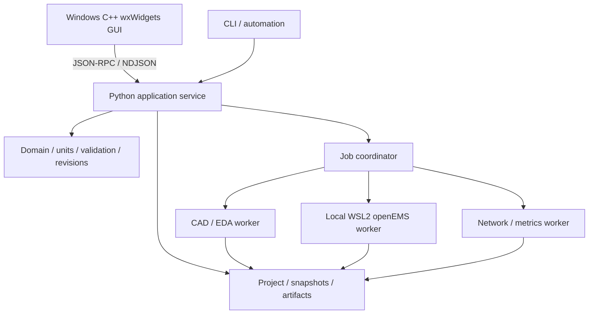

# TraceWave Studio 개발 영역

2026-11-07 사용자의 개발 착수 지시에 따라 제품 개발을 시작했다. GUI를 포함한 제품 소스, 빌드 설정과 시험은 이 `Code` 아래에서 관리한다. 승인된 설계 기준선은 `RFAD-D0-3.4`, 승인 커밋은 `6ebeda156e9d31b893bf69046550f5df9b16dc64`다. `01_Docs`의 착수 전 표기는 그 기준선 승인 당시 기록이며 현재 진행 상태는 [개발 상태](docs/development_status.md)에서 관리한다.

## 시스템 구성



위 그림은 승인된 목표 구조다. 현재 환경 진단, 스칼라 단위와 미정값, 정규 직렬화, 프로젝트 생성/이름/설명/매개변수 명령, 저장 기준점과 불변 스냅샷을 구현했다. CAD 형상/solver/GUI와 전체 물리 프로젝트 편집은 아직 구현하지 않았다.

| 구성 | 역할 | 배치 |
| --- | --- | --- |
| C++ wxWidgets GUI | 프로젝트 트리, 속성 입력, 2D/3D 표시, 선택, 결과와 작업 상태 | `ui/wxwidgets/` |
| Python 서비스 | 원본 도메인, 입력 검증, 명령, revision, hash를 단일 기준으로 관리 | `src/rfad/domain/`, `src/rfad/application/` |
| 저장과 작업 관리 | 단일 writer journal, 불변 snapshot, 초기 자료 처리 작업/취소/복구 | 현재 `src/rfad/storage/`, `application/projects.py`; native 작업은 후속 |
| CAD/EDA worker | 같은 설계에서 CAD 형상, STEP, 2D 및 제조 출력 생성 | 후속 `src/rfad/adapters/cad/`, `eda/` |
| EM worker | 고정한 입력으로 openEMS 실행과 정규화 | 후속 `src/rfad/adapters/solvers/openems/` |
| 후처리와 CLI | 결과 계산, 측정 비교, 동일 서비스의 자동화 | 후속 `physics/`, `adapters/networks/`; 현재 `cli/` |

GUI 안에 Python이나 solver를 내장하지 않는다. GUI에는 표시용 데이터와 안정된 객체 ID를 전달하고 CAD B-rep와 큰 결과 배열은 worker/파일에 둔다. 시작할 때 CAD/NumPy/solver 전체를 로드하지 않는다. 단위/물리식/해시를 GUI에서 중복 구현하지 않는다.

R1은 Windows 11 x64 wxMSW와 로컬 WSL2 worker를 우선한다. Linux native/headless worker의 R0 검증은 유지하고 Linux GUI는 후속이다. Qt 계열은 사용하지 않으며 유료 GUI 부품을 필수로 요구하지 않는다. 일반 60 fps/대형 30 fps 및 전체 프로세스 메모리 목표는 아직 실측 전이다.

## 현재 실행 방법

현재 구현은 Python 3.12 표준 라이브러리만 사용한다. 아래 명령은 `Code`에서 실행한다. 현재 PATH의 Python 환경을 조회하며 전역 패키지 설치나 WSL 배포판 설치를 자동 수행하지 않는다.

```powershell
$env:PYTHONPATH = 'src'
python -X utf8 -m rfad doctor --output .local/runtime-doctor.json
python -X utf8 -m unittest discover -s tests -v
python -X utf8 -m rfad serve
python -X utf8 -m rfad serve --workspace .local/projects-workspace
```

Linux에서 같은 기초 코드를 시험할 때는 다음 명령을 사용한다. Linux 실제 실행 증거는 아직 없다.

```sh
PYTHONPATH=src python3 -m unittest discover -s tests -v
PYTHONPATH=src python3 -m rfad doctor
PYTHONPATH=src python3 -m rfad serve
```

`serve`는 stdin에서 UTF-8 JSON 한 줄씩 읽으며 stdout에는 응답만 출력한다. workspace를 지정하지 않으면 읽기 전용이고, 지정하면 프로젝트 기능과 영속 request key epoch를 제공한다. 첫 조회는 다음과 같다.

```json
{"jsonrpc":"2.0","id":"hello-1","method":"capabilities.get","params":{"contract_version":"rfad.api/2.0","context":{},"input":{}}}
```

숫자/읽기 전용 규칙은 [초기 구현 계약](docs/bootstrap_contract.md), 프로젝트 명령과 저장/스냅샷의 사용법 및 제한은 [프로젝트 저장 계약](docs/project_persistence.md)에 있다. 조회 성공은 GUI/CAD/해석 검증 완료가 아니다. 허용한 명령 이외의 변경은 오류로 거부한다. `doctor`의 종료 코드 0은 진단 보고서 생성 성공이며 모든 의존성 준비 완료를 뜻하지 않는다.

`pyproject.toml`은 향후 가상환경에서 편집 설치할 수 있는 패키지 메타데이터다. 배포용 의존성 잠금은 아직 없으며 현재 코드는 설치 없이 위 명령으로 실행/시험했다. 로컬 환경 경로와 실행 파일 해시를 포함하는 보고서, cache와 빌드 출력은 `.local/`, `build/`에 두고 Git에서 제외한다.

## 구현 순서

1. WBS-002/003: 실제 환경과 의존성 조합, 단위/표현식/ID/명령/저장/snapshot 계약을 구축한다.
2. 최소 명령과 표시 데이터 계약이 갖춰지면 wxWidgets 창과 편집 흐름을 병행한다.
3. 원호/IFA 의미 모델, CAD 형상과 STEP/제조 파일의 독립 재열기를 연결한다.
4. 해석기의 완전한 참조 계산을 먼저 검증한 뒤 단일 포트 IFA, 이어 원호 검증을 진행한다.
5. 측정 파일 비교, 수렴/정확도 판정, 취소/복구, 전체 앱 성능을 검증하여 R1 내부 패키지로 묶는다.

한 단계의 기초 시험 통과를 R0/R1 전체 완료로 확대하지 않는다. 설계 근거는 [07 아키텍처](../01_Docs/07_RFAD_소프트웨어_아키텍처.md), [15 구현 계획](../01_Docs/15_RFAD_구현_계획.md), [24 GUI와 성능](../01_Docs/24_RFAD_GUI_선정과_성능_설계.md)을 따른다.
