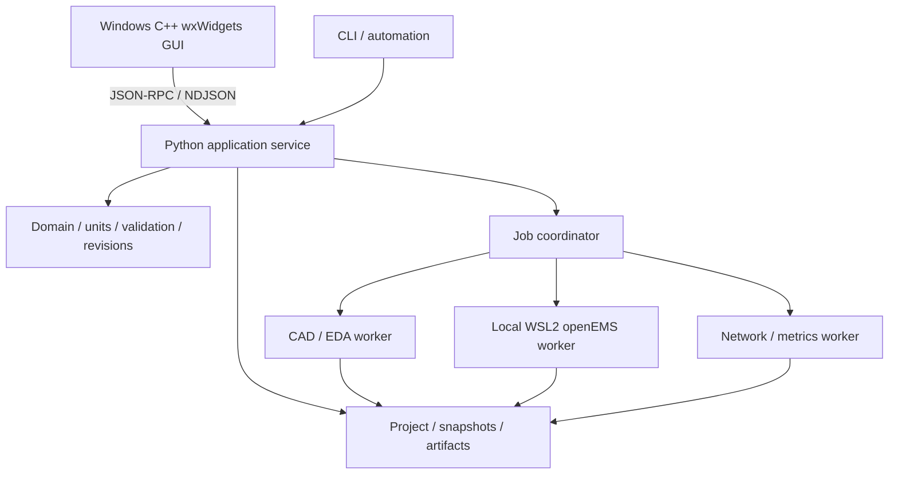

# TraceWave Studio 개발 영역

2026-11-07 사용자의 개발 착수 지시에 따라 제품 개발을 시작했다. GUI를 포함한 제품 소스, 빌드 설정과 시험은 이 `Code` 아래에서 관리한다. 승인된 설계 기준선은 `RFAD-D0-3.4`, 승인 커밋은 `6ebeda156e9d31b893bf69046550f5df9b16dc64`다. `01_Docs`의 착수 전 표기는 그 기준선 승인 당시 기록이며 현재 진행 상태는 [개발 상태](docs/development_status.md)에서 관리한다.

## 시스템 구성

재부팅 뒤 시작할 명령과 후속 작업 순서는 [재부팅 후 개발 재개](docs/reboot_resume.md)에 정리했다.



위 그림은 승인된 목표 구조다. 현재 환경 진단, 단위/미정값, 제한 표현식과 의존 그래프, 기판/적층/재료/선/원호/net/단일 포트 데이터, 목적별 입력 검사, 프로젝트 명령/저장/불변 스냅샷을 구현했다. 최소 wxWidgets GUI를 별도 서비스에 연결하는 개발 profile도 제공한다. 제품 CAD adapter, openEMS 계산과 2D/3D 설계 편집 화면은 후속이다.

| 구성 | 역할 | 배치 |
| --- | --- | --- |
| C++ wxWidgets GUI | 프로젝트 트리, 속성 입력, 2D/3D 표시, 선택, 결과와 작업 상태 | `ui/wxwidgets/` |
| Python 서비스 | 원본 도메인, 입력 검증, 명령, revision, hash를 단일 기준으로 관리 | `src/rfad/domain/`, `src/rfad/application/` |
| 저장과 작업 관리 | 단일 writer journal, 불변 snapshot, 초기 자료 처리 작업/취소/복구 | 현재 `src/rfad/storage/`, `application/projects.py`; native 작업은 후속 |
| CAD/EDA worker | 같은 설계에서 CAD 형상, STEP, 2D 및 제조 출력 생성 | 후속 `src/rfad/adapters/cad/`, `eda/` |
| EM worker | 고정한 입력으로 openEMS 실행과 정규화 | 후속 `src/rfad/adapters/solvers/openems/` |
| 후처리와 CLI | 결과 계산, 측정 비교, 동일 서비스의 자동화 | 후속 `physics/`, `adapters/networks/`; 현재 `cli/` |

GUI 안에 Python이나 solver를 내장하지 않는다. GUI에는 표시용 데이터와 안정된 객체 ID를 전달하고 CAD B-rep와 큰 결과 배열은 worker/파일에 둔다. 시작할 때 CAD/NumPy/solver 전체를 로드하지 않는다. 단위/물리식/해시를 GUI에서 중복 구현하지 않는다.

R1은 Windows 11 x64 wxMSW와 로컬 WSL2 worker를 우선한다. Linux native/headless worker의 R0 검증은 유지하고 Linux GUI는 후속이다. Qt 계열은 사용하지 않으며 유료 GUI 부품을 필수로 요구하지 않는다. 일반 60 fps/대형 30 fps 및 전체 프로세스 메모리 목표는 아직 실측 전이다.

## 현재 실행 방법

서비스 구현은 Python 3.12 표준 라이브러리만 사용한다. 아래 명령은 `Code`에서 실행한다. `tools/setup_python.ps1`은 서비스 .venv와 별도 .venv-cad를 구성한다. [Python 환경](docs/python_environment.md), [wxWidgets 빌드/실행](ui/wxwidgets/README.md), [WSL 재개 절차](docs/wsl_environment.md)를 참고한다. WSL 설치 시 Windows가 재부팅 필요를 보고했으며 Linux/openEMS는 아직 실행 검증하지 못했다.

```powershell
$env:PYTHONPATH = 'src'
.venv/Scripts/python.exe -X utf8 -m rfad doctor --output .local/runtime-doctor.json
.venv/Scripts/python.exe -X utf8 -m unittest discover -s tests -v
.venv/Scripts/python.exe -X utf8 -m rfad serve
.venv/Scripts/python.exe -X utf8 -m rfad serve --workspace .local/projects-workspace
```

GUI 빌드 후 `$env:RFAD_GUI_EXE`에 실행 파일의 절대 경로를 지정하면 실제 GUI 시험도 함께 실행한다. 현재 Windows에서 전체 166개 시험과 CAD 환경 STEP 왕복을 통과했다. 자세한 실행 근거와 미검증 범위는 [개발 상태](docs/development_status.md)에 있다.

Linux에서 같은 기초 코드를 시험할 때는 다음 명령을 사용한다. Linux 실제 실행 증거는 아직 없다.

```sh
PYTHONPATH=src python3 -m unittest discover -s tests -v
PYTHONPATH=src python3 -m rfad doctor
PYTHONPATH=src python3 -m rfad serve
```

`serve`는 stdin에서 UTF-8 JSON 한 줄씩 읽으며 stdout에는 응답만 출력한다. workspace를 지정하지 않으면 읽기 전용이고, 지정하면 프로젝트 기능과 영속 request key epoch를 제공한다. 첫 조회는 다음과 같다.

```json
{"jsonrpc":"2.0","id":"hello-1","method":"capabilities.get","params":{"contract_version":"rfad.api/2.0","context":{},"input":{}}}
```

숫자/읽기 전용 규칙은 [초기 구현 계약](docs/bootstrap_contract.md), 프로젝트 명령과 저장/스냅샷은 [프로젝트 저장 계약](docs/project_persistence.md), 표현식/객체 필드와 검사는 [설계 데이터](docs/design_data.md)에 있다. 조회 성공은 GUI/CAD/해석 검증 완료가 아니다. 허용한 명령 이외의 변경은 오류로 거부한다. `doctor`의 종료 코드 0은 진단 보고서 생성 성공이며 모든 의존성 준비 완료를 뜻하지 않는다.

`pyproject.toml`로 서비스 가상환경에 editable 설치한다. `runtime_profiles/`에는 검증한 Windows 개발 의존성의 버전/해시와 WSL의 미완료 상태를 기록한다. 제품 배포용 manifest와 라이선스 고지 검증은 후속이다. 로컬 환경 경로와 실행 파일 해시를 포함하는 보고서, cache와 빌드 출력은 `.local/`, `build/`에 두고 Git에서 제외한다.

## 구현 순서

1. WBS-002/003: 실제 환경과 의존성 조합, 단위/표현식/ID/명령/저장/snapshot 계약을 구축한다.
2. 최소 명령과 표시 데이터 계약이 갖춰지면 wxWidgets 창과 편집 흐름을 병행한다.
3. 원호/IFA 의미 모델, CAD 형상과 STEP/제조 파일의 독립 재열기를 연결한다.
4. 해석기의 완전한 참조 계산을 먼저 검증한 뒤 단일 포트 IFA, 이어 원호 검증을 진행한다.
5. 측정 파일 비교, 수렴/정확도 판정, 취소/복구, 전체 앱 성능을 검증하여 R1 내부 패키지로 묶는다.

한 단계의 기초 시험 통과를 R0/R1 전체 완료로 확대하지 않는다. 설계 근거는 [07 아키텍처](../01_Docs/07_RFAD_소프트웨어_아키텍처.md), [15 구현 계획](../01_Docs/15_RFAD_구현_계획.md), [24 GUI와 성능](../01_Docs/24_RFAD_GUI_선정과_성능_설계.md)을 따른다.
