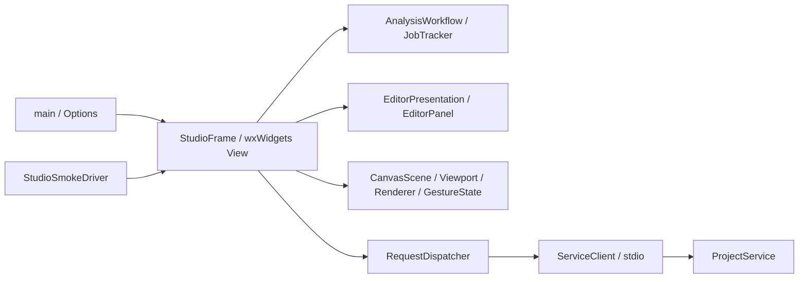

# 코드 구조와 유지보수 규칙

갱신일: 2026-11-12 KST

승인 설계 RFAD-D0-3.4를 유지한 구조 정리다. 공개 JSON-RPC, 프로젝트 저장 schema, 도메인 명령과 물리 모델의 의미를 새 GUI 계층에서 복제하지 않는다. 기능을 찾기 쉽게 파일을 분리하면서 상태와 결과의 소유자도 명시한다.

## GUI 구성 방식

PCB의 선택적 [독립 손실/전력 수지](pcb_power_balance.md)는 `application/pcb_power.py`의 입력/합계 검증과 `adapters/solvers/openems/pcb_absorption.py`의 native 필드 적분으로 분리한다. worker 조립기는 기능을 호출하고 원시 manifest/별도 산출물 검증은 기존 공통 계층에서 수행한다. GUI 계층에 물리 계산을 복제하지 않는다.

[손실 정밀도/PTH](pcb_loss_precision.md)는 `pcb_loss_partition.py`의 native QuarterCell 기여율과 sheet edge 배정, `pcb_loss_components.py`의 분할/해상도 계약, `pcb_loss_convergence.py`의 개별 성분 비교, `pcb_loss_study.py`의 단일 수치 축 검사로 분리한다. CLI 연구는 공개 plan/prepare/submit/result.open만 사용하며 미정 물성을 수정하지 않는다. 일반 연구의 작은 DTO에는 손실 비교의 최악 변화 성분만 요약하고 불변 판정에는 전체 성분을 보존한다. 별도 `tools/loss_recalculation.py`와 `loss_recalculation_native.py`는 원래 필드 생산자와 새 후처리 소스를 나눠 기록하는 검증 전용 도구이며 원본을 변경하거나 FDTD를 재실행하지 않는다.

[RO4350B 후속 연구](ro4350b_loss_refinement.md)는 `application/pcb_compute.py`에서 기본/명시적 확장 예산을 관리한다. 접수 조정기가 plan의 시간 상한을 검증하고 native 실행기는 계획의 스레드 수를 소비한다. `pcb_loss_box.py`는 native 단일 Box를 확인한 경우에만 QuarterCell 배열 가속을 담당하며 일반 재료 조회를 삭제하지 않는다. 비용 비교는 `tools/benchmark_pcb_loss_partition.py`에서 봉인한 같은 필드와 두 경로를 대조한다.

`tools/verify_ro_loss_followup.py`는 심화 연구에서 세 비교 계획을 먼저 준비하고, 동일 실제 XML/물리 입력을 증명한 기준 raw 하나만 재사용한다. 생산자와 비교 계획을 분리하고 `source_kind`와 별도 연구 schema로 출처를 보존한다. 새 native 실행은 나머지 두 조건뿐이며 일반 제품의 자동 cache로 적용하지 않는다. `derive_loss_study_axis.py`도 완료한 사전 고정 축만 별도 조회하며 원래 미완료 연구를 완료로 바꾸지 않는다.

[일반 프로젝트 연구](project_studies.md)는 `project_study_contract.py`의 입력/전체 계획, `project_study_commands.py`의 원자 생성/제어, `project_studies.py`의 상태 전이와 `project_study_results.py`의 봉인 조회/비교로 분리한다. wxWidgets는 `project_study_model.*`의 순수 입력/표시 정책, `project_study_dialog.*`와 `project_study_form.cpp`의 위젯/수명, `studio_study.cpp`의 서비스 연결로 구성한다. 연구가 없는 동안 조정기는 이벤트를 기다리며 journal을 주기적으로 다시 읽지 않는다.

wxWidgets View + Presentation Model + Service Gateway 구성을 사용한다. wxWidgets의 위젯과 이벤트는 화면 계층에 두고, 해석 단계/조회/입력 표시 정책은 위젯 없이 검사할 수 있는 객체에 둔다. 원본 도메인 모델은 Python 서비스가 소유한다. 별도 MVVM 프레임워크나 유료 부품을 추가하지 않는다.

| 경계 | 파일 | 책임 |
| --- | --- | --- |
| 진입점 | `ui/wxwidgets/main.cpp`, `app_options.h` | 실행 옵션 확인과 주 창 생성 |
| 화면 조립 | `studio_frame.*`, `studio_layout.cpp`, `studio_controls.cpp` | 위젯 수명, 화면 배치와 명령 활성화 |
| 공통 화면 스타일 | `studio_theme.*` | 물리 색과 분리한 라이트 표면/글자/도킹/DIP 토큰, 고대비 OS 색 및 시스템 색 변경 반영 |
| 기능별 화면 연결 | `studio_project.cpp`, `studio_editing.cpp`, `studio_drawing.cpp`, `studio_geometry_dialogs.cpp`, `studio_validation.cpp` | 프로젝트/편집/그리기/진단의 이벤트 연결과 DTO 표시 |
| CAD/해석 표시 | `studio_cad.cpp`, `studio_solver.cpp` | 서비스 명령 접수와 화면 반영. 도메인 계산은 서비스에 위임 |
| 비동기 통신 | `async_state.*`, `studio_session.cpp`, `service_client.*` | 요청 식별/콜백 회수/대기 상한/timeout, 작업 조회, 프로세스와 파이프 |
| 해석 단계 | `analysis_workflow.*` | Snapshot -> Plan -> Prepare -> Analysis -> Completed의 명시적 전이. 시작 설정 고정 |
| 장면 모델 | `canvas_scene.*`, `canvas_viewport.*`, `canvas_geometry.h` | 표시 DTO 해석, 객체 ID 색인, 경계/hit 검사, 좌표 변환 |
| 화면 그리기/입력 | `canvas_renderer.*`, `canvas_gesture.h`, `design_canvas.*` | paint 단위 renderer, 배타적 입력 상태와 wx 이벤트 변환 |
| 속성 폼 | `editor_presentation.*`, `coordinate_editor_dialog.*`, `editor_panel.*` | 값/모드별 표시 정책, 좌표 표 대화상자, 위젯 생성과 이벤트 |
| PCB 선택 상태 | `pcb_selection_model.*`, `pcb_selection_model_data.*` | 위젯 없는 요청 세대, 초안, 개정 고정, 미리보기와 적용 상태 |
| 적층 물성 제안 | `pcb_suggestion_model.*`, `pcb_selection_suggestions.cpp` | 같은 출처/층의 제안 검사, 기존 입력 보호, 페이지 및 명시적 재료 연결 |
| PCB 선택 화면 | `pcb_selection_dialog.*`, `pcb_selection_view.cpp`, `pcb_selection_layers.cpp`, `pcb_selection_materials.cpp`, `pcb_selection_review.cpp`, `studio_pcb.cpp` | 검색, 층/급전/물성 입력, 단면 검토, 대화상자 수명과 서비스 연결 |
| 실제 GUI 시험 | `studio_smoke.h`, `studio_smoke_*.cpp` | smoke 옵션의 시나리오/검사 상태. 제품 작업 객체에서 시험용 필드 분리 |

StudioFrame은 화면 사이의 연결과 서비스 DTO 캐시를 유지한다. 같은 클래스를 여러 파일로 나눈 부분은 화면 구성과 이벤트 연결이며, 재사용 상태/정책은 RequestDispatcher, JobTracker, AnalysisWorkflow, CanvasScene, EditorPresentation으로 실제 분리했다. StudioSmokeDriver만 시험을 위해 주 창의 private 위젯에 접근한다. 서비스/도메인은 시험 운전자나 wxWidgets를 참조하지 않는다.

`studio_frame.h`는 구체 위젯을 가능한 한 전방 선언한다. `studio_internal.h`는 화면 구현에서만 사용하는 위젯 include와 메뉴 ID를 보관한다. 문자열/UUID 변환은 `studio_support.*`, 공통 JSON/시각 별칭은 `studio_types.h`에 둔다.

## 상태와 응답 처리

- RequestDispatcher는 응답 콜백을 먼저 회수한 뒤 화면으로 넘긴다. 중복 응답과 연결 종료 뒤 과거 응답을 다시 실행하지 않는다. 요청은 최대 16개, 응답 제한은 30초이며 변경 명령을 자동 재전송하지 않는다.
- JobTracker는 일반 작업/CAD/해석의 조회 중 여부와 간격을 공통으로 관리한다. 이전 job의 지연 응답은 새 job의 조회 잠금까지 해제할 수 없다. 큐 거부와 조회 오류도 조회 상태를 회수하여 영구 정지를 피한다.
- AnalysisWorkflow는 시작한 개정과 설정을 고정하고, 올바른 단계의 완료 자료만 다음 명령으로 바꾼다. 취소 의도와 취소 전달 중 상태를 분리한다. 전달 실패 후 재시도할 수 있어도 다음 단계로 자동 진행하지 않는다.
- CAD/WSL 작업의 실제 종료 확인은 서버 coordinator가 맡는다. GUI의 취소 버튼이나 전송 단절을 실제 프로세스 종료로 취급하지 않는다.
- PcbSelectionModel은 검색/초안/미리보기 요청 세대를 비교하여 늦은 응답을 버린다. 입력을 변경하면 기존 미리보기를 무효화하고, 검토한 사양과 해시만 적용한다. 결과가 불명확한 적용 실패는 Stale로 잠가 재조회하도록 한다. 닫힌 대화상자의 응답은 약한 참조와 종료 상태로 폐기한다.
- 서버 `job_state.py`는 허용 전이를 명시하고 완료 상태 역행, 취소 요청 뒤 완료 승격과 event 식별 필드 덮어쓰기를 거절한다. 명시적 사용자 취소는 cancelled, 서비스 종료로 결과를 게시하지 않은 경우는 interrupted로 구분한다. 실제 종료가 확인되면 예약을 해제하고, 불명 상태는 예약을 유지한다. CAD 프로세스 회수와 WSL lease/outcome_unknown 처리는 각 coordinator의 별도 책임으로 남긴다.

## 서비스와 worker 구성

사용자 목표 입력은 `domain/targets.py`가 대역/표본/지표/참조/미정값을 검증하고 목표 개정과 역명령을 만든다. `project.py`는 프로젝트 0.3과 0.1/0.2 읽기 호환을 관리하며 `ProjectHistory`/`RequestLedger`가 기존 원자 게시를 그대로 사용한다. 목표별로 별도 저장소나 작업 상태머신을 만들지 않는다. `target_input_status`는 입력 상태만 제공하고 solver 설정이나 성능 판정을 생성하지 않는다.

목표 편집은 `application/target_editor.py`의 공개 요청/명령 연결, `target_editor_fields.py`의 폼/출처 DTO와 `target_editor_values.py`의 변경값/단위 처리로 나눈다. 템플릿은 `templates/cards.py`의 카드, `domain/template_inputs.py`의 입력 변환, `template_geometry.py`의 매개변수/기하, `template_ports.py`의 명시 급전, `template_instance.py`의 원본 사본 검증, `template_command.py`의 원자 명령으로 분리한다. `application/template_candidates.py`가 읽기 전용 미리보기와 검토 hash를 기존 writer에 연결한다. 단위 환산이나 출처 원본을 GUI가 별도로 계산하지 않는다.

화면은 `target_editor_dialog.*`/`target_editor_view.cpp`, `template_dialog.*`/`template_view.cpp`와 `studio_design_setup.cpp`의 주 창 연결로 분리한다. 공통 `ProjectSetupDialog`는 요청 세대, 닫힌 창, 변경 중 잠금과 결과 불명 상태를 관리한다. `EditorPanel`의 기본/고급 입력, 변경값 추출과 기존 `DesignCanvas` 미리보기를 재사용한다. 목표/템플릿 화면의 성공 응답은 같은 프로젝트 명령/undo/redo로 이어지며 별도 저장 형식을 만들지 않는다.

문헌 카드는 `templates/g031.py`의 고정 버전 원문/치수/가정과 `domain/literature_geometry.py`의 실제 기하 생성, `template_provenance.py`의 생성/검증 축 표시로 분리한다. 기존 `template_inputs.py`는 명시 원문 marker와 수정값/출처를 처리하고, `template_instance.py`는 과거 원문/입력에서 최초 객체 사본도 대조한다. `tools/verify_literature_sources.py`의 제한된 ZIP/member 검사와 PDF 시각 검수는 개발 검증용이며 정상 후보 생성에 원문 archive/PDF 의존성을 추가하지 않는다.

| 경계 | 모듈 | 책임 |
| --- | --- | --- |
| 공개 서비스 facade | `application/projects.py` | 저장소/조정기 수명, 요청 dispatch와 transaction 경계 |
| 카탈로그 facade | `catalog/service.py`, `application/catalog_api.py`, `cli/catalog.py` | 프로젝트 변경과 독립된 읽기 전용 자료 검색/상세, 선택적 DB 설정 |
| 카탈로그 자료 | `catalog/models.py`, `properties.py`, `source.py`, `build.py`, `schema.py`, `review.py` | 안정 ID/물성 조건, 원본 검증과 오프라인 원자적 SQLite 변환 |
| 카탈로그 adapter/조회 | `catalog/native*.py`, `query.py`, `repository.py` | 업체별 원시 자료 보존, 허용 필터와 읽기 트랜잭션/페이지/상한 |
| PCB 선택 근거/물성 | `catalog/selection_reader.py`, `selection_rules.py`, `material_selection.py` | 같은 개정의 제한된 원문 사본, Dk/Df 독립 채택과 사용자 가정 |
| 제조업체 적층 초안 | `catalog/stackup_draft*.py` | JLCPCB/PCBWay/관측별 물리 층 변환, 미정값과 수동 구성 사유 |
| 적층과 물성 대응 | `catalog/stackup_match.py`, `suggested_properties.py`, `stackup_suggestions.py` | 적층/출처/원문 층의 정확한 연결, 공개값과 미정/근사 분리, 제한된 제안 페이지 |
| PCB 적용 조정 | `application/pcb_selection*.py` | 요청 계약, 후보 조립, 층/급전 참조 검사, 미리보기 해시와 단일 writer 적용 |
| PCB 저장 계약 | `domain/pcb_selection*.py` | 버전이 있는 출처 확장, 현재 참조에 필요한 이전 출처, 원자 명령과 역명령 |
| 재료 손실 계약 | `domain/material_models.py` | 명시적 모델 검증과 목적별 소비 물성. 총 Df 모델의 독립 전도도 미소비 및 도체 적용 거절 |
| 요청 규칙 | `project_contract.py`, `request_ledger.py` | 입력 형태/상한/경로, epoch와 receipt의 멱등성 |
| 프로젝트 데이터 | `project_repository.py`, `project_history.py`, `project_operations.py` | 불변 문서 저장, 명령/undo/redo, 열기/저장/snapshot/검사 |
| 작업 조정 | `solver_jobs.py`, `cad_jobs.py`, `job_state.py` | 작업 접수/실행/취소/게시 및 명시적 상태 전이 |
| 실행 설정 | `solver_runtime.py`, `cad_runtime.py`, `solver_requests.py` | runtime 출처, 실행 입력과 지원 profile |
| 산출물 | `solver_artifacts.py`, `solver_queries.py`, `cad_artifacts.py` | 파일 검증/봉인과 작은 조회 DTO |
| PCB 투영 | `pcb_solver.py`, `pcb_projection.py`, `pcb_geometry.py`, `pcb_results.py` | 계획 조립, 물리 입력/도체 투영, 결과/종료 판정 |
| 격자/접촉 | `pcb_mesh.py`, `pcb_contacts.py`, `adapters/solvers/openems/pcb_mesh.py` | 계획 격자, 물리 접촉과 native 격자 확인 |
| CAD adapter | `adapters/cad/native.py`, `geometry.py`, `bodies.py`, `step_io.py`, `display.py` | 패키지 조립, 고체 생성/집계, STEP 교환과 표시 mesh |
| 제조 후보 검증 도구 | `tools/manufacturing_verification/jlc_ro4350b.py`, `tools/create_jlc_ro4350b_verification.py` | 실제 미정 물성과 출처 기반 탐색 입력의 분리, 공개 선택 API를 통한 새 프로젝트 생성 |
| CAD/해석 통합 검증 | `tools/catalog_pcb_verification/`, `tools/verify_catalog_pcb.py` | 저장된 동일 스냅샷의 기하/해석/재후처리와 카탈로그 및 worker 없는 결과 재열기 |

기존 공개 import와 필요한 worker 연결 seam은 명시적 재노출/위임으로 유지한다. 동적 mixin이나 monkeypatch로 구현 파일을 연결하지 않는다. 파일별 상세 책임과 작업 상태도는 [worker 구조](worker_structure.md), 원자적 저장/이력 경계는 [저장 계약](project_persistence.md)을 따른다.

## 재사용과 방어 보강

- CanvasScene의 ID 색인과 이미 해석한 polygon을 hit 검사에서 재사용한다. canvas renderer는 도형마다 graphics context를 만들지 않고 paint 단위로 재사용한다.
- 프로젝트 이력 복원은 명령 색인과 문서 읽기를 재사용한다. 폼 표시 정책은 필요한 mode/value/unit만 읽어 편집 중 bindings나 좌표 초안을 강제로 확정하지 않는다.
- 서비스 시작 도중 실패하면 이미 시작된 thread/coordinator와 journal writer를 회수한다. 시작하지 못한 thread에 join을 시도하지 않는다.
- captured 문서의 정규 바이트를 검사하고 알 수 없는 자료 작업을 snapshot 생성으로 처리하지 않는다.

이 변경은 실제 fps 또는 전체 메모리 예산 합격을 뜻하지 않는다. 성능 수치는 별도의 대표 장면에서 측정한다.

## 추가 변경 규칙

카탈로그 PCB 통합 검증은 제품의 공개 API를 사용하는 `tools/catalog_pcb_verification/`에 둔다. `common.py`는 RPC/대기/봉인 자료 읽기와 원자 보고서 게시, `cad.py`는 형상/STEP/mesh와 재입력, `solver.py`는 계획/준비/계산/후처리/재열기, `runner.py`는 입력 검사와 같은 snapshot의 단계 실행을 담당한다. `tools/verify_catalog_pcb.py`는 CLI만 구성한다. 실제 JLC 입력을 재현하는 도구는 시험 물성을 먼저 제거한 후 출처로 확인한 치수와 Dk만 선택하며, 제품의 재료 기본값을 변경하지 않는다.

1. 새 기능은 원본 domain, application orchestration, 외부 adapter, presentation 중 책임을 먼저 정한다. 여러 책임의 동작을 진입점이나 주 창에 모두 추가하지 않는다.
2. 화면의 입력 정책과 상태 전이는 가능한 한 wx 없는 객체로 두고, 외부 프로세스/파일 I/O는 명시적 경계에 둔다. GUI에 물리 공식/도메인 해시의 별도 구현을 만들지 않는다.
3. 상태 필드를 늘릴 때 허용 조합과 전이를 먼저 정한다. 진행 단계는 enum/명시적 상태표, 독립적인 취소 의도/전송 상태는 별도 값으로 표현한다.
4. 코드 주석은 한국어 Doxygen, C++는 BSD/Allman과 공백 4칸, 제어문 중괄호 필수다. `.clang-format`과 `.editorconfig`를 제공한다. 파일 길이만 줄이는 기계적 분할이나 불필요한 추상 계층은 피한다.
5. 기존 저장소/명령/결과 계약과 취소/복구 의미를 보존하는 회귀를 수행한다. 네이티브 함수 이동 시 입력 계획과 실제 CAD/openEMS 실행을 확인한다.

기존 IFA 수렴과 runtime profile은 당시 소스의 검증 기록으로 유지한다. 소스 분리에 따라 worker source identity가 달라지므로 이전 연구에 현재 소스로 `--resume`을 섞지 않는다. 완료 자료의 `--reassess-only` 또는 새 workspace를 사용한다.

## 용량과 후속 연계 모듈

- `domain/resource_limits.py`: 저장/근거/선택/적층/전송의 유한 자원 예산.
- `domain/pcb_evidence_pool.py`: 선택 0.2의 공유 원문 보존과 0.1 검증용 복원. 외부 sidecar 없음.
- `application/wsl_process.py`: worker 접수 전 준비/취소와 접수 후 소유권 복구의 구분.
- `application/mcp.py`, `tools/mcp_stdio.py`: 기존 공개 API와 영수증을 재사용하는 MCP 2025-11-25 stdio adapter.
- `application/radiation.py`, `tools/nf2ff_dipole_worker.py`: 방사 지표의 의미와 격리된 참조 계산. 사용자 PCB worker와 별도.
- `ui/wxwidgets/study_report_dialog.*`: 완료 연구의 설정과 판정을 표시하는 읽기 전용 비교 화면.
- `tools/canvas_render_benchmark.cpp`, `build_internal_bundle.py`: 제품 renderer 계측과 내부 검증 묶음 생성.
