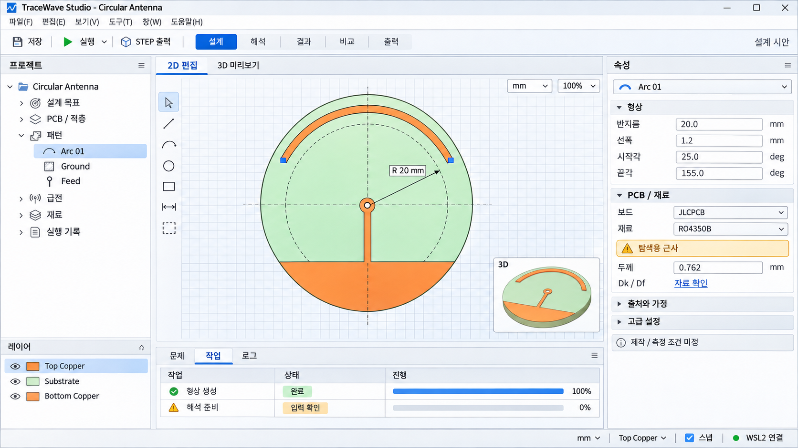

# TraceWave Studio GUI 디자인과 화면 계약

갱신일: 2026-11-12 KST. 개발 완료 계획 2번의 설계 산출물과 4번의 첫 화면 기반 구현을 기록한다. 승인 기준선 RFAD-D0-3.4의 [05 화면 설계](../../01_Docs/05_RFAD_화면과_사용자_경험_설계.md), [24 GUI와 성능](../../01_Docs/24_RFAD_GUI_선정과_성능_설계.md), 기존 [화면 시안](ui_concept.md)을 구체화한다. 화면 계약 전체와 성능의 완료를 뜻하지 않는다. 이번에 구현/확인한 범위는 11절을 따른다.

위 이미지는 완성 목표 시안이다. 형상/치수/상태는 설명용 예시이며 현재 실제 구현 화면이나 제작 확정값이 아니다. [생성 입력 기록](assets/tracewave-studio-ui-concept-v2-prompt.txt)과 실제 코드/시험의 증거를 구분한다.

## 1. 디자인 방향

GUI는 C++ wxWidgets로 유지하며 Studio 형태의 통합 작업 공간으로 완성한다. native 텍스트 입력, 표, 트리, 메뉴와 접근성 동작 위에 일관된 작업 탭, 도킹 패널, 문맥 도구막대, 아이콘과 색상 체계를 적용한다. Windows 창의 이동/크기 변경/시스템 메뉴는 OS 동작을 사용한다. Qt와 필수 유료 GUI 부품은 도입하지 않는다.

모던한 외형은 작업 영역의 명확한 구분, 읽기 쉬운 밀도, 일정한 여백과 선택/상태 표현으로 만든다. 창 전체를 거대한 custom canvas로 바꾸거나 효과를 많이 넣는 것을 디자인 목표로 삼지 않는다. 어떤 toolkit을 쓰는지만으로 메모리나 실제 조작 속도가 보장되지는 않으므로 제품 전체를 측정한다.

이 문서의 간격/색상 값은 화면 구현의 초기 디자인 토큰이다. 승인된 물리 입력이나 성능 목표를 변경하지 않으며 실제 DPI/고대비/입력 검수에서 접근성을 해치면 해당 토큰을 조정한다.

## 2. 작업 공간

| 영역 | 구성과 행동 |
| --- | --- |
| 프로젝트 바 | 프로젝트명, 저장 상태와 현재 작업 개정. 자주 쓰는 저장/실행 명령과 명령 찾기 |
| 작업 탭 | 설계 / 해석 / 결과 / 비교 / 출력. 탭 이동이 원본 변경이나 해석 실행을 자동 발생시키지 않음 |
| 왼쪽 탐색 | 목표, 기판/적층, 패턴, 재료, 급전, 환경, 실행/결과. 객체/레이어 필터와 검색 |
| 중앙 | 설계에서는 2D/3D, 해석에서는 준비 계획/연구 표, 결과에서는 그래프/방사. 선택 작업에 공간을 우선 배정 |
| 문맥 도구막대 | 선택한 도구에 필요한 동작만 제공. 선/원호의 치수, 활성 층과 스냅처럼 현재 행동에 필요한 값은 바로 표시 |
| 오른쪽 속성 | 기본 입력과 단위/평가값을 먼저 표시. 출처, 가정, 고급 수치 조건은 펼쳐서 확인 |
| 하단 | 문제 / 작업 / 로그 / 출력 검수. 접힌 상태에서도 차단 문제 수와 실행 상태를 유지 |
| 상태 표시줄 | 좌표/단위/활성 층/스냅/선택 수와 worker 연결 상태. 입력 편집 가능 여부와 solver 준비 여부를 구분 |

좁은 창에서는 우측 속성을 탭으로 접고 도구막대를 overflow 메뉴로 옮긴다. 숫자와 단위를 나누어 잘라내거나 실행/취소 버튼을 화면 밖으로 밀지 않는다. 도킹 배치는 사용자 설정으로 저장하고 손상되거나 모니터 밖에 있으면 기본 배치로 복원한다. 레이아웃 설정은 RF 프로젝트의 물리 snapshot에 포함하지 않는다.

신규 사용자의 기본 흐름은 `프로젝트 -> 기판/재료 -> 패턴/급전 -> 입력 확인 -> 해석 -> 결과 -> 출력`이다. 숙련자는 트리와 명령 찾기로 필요한 단계에 바로 접근한다. 단계 이동이 필수값을 임의 완성하지 않으며, 차단 문제에는 이유와 수정할 필드로 이동하는 동작을 제공한다.

## 3. 시각 토큰과 입력 위젯

라이트 테마를 먼저 완결하고 동일 토큰에 다크 팔레트를 준비한다. 다크는 사용 중인 native 입력/팝업/선택/비활성/포커스까지 읽기 가능한지 확인한 구성에서 활성화한다. 시스템 고대비에서는 사용자 OS 색/포커스 설정을 우선한다. 배경만 어둡게 바꾼 상태를 완성된 다크 모드로 표시하지 않는다.

| 토큰 | 초기 값 또는 규칙 |
| --- | --- |
| 간격 단위 | 4 DIP. 입력 간격 8 DIP, 패널 내부 여백 12 DIP, 큰 그룹 간격 16 DIP |
| 입력/도구 높이 | 28~32 DIP를 시작점으로 하되 시스템 글꼴의 최소 높이와 실제 내용에 맞춤 |
| 본문 글꼴 | OS UI 글꼴과 한글 fallback 사용. 본문은 기본 크기, 제목은 동일 계열 굵기/크기 차이로 구분 |
| 숫자/단위 | 표 안 숫자는 오른쪽 정렬. 단위는 같은 행에 고정하고 마지막 적용값/현재 초안을 구분 |
| 라이트 배경/면 | workspace #F3F5F8, panel #FFFFFF, 경계 #D8DEE8 |
| 라이트 글자 | 기본 #202733, 보조 #536174. 비활성 상태도 숨김과 구분 |
| 다크 후보 | workspace #181C22, panel #222831, 경계 #3C4655, 기본 글자 #E8EDF5, 보조 #AEB9C8 |
| 강조/포커스 | 라이트 #245FC7, 다크 후보 #82B1FF. 키보드 포커스에는 별도 외곽선 |
| 의미 상태 | 성공/경고/오류/미평가에 아이콘과 한글 라벨 병기. 배경과 글자 조합은 테마별 검수 |
| 아이콘 | 동일 선 굵기와 16/20/24 DIP 크기군. 로컬 벡터 원본 또는 검수한 해상도 자산을 DPI별로 재사용 |
| 효과 | 기본은 정적 면/경계. 지속 애니메이션, 배경 blur, 그림자 중첩을 기본 비용으로 추가하지 않음 |

위 팔레트의 모든 상태 조합에 대한 대비 검수는 후속 구현 수용 항목이다. 도체/층 색상과 성공/오류 색상은 서로 다른 의미를 가진다. 그래프는 색 외 선 종류/마커/범례로도 구분하고 수치 표를 제공한다.

`wxTextCtrl`, `wxChoice`, 표/트리 등의 편집 역할을 유지한다. 숫자 입력, 한국어 IME, 선택/복사/붙여넣기, 키보드 이동을 custom paint 코드가 다시 구현하지 않는다. 장식이나 탭/도킹 캡션을 custom draw하는 경우 접근 가능한 이름과 상태, 키보드 동작을 함께 구현한다. 아이콘만 있는 버튼에도 명령명과 단축키 설명이 있어야 한다.

## 4. 구현 책임과 공통 계약

현재 구조를 재사용하면서 표시와 서비스 연결을 구분한다.

GUI의 기술 구성은 C++ wxWidgets + wxAUI + 사용자 정의 2D 캔버스 + wxGLCanvas/OpenGL 3D 뷰다. wxWidgets는 입력/표/트리/메뉴, wxAUI는 도킹과 작업 영역 배치, DesignCanvas는 2D 패턴의 표시와 조작을 맡는다. ModelView는 OCCT worker가 생성한 표시 mesh를 OpenGL로 그린다. Open CASCADE는 형상 생성과 STEP 교환을 맡고, wxAUI와 OpenGL은 형상 원본을 소유하지 않는다.

2D는 현재 wxGraphicsContext 기반 renderer이며 OpenGL로 전면 교체하지 않는다. 3D는 필요한 시점에 context를 생성하고 background에서 검증한 mesh를 소비한다. 방사 패턴의 3D 표시와 field 조회는 결과 화면의 후속 범위다. 도킹/색/간격/문맥 도구를 일관되게 구성하여 Studio 형태를 만들며, 입력 위젯의 native 편집/IME/접근성 동작을 유지한다.

Python application service가 원본 데이터, 단위, 명령, 이력, snapshot과 작업을 관리한다. Open CASCADE와 openEMS는 별도 worker에서 실행한다. 따라서 화면이 계산 완료를 기다리는 동안에도 입력과 작업 상태를 처리할 수 있으며, 실제 메모리와 조작 지연은 GUI/service/worker 전체에서 별도로 측정한다. 이 구조 선택만으로 60/30 fps나 메모리 목표의 달성을 주장하지 않는다.

| 책임 | 현재 재사용 대상 | 후속 계약 |
| --- | --- | --- |
| 주 창/화면 조립 | StudioFrame, studio_layout.cpp, studio_* 연결 파일 | 작업 탭과 도킹 구성을 조립. 물리 계산/파일 변환/영구 상태 소유 금지 |
| View | EditorPanel, PcbSelectionDialog, ProjectStudyDialog, ModelView, DesignCanvas | 사용자 입력/조회 표시. 위젯 값 자체를 영구 물리 원본으로 사용하지 않음 |
| 순수 표시/입력 상태 | EditorPresentation, CanvasScene/CanvasGestureState, PcbSelectionModel, project_study_model | 위젯 없는 숫자/상태/행동 판정. 상태/입력 변환 시험을 여기서 수행 |
| 화면 동작 연결 | studio_editing.cpp, studio_pcb.cpp, studio_study.cpp 등 실제 연결 파일 | 입력을 공개 service API로 전달하고 결과의 문맥을 검사. 기능별 presenter 책임을 이 경계에서 유지 |
| 요청/작업 추적 | RequestDispatcher, JobTracker, AnalysisWorkflow | 접수/조회/취소 요청/종료 확인을 구분. 같은 요청을 임의 재전송하지 않음 |
| 물리 원본/명령/작업 | Python application service와 별도 CAD/solver worker | validation, 명령/undo/revision, snapshot/plan, 수치와 출처를 소유 |
| 테마 | StudioTheme namespace의 라이트 색/간격과 주 창 적용. 여러 renderer/form의 개별 정의도 남아 있음 | 물리 장면의 의미 색과 분리하여 공통 토큰 적용을 확장. 아이콘/다크/전체 DPI 및 접근성 수용은 후속 |

화면 모델에는 물리 정답을 복제하지 않는다. 미적용 입력은 화면의 draft이며, 적용은 기존 공개 명령으로 검증/저장한다. 설계 변경으로 무엇이 오래된 결과가 되는지는 service의 개정/의존성 판단을 표시한다. 카메라/테마 변경은 물리 명령을 만들지 않는다.

조회 문맥은 현재 project/revision, 선택 entity 또는 result/study ID, 화면 요청 토큰으로 검사한다. PcbSelectionModel의 token/channel 검사와 JobTracker의 작업 ID 검사를 새 화면에도 재사용한다. 늦은 검색/준비/결과 응답이 현재 선택/새 입력을 덮지 않아야 한다. RequestDispatcher가 응답 ID를 회수했다는 사실만으로 모든 화면의 revision 일치까지 보장된 것으로 해석하지 않는다.

원래 JobState와 GUI transport 상태 및 `stale` 관계는 별도로 유지한다. `취소 요청 중`은 종료 확인 전 표시이며 `계산 완료`가 수렴/실측/제조 합격을 뜻하지 않는다. RO4350B 개별 손실의 미확립과 납품 물성의 미정은 GUI 디자인을 바꿔도 그대로 표현한다.

새 화면의 기본 입력에는 필요한 이름/값/단위/유효성/출처를 표시한다. 내부 UUID, 원시 JSON, worker 경로, profile schema 등은 사용자가 기본 작업을 하는 데 필요한 정보가 아니므로 진단/고급 상세에 둔다. 설정을 숨겨도 실제 채택한 값과 근거를 열어 확인할 수 있어야 한다.

## 5. 성능과 수명

현재 StudioFrame의 50 ms timer는 서비스 응답과 작업을 조회한다. 이것을 60 fps 연속 redraw라고 설명하지 않는다. 향후 유휴 조회/이벤트 처리 비용도 PERF-008로 실측하며, 조작이 없을 때 장면을 계속 다시 그리는 loop를 추가하지 않는다.

- 입력/선택/노출/데이터 변경으로 필요한 영역만 invalidation한다. drag preview는 가볍게 그리고 확정 시 도메인 명령 하나로 적용한다.
- CAD, 해석, 큰 파일 읽기/hash, 데이터 변환은 background 또는 worker에서 수행한다. GUI thread에서는 입력과 표시를 처리한다.
- 숨긴 3D/field 화면의 context/mesh/버퍼 수명을 명시한다. 이미 있는 ModelView의 지연 생성/비동기 읽기를 재사용하고 LOD/반복 수명은 별도 검수한다.
- 테마/아이콘/pen/brush는 유한한 공통 cache를 사용한다. paint마다 파일 읽기, 폰트 생성, 물리 geometry 재생성을 수행하지 않는다.
- 표와 그래프에는 현재 필요한 페이지/구간을 보낸다. 표시 축소와 수치 판정 원본은 구분한다.
- 일반 2D/표/100000 triangle 3D와 대형 1000000 triangle 3D는 각각 검사한다. 초기 p95 목표는 16.67 ms/33.33 ms이며 평균 FPS나 합성 렌더 함수 시간으로 대체하지 않는다.

메모리는 GUI뿐 아니라 service/CAD/solver/postprocess와 GPU 및 WSL 경계를 기록한다. PERF-001~010의 조건/예산/fixture가 우선이며 테마 구현을 이유로 목표를 완화하지 않는다. 현재 최신 합성 렌더 측정과 GUI 기능 시험은 제품 전체 성능 합격이 아니다.

## 6. 현재 증거와 남은 구현

| 읽은 코드/시험 | 확인한 범위 | 남은 수용 |
| --- | --- | --- |
| [studio_layout.cpp](../ui/wxwidgets/studio_layout.cpp), [studio_drawing.cpp](../ui/wxwidgets/studio_drawing.cpp) | wxAUI 배치, native 메뉴/입력, 기본 배치 복원과 실제 설계 명령 | 작업 탭 일관성, 축소 창/DPI 전반의 배치, 공통 테마/아이콘과 명령 찾기 |
| [async_state.cpp](../ui/wxwidgets/async_state.cpp), [gui_state_test.cpp](../tests/gui_state_test.cpp) | 최대 16개 요청, 중복 응답 회수, 지연 작업 응답 차단, 입력 고정과 취소 상태 | 새 화면별 revision/선택 문맥 적용 및 전체 재접속 UX |
| [gui_presentation_test.cpp](../tests/gui_presentation_test.cpp) | 장면/선택/제스처, 미정값, 기본/고급 입력, 진단 위치의 순수 표시 검사 | 실제 키보드/IME/고대비/스크린리더와 시각 품질 수용 |
| [project_study_model_test.cpp](../tests/project_study_model_test.cpp) | 입력 정밀도, 명시적 기준, 음수 전력 잔차, 이전 개정/실제 물성 미정 표시 | 3축 행렬/일반 설계 스윕 및 다중 결과 작업 공간 |
| [test_gui_solver_process.py](../tests/test_gui_solver_process.py) | 원형 PCB 미정 입력 차단, 조건 활성화 시 실제 실행/저장/취소/재열기/NF2FF 조회 | 3D 방사와 여러 결과 중첩, 모든 조합의 시각/성능 수용 |
| [test_gui_project_study_process.py](../tests/test_gui_project_study_process.py) | 미정 물성을 자동 보완하지 않고 연구 생성을 차단 | 전체 연구 흐름/복구와 현대화한 화면의 실제 검수 |

이 표는 계획 2번에서 코드와 시험 본문을 대조한 범위다. 이후 4번의 기반 스타일 구현과 새 실행 검증은 11절에 추가했다. 전체 실행 이력/환경 스킵/수치 기록은 [개발 상태](development_status.md)와 각 runtime profile을 따른다. 현재 색/간격의 일부가 개별 cpp에 있고 Studio 외형 전체의 통합 검수는 아직 없다.

## 7. 적용 순서와 완료 조건

[개발 완료 계획](completion_plan.md)의 번호를 사용한다.

| 단계 | GUI 산출물 | 완료 때 확인할 것 |
| --- | --- | --- |
| 4 설계 작업 | 공통 테마 토큰/아이콘, 작업 공간과 정밀 편집 | native 입력/IME 보존, 키보드만으로 기본 설계, 기본/고급/오류 위치, 2D/3D/속성 동일 선택과 undo/revision |
| 6 연구 | 행렬/후보/예산과 실행·취소·재개 화면 | 고정 snapshot/출처 표시, 응답 역전/재접속, 취소 요청과 실제 종료, unknown 상태 보존 |
| 7 결과 | 다중 곡선/전력/수렴/3D 방사 | 동일 비교 조건, 이전 개정/근사/미확립 표시, 원시/보간 구분, 페이지 조회와 범례/표 접근 |
| 10 출력 | 도면/CAD/CAM 미리보기와 검수 | 동일 revision, 생성/검증 완료 구분, 실패 파일 상태와 알려진 제한 |
| 11 측정 | 파일/교정/기준면/시료와 비교 | 원시 출처 보존, 조건 불일치 안내, 미정 불확도와 실제 판정 분리 |
| 12 전체 UX | 테마/레이아웃/접근성/복구/성능 통합 | 100/150/200% DPI와 모니터 이동/도킹 복구, Tab/F6/단축키/IME, 고대비, GPU/WSL 장애, 승인 PERF-001~010 실제 측정 |

각 기능은 서비스 연결과 해당 화면을 함께 검증한다. 최종 수용에는 실제 창/입력/상태를 확인하고, UI 모형이나 버튼 클릭 성공만으로 완료 처리하지 않는다. 시스템 고대비와 실제 사용하는 native 위젯을 포함하여 다크 테마 수용 범위를 기록한다. 모든 화면의 장식을 한 번에 바꾸는 대신 기능 단위로 공통 디자인을 적용한다.

## 8. 공식 자료를 다시 확인한 UI 비교

확인일은 2026-11-12이다. 아래 9개 제품/프로젝트의 공식 설명과 문서를 읽어 작업 흐름과 화면 구성만 비교했다. 제품을 전부 설치한 사용성 시험이나 메모리/FPS/해석 정확도의 독립 비교는 아니다. 사이트의 데모나 홍보 수치를 TraceWave의 완료 증거로 사용하지 않는다. 상용 도구를 참고해도 그 도구나 유료 위젯을 제품 의존성으로 채택하지 않는다.

| 도구와 공식 근거 | 확인한 유용한 형태 | 적용 결정과 주의점 |
| --- | --- | --- |
| [KiCad PCB Editor](https://docs.kicad.org/10.0/en/pcbnew/pcbnew.html) | 중앙 편집, 속성/표시 패널, 객체 종류별 선택 필터 | 층/객체 필터, 선택과 속성 동기화, Esc 도구 취소를 적용한다. 고밀도 도구막대 전체를 처음부터 노출하지 않는다. |
| [MATLAB PCB Antenna Designer](https://www.mathworks.com/help/antenna/ref/pcbantennadesigner-app.html) | 금속/유전체 층, 급전/비아, 변수, 메시, 해석과 출력의 연결 | 기판/적층 미리보기와 선택 객체 속성을 같은 흐름에 둔다. 예제의 재료나 도체 가정을 사용자 PCB의 확정값으로 복사하지 않는다. |
| [CST 설계 환경](https://www.3ds.com/products/simulia/cst-studio-suite/electromagnetic-design-environment) | 작업별 탭, 문맥 도구와 안내 흐름, 전후처리 통합 | 설계/해석/결과 작업 탭과 현재 작업의 도구를 적용한다. 모든 solver/고급 설정을 초기 화면에 채우지 않는다. |
| [Fairbeam](https://fairbeam.org/) | 모델/실행 결과 연결, S 파라미터와 원거리장, 모델 위 방사 표시 | 실행별 입력 개정, 곡선 마커와 수치 표, 형상/방사 연결을 적용한다. gain/directivity/realized gain을 별도 지표로 표시하고 사이트의 미리 계산한 데모를 실제 검증으로 취급하지 않는다. |
| [webantenna](https://github.com/vkopitsa/webantenna) | 형식/주파수에서 시작하는 치수 설계, 도면/3D, 시뮬레이션 및 측정 파일 비교 | 쉬운 시작, 결과 중첩과 제작 출력의 연결을 적용한다. 초기 치수 추정, 전파 해석, 측정값의 종류와 조건을 구분한다. |
| [EMStudioFree](https://github.com/king-aj3/EMStudioFree) | 형상/재료/포트/경계/격자/실행의 안내, 프로세스 분리 | 모델 역할 지정과 준비 검사, 실패 위치와 다음 행동을 명확히 한다. 학습/실험용 프로젝트의 설명을 모든 물리 모델의 검증으로 확대하지 않는다. |
| [VS Code 기본 화면](https://code.visualstudio.com/docs/editing/getting-started/userinterface), [배치 변경](https://code.visualstudio.com/docs/configure/custom-layout) | 중앙 작업, 양쪽 패널, 하단 문제/출력, 상태 표시와 작업별 배치 | 중앙 작업 공간을 우선하고 문제/작업 패널을 필요할 때 연다. RF 초보자가 이해할 수 있도록 주요 탐색에는 아이콘과 이름을 함께 둔다. |
| [Visual Studio 창 배치](https://learn.microsoft.com/en-us/visualstudio/ide/customizing-window-layouts-in-visual-studio?view=visualstudio) | 도킹/분리, 여러 모니터, 배치 저장과 복원 | 설계/결과 배치를 저장하고 모니터 제거 시 안전한 위치로 복원한다. 기본 상태에서 모든 패널을 분리해 띄우지 않는다. |
| [JetBrains UI](https://www.jetbrains.com/help/idea/new-ui.html), [도구 창](https://www.jetbrains.com/help/idea/tool-windows.html) | 간소화한 도구막대, 일관된 아이콘, 작업별 도구 창과 선택적 compact 표시 | 핵심 행동을 먼저 보이고 고급 항목은 점진적으로 펼친다. compact 모드는 선택 사항이며 필수 물성/단위/출처를 숨기는 수단으로 쓰지 않는다. |

종합 방향은 PCB 도구의 객체/층/속성 편집, RF 도구의 모델/해석/결과 추적, IDE의 작업 공간과 문제 탐색을 결합하는 것이다. 기능 개수가 많다는 이유로 모든 도구를 한 화면에 놓지 않는다. 현재 선택과 작업에 필요한 내용이 읽히고 다음 행동이 분명한지를 기준으로 선택한다.

## 9. 기존 조사 26개 항목의 적용 범위

아래 목록은 [23 원본 추가 요구사항](../../01_Docs/23_RFAD_원본_추가_요구사항.md)의 기존 조사 전체를 누락 없이 대조한 것이다. 8절의 재확인 대상 이외에는 승인 원본에 기록된 조사 범위를 사용했다. 이번에 26개 모두의 최신 버전/기능을 웹에서 다시 확인하거나 실행했다는 의미가 아니다. 엔진과 변환기는 화면 디자인 도구와 역할이 다르므로 공통 계약/안내에 참고한다.

| 번호 | 기존 조사 대상 | 가져올 원칙과 적용 경계 |
| --- | --- | --- |
| 01 | openEMS | 계산 조건/진행/출력 출처를 노출한다. 엔진을 완성형 GUI나 모든 정확도의 보증으로 취급하지 않는다. |
| 02 | webantenna | 템플릿, 초기 치수, 측정 비교와 제작 자료 흐름을 연결한다. 추정과 해석/측정의 상태를 구분한다. |
| 03 | Fairbeam | 매개변수 모델에서 실행/수렴/결과로 이동하게 한다. 미리보기와 제조 검증은 구분한다. |
| 04 | antenna-cad | 단위와 요구 입력을 명시하고 여러 출력의 동일 입력/재현성을 유지한다. 특정 안테나 지원을 임의 형태 지원으로 확대하지 않는다. |
| 05 | EMStudioFree | 형상별 역할과 누락 입력, 실행 자원을 안내한다. 실험적 기능의 정확도는 별도 검증한다. |
| 06 | FreeCAD OpenEMS Export | 객체를 재료/포트/격자에 연결한 결과를 눈으로 검토하게 한다. CAD 가져오기가 자동 안테나 설계를 뜻하지 않는다. |
| 07 | pyems | 반복 가능한 매개변수/API 경로를 GUI와 공유한다. GUI 외형의 근거로 사용하지 않는다. |
| 08 | gerber2ems | Gerber/drill/적층/포트에서 누락된 정보를 안내한다. SI 변환 가정을 안테나에 자동 적용하지 않는다. |
| 09 | AntennaCAT | 후보별 입력/실행/결과 이력을 보존한다. 외부 상용 해석기를 필수 의존성으로 도입하지 않는다. |
| 10 | AntennaCalculator | 주파수/두께/Dk로 초기 치수를 제안하되 식의 적용 범위와 출처를 표시한다. 제안을 검증 결과로 표시하지 않는다. |
| 11 | Antenna-Insyght | 제약/후보/정합 목표를 함께 표시한다. 특정 반원형/이중 대역 IFA 사례를 일반 원호 합성기로 해석하지 않는다. |
| 12 | MATLAB PCB Antenna Designer | 적층/급전/비아/형상과 변수 편집을 연결한다. 모델의 기본값을 실제 납품 물성으로 보증하지 않는다. |
| 13 | Antenna Magus/CST | 템플릿에 용도/조건을 붙이고 생성 후 편집과 해석을 연결한다. 초기 설계와 full-wave 확인을 분리한다. |
| 14 | Cadence AntSyn | 요구사항/강제 제약과 후보의 충족 여부를 설명한다. 자동 탐색 범위를 현재 R1보다 임의 확대하지 않는다. |
| 15 | HFSS/AEDT Antenna Toolkit | 생성 모델의 포트/경계/입력을 검토할 수 있게 한다. 유료 엔진 사용을 제품 전제로 만들지 않는다. |
| 16 | Feko/CADFEKO | 템플릿을 편집 가능한 매개변수 모델로 제공한다. CAD 교환 가능 여부와 제조 출력 합격을 구분한다. |
| 17 | CENOS RF | 가져오기/역할/메시/자원 검사에 다음 행동을 붙인다. 안내형 해석 흐름을 자동 합성으로 표현하지 않는다. |
| 18 | Keysight ADS/RFPro | 정합 회로를 연결한 결과와 안테나 단독 결과의 조건을 명시한다. 기본 RLC 범위와 후속 고급 연동을 구분한다. |
| 19 | Taoglas Integrator | 기판 내 위치, 주변 금속/keepout과 적용 조건을 보여준다. 카탈로그 안테나 배치를 임의 패턴 해석과 혼동하지 않는다. |
| 20 | COMSOL RF | 물리 조건에 맞는 입력을 선택적으로 표시한다. 모든 다중 물리 기능을 R1에 추가하지 않는다. |
| 21 | Remcom XFdtd | CAD/PCB의 재료/포트/격자와 계산 자원 준비 상태를 표시한다. 임의 형상의 자동 합성을 전제하지 않는다. |
| 22 | Sonnet | 모델 종류의 적용 범위와 경계 조건을 분명히 한다. 평면 해석 가정을 모든 3D 안테나에 확대하지 않는다. |
| 23 | Qucs RF layout | 지원하는 회로 요소와 형상/해석의 매핑을 표시한다. 지원하지 않는 요소는 명시적으로 차단한다. |
| 24 | KiCad SI Simulation Wrapper | 가져온 net/적층/포트와 선택 영역을 확인하게 한다. SI용 net 제외가 안테나 해석에도 타당한지 별도 검사한다. |
| 25 | Palace | 후속 엔진 capability와 입력 계약을 분리할 수 있게 한다. R1의 새 필수 엔진으로 추가하지 않는다. |
| 26 | Meep | 후속 재료/탐색 모델의 지원 범위를 명시하게 한다. PCB 포트/제조 조건이 자동 검증되었다고 주장하지 않는다. |

## 10. 가독성과 편의성의 수용 시나리오

화면의 외형 검수와 사용자의 작업 완료를 함께 확인한다. 다음 시나리오마다 완료 여부, 막힌 위치, 보조 설명 필요 여부, 반복 클릭/입력 실수와 소요 시간을 기록한다. 비교할 기존 사용자 측정값이 없으면 개선률을 만들지 않고 첫 측정을 기준으로 남긴다.

| 시나리오 | 관찰할 사용자 행동과 통과 조건 |
| --- | --- |
| 처음 IFA 프로젝트 생성 | 기본 화면에서 기판/패턴/급전의 의미와 다음 단계를 찾는다. 예제 값/미정값의 상태를 확인할 수 있고 자동으로 제조 확정 상태가 되지 않는다. |
| 제조업체 PCB 또는 직접 입력 | 제조업체/적층의 두께와 Dk/Df, 출처/주파수/근사 상태를 확인한다. 직접 입력으로 이동해도 원래 출처와 변경 이력이 보존된다. |
| 객체 선택과 정확한 수정 | 조밀한 패턴에서 층/객체 필터로 선택하고 단위/치수를 수정한다. 2D/3D/속성이 같은 객체를 가리키며 취소/undo가 기대한 상태로 돌아간다. |
| 입력 오류 수정 | 문제 목록에서 차단 이유를 읽고 현재 입력 위치로 이동한다. 이전 개정의 진단을 현재 객체에 잘못 적용하지 않는다. |
| 해석/취소/재열기 | 현재 설계와 실행 입력의 관계를 확인하고 취소 요청/종료를 구분한다. 재열기 후 동일 출처/개정/미확립 상태를 볼 수 있다. |
| 결과 비교와 출력 | 비교 가능한 조건과 다른 조건을 확인하고 수치 표/곡선/출력 원본으로 이동한다. 경고나 수렴 실패가 화면 전환으로 사라지지 않는다. |
| 키보드/IME/DPI | 마우스 없이 기본 작업이 가능하고 포커스가 보인다. 한글 조합 중 단축키가 문자를 훼손하지 않는다. 100/150/200%에서 값/단위/확인/취소가 잘리지 않는다. |

기본 화면의 주요 탐색과 행동은 한글 이름을 가진다. 내부 명칭을 사용해야 하면 뜻과 단위를 가까이 둔다. 툴팁은 보조 설명이며 필수 오류 사유를 툴팁에만 숨기지 않는다. 핵심 상태는 제목/본문/버튼에서 일관된 표현을 사용한다. 시각 표현 변경으로 프로젝트, 물성, 명령 이력 또는 해석 결과가 달라지는 문제는 수용 실패다.

## 11. 첫 라이트 작업 공간 구현과 확인

2026-11-12에 [studio_theme.h](../ui/wxwidgets/studio_theme.h) / [studio_theme.cpp](../ui/wxwidgets/studio_theme.cpp)를 추가하여 실제 주 창에 연결했다. 이 단계는 완성 목표 이미지 전체를 구현한 것이 아니다.

- 주 창/탐색/선택 속성/2D 도구 영역/3D 도구 영역/해석 패널의 표면과 보조 글자, wxAUI 캡션/경계에 공통 라이트 토큰을 적용했다.
- 제목은 OS 기본 글꼴의 굵기로 구분하고 간격/버튼 최소 높이를 DIP로 환산했다. native 입력, 버튼, 트리, 메뉴와 OS 창 동작을 유지했다.
- 상단 파일/이력/출력 명령 사이에 경계를 추가했다. 편집/3D/해석 도구는 좁은 중앙 영역에서 줄바꿈한다. 활성 층 선택과 선폭/단위는 각각 한 묶음으로 유지한다.
- 새 표면/보조 글자/도킹 색은 Windows 고대비 조회 시 OS 색을 사용하고 시스템 색 변경 이벤트에서 다시 적용한다. 고대비의 실제 전체 화면 수용을 완료했다는 뜻은 아니다.
- native 입력 내부를 custom paint로 바꾸지 않았다. 2D/3D 도체/층/선택 색, 물리 데이터, 서비스 명령, 출처와 미정값 처리도 변경하지 않았다.

| 확인 | 결과와 범위 |
| --- | --- |
| Release 빌드 | `cmake --build --preset windows-release --parallel 4` 성공 |
| native 회귀 | `ctest --preset windows-release`: 9/9 통과, 총 1.04초 |
| GUI 프로세스 회귀 | `RFAD_GUI_EXE`를 지정한 `test_gui*_process.py`: 18개 중 14 통과/4 스킵, 117.284초. CAD 2개는 실행 환경 미지정, 실제 WSL 2개는 실행 플래그 미지정. `.local/studio-theme-gui-tests.log` |
| 실제 창 확인 | computer-use로 독립 `.local/studio-theme-visual` 작업 영역에서 신규 프로젝트, 라이트 표면/속성, 약 1346 x 853 및 987 x 723 창의 도구 줄바꿈, 활성 층/선폭 단위 묶음, 좁은 해석 탭을 확인한 뒤 종료 |
| 변경 검사 | `git diff --check` 통과. Python 도메인/수치 계산은 이 스타일 변경의 범위가 아님 |

실제 창 확인은 현재 디스플레이 조건의 가독성 검수다. 100/150/200% 전체 DPI, 다중 모니터 이동, 고대비 전환, IME 조합, 스크린리더, 60/30 fps와 메모리 예산은 아직 수용 전이다. 기본/고급 입력을 포함한 모든 대화상자 스타일 통일, 아이콘, 다크 모드와 완성형 작업 탭은 후속이며 이 부분 구현을 계획 4번 전체 완료로 표시하지 않는다.

## 12. 목표 편집과 원호/IFA 후보 화면

같은 native 위젯과 StudioTheme 위에 [목표/템플릿 GUI](target_template_gui.md)를 연결했다. 목표는 목록과 기본 입력/단위/미정 상태를 우선 표시하고 출처/상태 상세를 접어 둔다. 템플릿은 카드/도체층/선택 목표와 명시 치수를 입력하고 기존 DesignCanvas에서 후보를 읽기 전용으로 검토한다. 입력 변경은 이전 후보를 무효화하며 적용은 한 명령으로 기존 프로젝트 이력에 기록한다.

`ProjectSetupDialog`가 늦은 조회 폐기, 창 수명과 변경 중 잠금, 결과가 불명확한 변경의 재조회 경계를 공유한다. 목표/템플릿은 각각 기능별 View와 서비스 DTO를 사용한다. UI에서 SI 환산, RF 합성식 또는 물리 원본의 별도 해시를 구현하지 않는다. 문헌 원본 카드/자동 합성, 정밀 편집과 작업별 전체 화면은 남은 단계에서 확장한다. 최종 확인 범위와 제한은 [개발 상태](development_status.md)를 따른다.

후속으로 [G031 문헌 부분 기하 카드](literature_templates.md)를 같은 화면에 추가했다. 원문 치수 표시와 사용자 배치/수정, 생략/미정 안내와 생성/초기 추정/해석/수렴/실측 축을 표시한다. 전체 문헌 카탈로그나 자동 RF 합성, 계획 3/4번 전체 완료는 아니며 추가 카드와 정밀 편집은 남아 있다.
