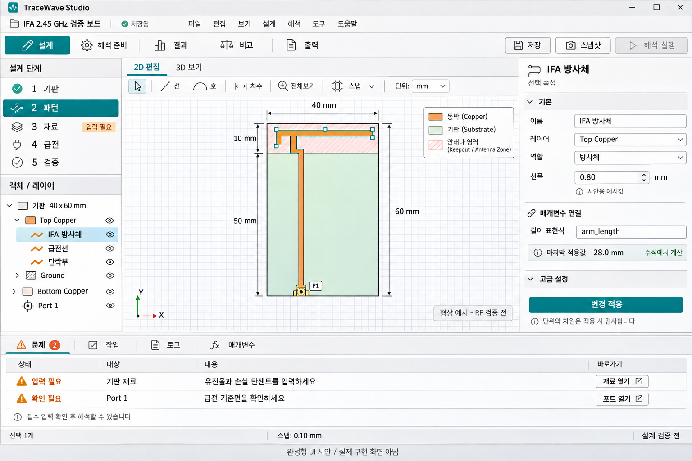

# TraceWave Studio 화면 시안

작성일: 2026-11-10 KST

사용자의 완성형 UI 요청을 시각화한 개발 보조자료다. 승인된 RFAD-D0-3.4와 [05 화면 설계](../../01_Docs/05_RFAD_화면과_사용자_경험_설계.md)의 방향을 구체화한다. 시안은 구현 완료 화면이나 추가 설계 승인, RF 검증 근거가 아니다.

## 화면의 역할

| 영역 | 사용자 작업 |
| --- | --- |
| 상단 프로젝트와 작업 탭 | 저장 상태를 확인하고 설계, 해석 준비, 결과, 비교, 출력으로 전환한다. |
| 왼쪽 단계와 객체 목록 | 다음에 채울 입력을 찾고 객체와 레이어의 선택/표시 상태를 조절한다. |
| 중앙 2D/3D 화면 | 선택, 그리기, 치수 확인과 형상 검토에 가장 넓은 영역을 사용한다. |
| 오른쪽 선택 속성 | 현재 객체의 기본 입력을 우선 표시하고 고급 정보를 필요할 때 연다. 값과 단위, 수식의 마지막 적용값을 구분한다. |
| 하단 문제/작업 목록 | 오류 이유와 수정 위치를 연결하고 실행 상태, 취소, 로그를 확인한다. |

모든 창을 동시에 보여주지 않는다. 좁은 화면에서는 패널을 접거나 탭으로 전환하고, DPI 확대 시 값과 단위가 분리되지 않도록 한다. 오류는 색과 텍스트를 함께 사용한다. 필수 입력이 비어 있으면 값을 만들어 넣지 않고 문제 항목과 해결 동작을 제공한다.

결과 작업 공간은 검증된 실행의 입력 revision과 결과를 연결한다. S11/임피던스, 3D 방사 패턴과 각도 단면, 효율/전력, 측정 비교는 실제 adapter와 지표 검증 후 제공한다. 이 시안에는 계산하지 않은 그래프나 합격 수치를 넣지 않았다.

## wxWidgets 구현 대응

| 화면 요소 | 구현 경로 |
| --- | --- |
| 메뉴, 상태, 트리, 탭, 입력 | wxWidgets 기본 위젯과 EditorPanel을 사용한다. 프로젝트/입력/저장 상태와 안정 ID 선택을 연결했다. |
| 접기/이동 가능한 작업 패널 | wxAUI pane과 notebook으로 탐색/중앙 캔버스/속성/문제/로그를 배치했다. core/base/aui를 연결하고 기본 패널 배치 복원을 제공한다. |
| 2D 형상과 선택 강조 | 별도 DesignCanvas와 mm/deg 표시 DTO, 좌표 변환/hit testing, 선/원호 preview와 직접 편집을 연결했다. 초기 렌더링은 wxGraphicsContext이며 큰 장면 성능은 별도 측정한다. |
| 3D 형상 | ModelView와 지연 생성 wxGLCanvas/OpenGL 1.1을 연결한다. CAD worker가 만든 제한 mesh 파일을 background에서 hash 검증하고 실제 두께로 표시한다. 회전/이동/확대와 stable body 선택을 제공한다. |
| CAD 출력과 작업 상태 | STEP 출력/3D 갱신에서 입력 적용과 snapshot을 연결한다. 별도 CAD 상태/취소/출력 폴더, 이전 설계 표시와 게시 결과의 재열기를 제공한다. |
| 방사 및 해석 결과 | solver adapter와 결과 지표 검증 후 별도 결과 화면으로 연결한다. 현재 3D는 기하 표시다. |
| 시안의 시각 스타일 | 색상, 아이콘, 간격과 일부 custom draw를 추가한다. 기본 위젯의 플랫폼별 외형과 DPI/접근성도 확인한다. |

시안의 패널 구조는 wxWidgets로 구현할 수 있다. native 위젯 선택만으로 프레임 성능이 결정되지는 않는다. 대형 형상/배열과 해석기는 worker에 두고 화면에는 필요한 표시 데이터만 전달한다. 유료 도킹/차트 위젯을 필수로 도입하지 않는다.

## 참고 요소와 적용 판단

다음은 공식 문서와 공개 설명에서 확인한 참고 요소다. 해당 도구를 모두 설치하거나 성능/정확도를 독립 비교했다는 뜻은 아니다. 실제 사용자가 수행할 작업을 기준으로 선택하며 다른 앱의 기능 전체를 한 화면에 합치지 않는다.

| 참고 도구 | 참고 요소 | TraceWave 적용 방향 |
| --- | --- | --- |
| [KiCad PCB Editor](https://docs.kicad.org/10.0/en/pcbnew/pcbnew.html) | 객체 선택과 속성, 레이어와 선택 필터 | 직접 편집과 안정된 객체 선택 |
| [PCB Antenna Designer](https://www.mathworks.com/help/antenna/ref/pcbantennadesigner-app.html) | 기판/적층/급전 중심 설계 흐름 | 기판에서 출발하는 단계 안내와 입력 검사 |
| [CST 설계 환경](https://www.3ds.com/products/simulia/cst-studio-suite/electromagnetic-design-environment) | 작업 단계별 도구와 문맥 | 현재 작업에 필요한 도구, 조건부 고급 입력 |
| [Fairbeam](https://fairbeam.org/) | 모델과 해석 결과의 연결 | 설계 버전과 결과를 함께 추적하고 비교 |
| [webantenna](https://github.com/vkopitsa/webantenna) | 쉬운 시작, 초기 치수, 제작과 측정 비교 흐름 | 템플릿과 비교 작업. 초기 추정값과 해석 검증 결과 구분 |
| [EMStudioFree](https://github.com/king-aj3/EMStudioFree) | 형상/재료/포트/메시/실행의 안내 흐름 | 누락 입력과 다음 행동 안내 |

전체 과거 비교 목록은 [23 원본 추가 요구사항](../../01_Docs/23_RFAD_원본_추가_요구사항.md), 검토 범위와 링크는 [02 병합 검토](../../01_Docs/02_RFAD_원본_검토와_병합.md) 및 [18 출처](../../01_Docs/18_RFAD_출처와_근거.md)에 있다. 참고 도구를 제품 의존성으로 채택한다는 의미가 아니다. 제품 GUI는 wxWidgets이며 Qt와 필수 유료 GUI 부품을 사용하지 않는다.

## 시안과 현재 구현의 경계

현재까지 연결한 시안 요소는 다음과 같다.

- wxAUI 탐색/2D 캔버스/속성/문제/로그 작업 공간과 기본 패널 배치 복원.
- 기판/패턴/재료/급전/입력 검사 단계의 접근 동작과 트리/속성/장면의 안정 ID 선택 동기화. 재료/급전 생성은 아직 후속이다.
- 사각 기판과 미정 도체/유전체 층 생성, 두 점 선분과 중심/시작/끝 방향 원호, Shift CW, 정확한 좌표/각도 입력 대화상자.
- 선택/드래그 이동/삭제, preview 취소, fit/휠 확대/가운데 버튼 이동. 확정한 편집은 단일 명령과 영속 undo/redo에 연결한다.
- 활성 도체층/선폭, 표시용 그리드, 선택 속성/표현식, 미적용/적용/저장 상태와 입력 오류 보존.
- 명시적 EM 입력 검사와 문제 위치 이동. 이전 revision의 진단은 현재 객체 이동에 사용하지 않는다.
- 별도 CAD worker에 연결한 STEP 출력/3D 갱신, 작업 상태와 취소, 실제 패키지 폴더 열기.
- 2D/3D 중앙 탭, 실제 두께의 유전체/선/원호 mesh, 회전/이동/확대/맞춤과 객체 선택. 입력 개정과 다른 형상은 갱신 필요 상태를 명시한다.

현재 그리드는 표시만 제공하며 마우스 스냅은 미구현이다. 수치 정밀도가 필요한 좌표와 각도는 `좌표 입력` 또는 속성에서 지정한다. 표시/편집 계약은 [canvas.get/canvas.apply](canvas_contract.md), CAD 기하와 표시 mesh 계약은 [CAD/STEP](cad_contract.md)을 따른다. 3D 장면은 OCCT 고체에서 파생한 표시 자료이며 방사 패턴이나 해석 결과가 아니다.

해석/결과/비교 작업 공간, 범용 계산 작업 관리, 마우스 스냅, 치수/endpoint/구속/Boolean 도구는 후속이다. 현재 3D는 제한 CPU float 배열과 OpenGL을 사용하는 100000 triangle 이하 profile이며, LOD와 1000000 triangle 대형 장면은 후속이다. 파일 읽기와 SHA256 검사는 background에서 수행하고 GL context는 필요할 때 생성한다. GUI 통합/회귀 시험의 최종 범위와 결과는 [개발 상태](development_status.md)에 기록한다.

이전 2D 경계 보완본은 Windows 전체 227개 통과, Linux 220개 통과/GUI 7개 스킵과 native CTest 1개 통과를 확인했다. 이 수치는 당시 구현의 이력이며 현재 3D 통합 시험의 결과로 재사용하지 않는다.

실제 창에서 발견한 상단 도구막대 높이와 초기 DPI 창 크기를 보완하고 입력 검사 사유도 한국어 진단 본문에 연결했다. 최종 GUI 7개 재시험과 실제 창의 패널 배치, 기판/선/원호, 선택 속성 연동, 문제 위치 이동을 확인했다. 이 시각 확인은 현재 디스플레이 범위이며 모든 DPI/IME 환경이나 성능 예산의 합격을 뜻하지 않는다.

그림의 40 x 60 mm 외형, 40 x 10 mm 안테나 영역과 2.45 GHz 초기 설계점은 승인 기준을 반영한다. 방사체 모양, 선폭 0.80 mm와 길이 28.0 mm는 화면 설명용 예시이며 승인된 실제 IFA 상세 설계값이 아니다. 접속, 급전, 공차나 RF 성능을 그림으로 검증할 수 없다.

일반 편집 60 fps/대형 장면 30 fps는 초기 성능 목표다. 화면 시안이나 편집 기능 시험만으로 메모리 및 성능 예산을 충족했다고 판단하지 않는다. 실제 장면과 전체 프로세스를 대상으로 후속 측정한다.

## 생성 기록

내장 image_gen 도구와 imagegen 스킬을 사용했다. 최종 생성 입력은 [prompt 기록](assets/tracewave-ui-concept-v1.prompt.txt), 이미지 원본은 [PNG](assets/tracewave-ui-concept-v1.png)다. 생성 이미지의 정렬과 주요 한글 문구를 확인했으며, 이것은 실제 앱의 시각 QA와 별개다.
