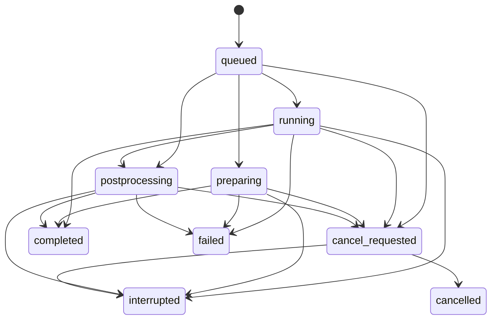

# CAD와 해석 작업 모듈 구조

작업 조정기는 실행 순서를 결정하고 journal transaction 안에서 접수/상태/결과 참조를 게시한다. 파일 읽기, 런타임 캡처, 결과 검증과 표시 DTO 계산은 별도 모듈에서 수행한다. 기존 공개 API와 저장 schema는 유지하며, 파일 분할 때문에 과거 결과를 다시 계산하거나 재해석하지 않는다.

| 책임 | 모듈 | 의존 범위 |
| --- | --- | --- |
| CAD 접수/실행/취소/게시 | `application/cad_jobs.py` | 서비스, 런타임, native process, CAD 산출물 함수 |
| CAD 실행 파일/설치/소스 identity | `application/cad_runtime.py` | 표준 라이브러리와 canonical codec |
| CAD 파일/STEP/sidecar/표시 mesh 검증과 봉인 | `application/cad_artifacts.py` | journal과 CAD/표시 계약 |
| 해석 접수/실행/취소/게시/종료 재확인 | `application/solver_jobs.py` | 서비스, transport, 계획, 산출물 함수 |
| 해석 요청 필드/ID/profile 검증 | `application/solver_requests.py` | 해석 계약과 오류 모델 |
| WSL 설치/소스 캡처와 실행 입력 staging | `application/solver_runtime.py` | journal, 호스트 설정과 WSL transport |
| 해석 파일 봉인과 raw/계획/종료 근거 검증 | `application/solver_artifacts.py` | journal과 해석/물리 검증 함수 |
| 완료 결과/최신 결과/그래프 DTO 조회 | `application/solver_queries.py` | 서비스의 프로젝트 확인과 journal 읽기 |
| 공통 상태 전이와 event 작성 | `application/job_state.py` | 오류 모델만 사용하며 worker를 실행하지 않음 |

산출물 함수는 journal을 명시적으로 받는다. 조정기나 서비스의 메서드를 동적으로 주입하거나 상속 mixin으로 재결합하지 않는다. 결과 조회 함수는 작업 접수와 native 실행에 의존하지 않는다. 따라서 CAD/solver가 구성되지 않아도 이미 게시한 결과를 조회할 수 있다.

기존 `cad_jobs.CadRuntime`과 `solver_jobs.SolverRuntime` import는 유지한다. 격리 CAD 진입점은 `cad_runtime`을 직접 import하여 런타임 검증에 조정기를 함께 로드하지 않는다. 새 응용 모듈은 기존 `src/rfad/**/*.py` 캡처에 자동 포함된다. source identity가 달라진 과거 작업을 새 구현으로 조용히 재개하지 않는 규칙도 그대로다.

## 형상과 물리 투영의 내부 분리

CAD의 `adapters/cad/native.py`는 최종 패키지 조립만 담당한다. `geometry.py`가 선/원호/polygon/pad/중공 비아의 정확한 기본 고체를 만들고, `bodies.py`가 층/net별 집계와 연결/측정을 확인한다. `step_io.py`는 AP242 교환과 같은 커널 재입력, `display.py`는 원본 고체에서 표시 삼각형을 파생한다. `native.build_package`와 `native.read_step`의 기존 호출 경로는 유지한다. native 라이브러리는 이전과 같이 실행 함수 안에서만 import한다.

PCB의 `application/pcb_solver.py`는 원본 snapshot/runtime/settings를 검사하고 계획을 조립한다. `pcb_projection.py`는 재료 소비 catalog, 기판 외곽, 도체/비아와 급전 조건을 투영한다. `pcb_geometry.py`는 SI/mm 수량과 analytic 기하/polygon 근사를, `pcb_mesh.py`는 실제 격자 생성과 공기 격자 정책을, `pcb_results.py`는 준비/종료/정규화/표본 결과 검증을 맡는다. 기존 `pcb_solver` 함수 import 경로는 re-export로 유지한다.

구조 변경에서 CAD 수치/고체 알고리즘을 변경하지 않았다. 기존 25개 함수의 AST 일치를 확인했고, 사각+원호, 원형+원호, IFA, PTH와 graded IFA의 5개 PCB 입력에서 같은 snapshot/runtime을 사용한 계획의 canonical payload가 plan_id 제외 완전히 같음을 확인했다. 이는 리팩터링 동작 보존 근거이며 독립 CAD/실물 정확도 검증과 다르다.

## 상태와 자원 소유

모든 서비스 작업의 `_event`는 공통 `append_event`를 통과한다. 상태 이름과 event 필드는 저장 계약을 유지한다. 전이 검사를 통과한 뒤 상태와 event를 함께 변경하고, 거절된 전이는 작업 레코드를 변경하지 않는다.

`completed`, `failed`, `cancelled`, `interrupted`에서 새로운 작업 상태로 돌아가지 않는다. 특히 취소 요청이 먼저 게시되면 늦은 완료 통지가 성공으로 덮어쓰지 못한다. 새 계산은 새로운 job/run ID로 접수한다. event의 seq/run_id/phase 같은 예약 필드는 부가 데이터로 덮어쓸 수 없다.

이 상태 표가 프로세스 종료나 슬롯 해제를 증명하지는 않는다. CAD의 native 프로세스 종료 판단과 WSL의 nonce/lease/guest 종료 확인은 각각 조정기가 처리한다. WSL의 `interrupted` 작업에서 종료를 확인하지 못한 경우에만 예약을 유지하며, 재확인은 작업을 재실행하거나 결과를 게시하지 않는다. CAD와 WSL의 서로 다른 소유권 의미를 하나의 추정 상태로 통합하지 않는다.

사용자의 `job.cancel`이 먼저 게시된 작업은 실제 종료를 확인한 뒤 `cancelled`가 된다. 서비스 닫기 또는 사용자 요청 없이 발생한 실행 중단은 `interrupted`로 남긴다. 이때 WSL 종료가 확인되면 `termination_confirmed=true`, `outcome_unknown=false`를 기록하고 슬롯을 해제한다. 종료를 확인하지 못하면 사용자 취소 요청 유무와 관계없이 `interrupted`와 예약을 남긴다. 파일을 봉인한 직후 종료 신호가 도착한 경우에도 결과 참조를 게시하지 않고 이전 완료 결과를 보존한다. 순수 `solver.plan` 작성은 native 실행이 없는 원자적 자료 처리이므로 이미 시작한 계획 게시를 마칠 수 있다.

OS 스레드 시작이 실패하면 시작되지 않은 thread를 join하지 않고 정리를 완료한다. 원래 시작 오류를 다른 정리 오류로 가리지 않으며, native 환경이 없는 조회 전용 서비스와 반복 close도 지원한다.

## 검증 경계

기존 CAD/solver 회귀는 파일 봉인 후 취소, nonce 교체, source 변조, 잘못된 package/raw/계획 결합, crash, timeout, 출력 제한, 재시작 후 조회를 그대로 검사한다. 공통 상태 회귀는 terminal 역행, 취소 후 성공, event 식별 위조와 잘못된 초기 전이에서 원본 보존을 추가 확인한다. 추가 수명 회귀는 스레드 시작 실패 정리, 실제 서비스 닫기 중 준비 작업 회수, 사용자 요청 없는 실행/후처리 중단, 파일 봉인 직후 종료 신호에서 상태와 슬롯을 함께 확인한다. 구조 변경은 RF 정확도나 성능 예산의 새 합격 근거가 아니다.
